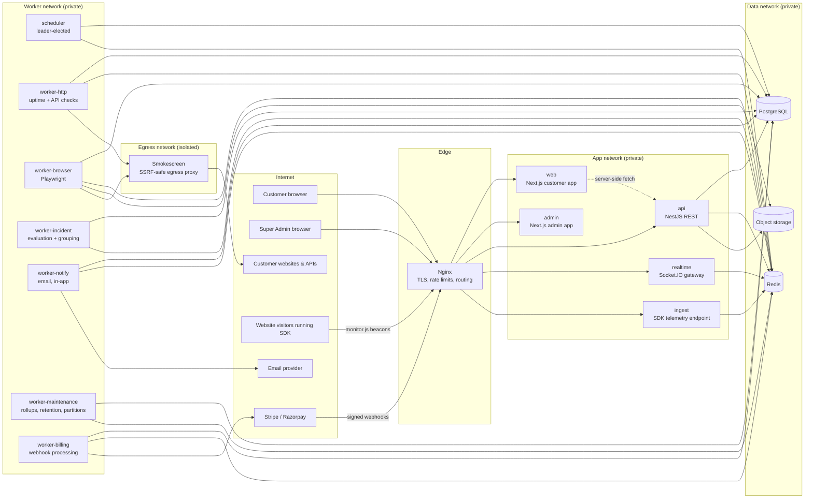
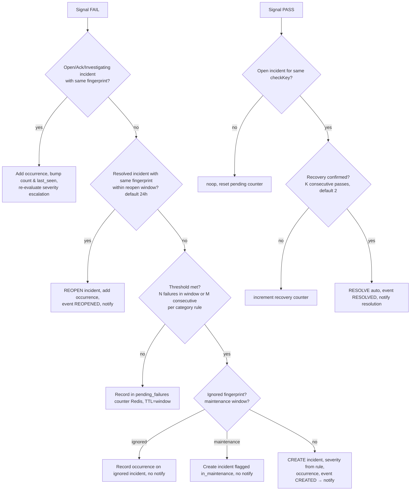
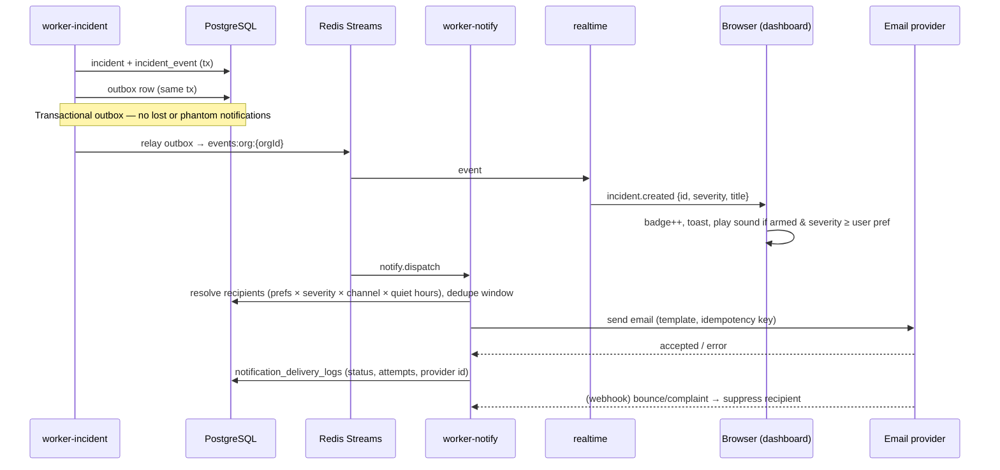

# Architecture

> Status: **Phases 1–3 approved; Phase 4A (network isolation, ownership revalidation) 4B (scheduler and queues), 4C (HTTP availability engine) and 4D (browser monitoring) implemented; 4E–4H planned in [PHASE4_PLAN.md](PHASE4_PLAN.md)** · Last updated 2026-11-13
>
> Companion documents: [DATABASE_SCHEMA.md](DATABASE_SCHEMA.md) · [API_DOCUMENTATION.md](API_DOCUMENTATION.md) · [SECURITY.md](SECURITY.md) · [DEPLOYMENT.md](DEPLOYMENT.md) · [DEVELOPMENT_ROADMAP.md](DEVELOPMENT_ROADMAP.md)

This document defines the technical architecture of the Website Monitoring & Incident Management SaaS (internal package scope `@wim/*`; the customer-facing product name is configurable by the Super Admin). It records every major engineering decision as an **ADR-style decision** (`D-xx`) so it can be challenged and revised.

---

## Table of contents

1. [Requirement analysis: contradictions and gaps](#1-requirement-analysis-contradictions-and-gaps)
2. [Key architectural decisions](#2-key-architectural-decisions)
3. [System context and service topology](#3-system-context-and-service-topology)
4. [Module breakdown](#4-module-breakdown)
5. [Repository and folder structure](#5-repository-and-folder-structure)
6. [Check tiers and the monitoring cost model](#6-check-tiers-and-the-monitoring-cost-model)
7. [Background worker architecture](#7-background-worker-architecture)
8. [Website monitoring execution flow](#8-website-monitoring-execution-flow)
9. [The test engine](#9-the-test-engine)
10. [Incident detection and notification flow](#10-incident-detection-and-notification-flow)
11. [Domain identity, registration and verification](#11-domain-identity-registration-and-verification)
12. [Subscriptions, entitlements and trial anti-abuse](#12-subscriptions-entitlements-and-trial-anti-abuse)
13. [JavaScript SDK and telemetry ingestion](#13-javascript-sdk-and-telemetry-ingestion)
14. [Website Health Score](#14-website-health-score)
15. [Data lifecycle: retention, rollups and artifacts](#15-data-lifecycle-retention-rollups-and-artifacts)
16. [Tenant isolation](#16-tenant-isolation)
17. [Super Admin privacy model](#17-super-admin-privacy-model)
18. [Real-time delivery](#18-real-time-delivery)
19. [Configuration management](#19-configuration-management)
20. [Observability of the platform itself](#20-observability-of-the-platform-itself)
21. [Major technical risks and mitigations](#21-major-technical-risks-and-mitigations)
22. [Phase 2 implementation decisions](#22-phase-2-implementation-decisions)
23. [Phase 3 implementation decisions](#23-phase-3-implementation-decisions)
24. [Phase 4 implementation decisions](#24-phase-4-implementation-decisions)

---

## 1. Requirement analysis: contradictions and gaps

The specification is thorough, but it contains tensions that must be resolved explicitly rather than discovered during implementation.

### 1.1 Contradictions and their resolutions

| # | Tension | Resolution |
|---|---------|------------|
| C1 | "Every 1 minute" monitoring **and** "test every page with Playwright, across 5 viewports, including components and journeys". 5 sites × 50 pages × 5 viewports every minute = 1,250 browser page loads/min for a single customer, which is economically impossible at SaaS price points. | **Tiered checks** (D-03). Cheap HTTP availability checks may run every minute. Browser render checks run at a lower, plan-bounded frequency. Deep scans (components, responsive, journeys) run hourly to daily. The plan defines a frequency **per tier**, not one global frequency. See §6. |
| C2 | "Super Admin has comprehensive control over the entire platform" **vs** "Super Admin must not have unrestricted access to customer business data." | Admin controls **configuration, accounts, and metadata**, never content. Enforced at the **database role level** (column grants and views), not only in the UI. Content access requires break-glass (§17). |
| C3 | "A website can never be registered twice" **vs** unverified claims. If Customer A types `example.com` and never verifies it, the real owner is locked out (domain squatting). | A claim is either `PENDING` (with a time limit, 72h by default) or `VERIFIED`. Only one **active claim** can exist per identity. Pending claims expire automatically. A verified owner can contest any claim through the transfer flow (§11.6). |
| C4 | "Account deletion must delete data" (privacy) **vs** "domain history must survive deletion" (anti-abuse). | A separate **domain trial ledger** stores only the normalized domain, timestamps, and keyed hashes of weak signals. It holds no names, emails, or content, and FKs to the organization are `SET NULL` on deletion. The ledger is disclosed in the privacy policy as legitimate-interest processing (§12.5). |
| C5 | "Admin configures plan prices freely" **vs** payment gateways (Stripe `Price`, Razorpay `Plan`) are **immutable** once created. | A plan holds **price versions**. A price change creates a new gateway price object and archives the old one. Existing subscribers keep their price until renewal, unless the admin explicitly migrates them. |
| C6 | "Functional testing of forms, submit buttons and error messages" **vs** "never submit real forms or perform irreversible actions." | By default, form tests are **non-submitting**. They check field discovery, `required` and constraint attributes, the HTML5 Constraint Validation API (`checkValidity()` evaluated in-page, with no submit event), labels and accessibility. Submissions run only in a **customer-approved test workflow** against a customer-declared safe URL (§9.4). |
| C7 | "Respect robots.txt" **vs** "monitor the customer's own site comprehensively". | robots.txt is respected by default. After **verified ownership**, the owner can opt out per site because they are authorizing their own crawler. The user agent always identifies the platform. |
| C8 | "Monitor only verified customer infrastructure" for APIs **vs** real APIs that live on third-party hosts (payment, auth, CDN APIs). | Endpoints under a verified website's registrable domain are allowed automatically. Other hosts require either (a) host verification with a DNS TXT or well-known file, or (b) a Super-Admin-curated **public API allowlist**. All cases are rate-capped (§8.5). |
| C9 | "Interaction to Next Paint, where measurable" | INP needs real user interaction and **cannot be measured synthetically** in a meaningful way. Synthetic runs report **TBT** (Total Blocking Time) as a lab proxy. INP comes **only from SDK real-user data** and is labelled as such. |
| C10 | "Sound alert on critical incidents" **vs** browser autoplay policies. | Sound is armed only after an explicit user gesture ("Enable sound alerts"). The dashboard shows a persistent badge when sound is not armed. |
| C11 | "Install the script" as the ownership proof **vs** script presence being a weak proof (anyone can put any public site key on a page they control, but cannot put it on someone else's site, so this is actually fine). However, a script check through a JS-rendered SPA requires a browser. | Ownership verification accepts **DNS TXT** (strongest), an **HTML meta tag**, a **well-known file**, or **SDK beacon + browser detection**. Script installation is tracked separately as an *installation status*, independent of ownership. |
| C12 | "Never collect form contents" **vs** "form submission failure monitoring". | The SDK reports **only** the event type, the form's selector or name hash, the HTTP status of the submission request, and validation-failure counts per field *name*. It never reports values (§13). |

### 1.2 Missing requirements (added with documented defaults)

| # | Gap | Decision |
|---|-----|----------|
| G1 | **False positives from a single vantage point** (local network blips page people at 3 a.m.). | Before failing an availability check, it is **confirmed** by an immediate retry, and once multi-region exists, by a second region. The architecture tags queues by region from day one (`region` column on executions). Launch is single-region. |
| G2 | **Maintenance windows per customer** (only global ones were specified). | Per-website and per-org maintenance windows suppress incident creation and alerts, but checks still run and are recorded. |
| G3 | **Timezones** for reports, schedules and daily rollups. | All storage is UTC. Org and user timezones apply only at presentation and report time. |
| G4 | **Organizations vs users.** The spec uses "customer" loosely. | Tenancy is the **Organization**. A user can belong to several orgs (agencies). Subscriptions, websites and limits belong to the org. |
| G5 | **Customer API keys / public API** for CI integration. | Out of MVP scope. The schema reserves `api_keys` so it can be added in Phase 10+. |
| G6 | **Tax invoicing (India GST via Razorpay, EU VAT via Stripe Tax).** | Invoices are generated by the gateway where supported (Stripe), or by us with sequential numbering (Razorpay). Tax settings live in the admin panel. Tax *logic* is delegated to the gateway (Stripe Tax) or configured as flat GST. **Needs business input** before Phase 8. |
| G7 | **Email deliverability.** | SPF/DKIM/DMARC setup is documented. Bounces and complaints come in through provider webhooks and auto-suppress recipients. |
| G8 | **Account deletion grace period.** | Deletion is soft for 14 days (cancellable), then hard-purged by the maintenance worker. Ledger records are retained per C4. |
| G9 | **Abuse: pointing the crawler at third-party sites** (DDoS-by-proxy, scanning). | Deep scans require verified ownership. Unverified sites get **no checks at all**. A per-host global rate limit applies across all tenants. |
| G10 | **Status pages** (public uptime pages) are a common expectation. | Out of scope for v1. The data model (rollups, incidents) supports adding them later. |
| G11 | **Monitoring authenticated areas** ("Authentication configuration"). | Supported through an encrypted **login recipe** (URL, selectors, credential reference) executed in an isolated context. We strongly recommend a dedicated low-privilege test account, and the UI warns about this. |
| G12 | **Who pays for SDK telemetry volume?** | Per-plan monthly event quota, sampling, and hard ingestion caps (§13.4). |

---

## 2. Key architectural decisions

| ID | Decision | Rationale / alternatives considered |
|----|----------|-------------------------------------|
| D-01 | **pnpm + Turborepo monorepo**, strict TypeScript everywhere. | Shared Zod contracts between frontend, API and workers. One versioned schema. Polyrepo was rejected because coordination overhead is too high for a single team. |
| D-02 | **NestJS** for the API, **framework-free Node processes** for workers, and domain logic in a framework-agnostic `packages/core`. | NestJS gives modules, guards and interceptors, which suit RBAC and tenant scoping. Workers must stay lean, especially the Playwright image, and share *logic*, not DI containers. |
| D-03 | **Three check tiers**: HTTP probe, browser render, deep scan. | This is the core cost control (§6). |
| D-04 | **Database-driven scheduler**, not BullMQ repeatable jobs. | Hundreds of thousands of repeatable jobs in Redis are fragile (hard to edit, drift on config change, lost on Redis flush). The DB holds `next_run_at`. One elected scheduler leader claims due rows with `FOR UPDATE SKIP LOCKED` and enqueues jobs with deterministic IDs (`scheduleId:slot`) for dedupe. Changing a schedule is a row update that takes effect on the next tick, with no redeploy (requirement #20). |
| D-05 | **BullMQ** queues for execution, with a separate queue per job class and per region. | Required by the spec. Mature retries, backoff, rate limits and stalled-job detection. Dead-letter is implemented as a terminal `failed` state plus a DLQ queue copy for alerting. |
| D-06 | **Egress enforcement at the network layer** with an SSRF-safe forward proxy ([Smokescreen](https://github.com/stripe/smokescreen)) for all monitoring traffic. There is also in-process validation (`packages/netguard`) for the HTTP worker. | Application-level `page.route()` checks are bypassable (WebSockets, service workers, WebRTC, DNS rebinding between check and connect). Browser containers live on a Docker network **with no route to anything except the egress proxy**. The proxy resolves DNS once, checks the IP against deny ranges, and connects to that same IP, which defeats rebinding. |
| D-07 | **PostgreSQL 16 with native declarative partitioning** for high-volume tables, plus our own rollup tables. TimescaleDB was rejected for v1. | Timescale is a great fit technically, but it is not available on most managed Postgres offerings (RDS, Cloud SQL), which hurts the VPS-to-cloud migration path. Native partitioning plus a rollup worker gives the same outcome portably. Partitions are created and dropped by the maintenance worker. |
| D-08 | **Raw results are hot for 14 days; hourly and daily rollups are kept for the plan's retention period (60 days by default).** | 60 days of raw per-page, per-viewport results is the largest storage cost and is rarely queried. Charts beyond 14 days read rollups. Incidents and their occurrences are retained for the full retention period. Every value is configurable (§15). |
| D-09 | **Opaque server-side sessions** (httpOnly, Secure, SameSite=Lax cookies; SHA-256 hashed token in the DB, cached in Redis). No JWT access tokens for browsers. | Instant revocation (suspend account, password change), no token-in-localStorage XSS exposure. Sessions rotate on login and privilege change, which satisfies the "refresh rotation where applicable" intent. |
| D-10 | **Separate admin application on a separate origin**, with separate sessions, mandatory TOTP/WebAuthn 2FA, an optional IP allowlist, and a separate DB role. | Limits blast radius. A customer XSS cannot reach admin cookies. |
| D-11 | **Envelope encryption** (AES-256-GCM): each organization has a data key (DEK) wrapped by a key-encryption key (KEK) from a pluggable `KeyProvider` (local file or env on a VPS, AWS KMS or GCP KMS in cloud). The ciphertext header carries the key version. | Supports rotation without re-encrypting everything at once. Crypto-shredding: destroying an org's DEK renders its secrets unrecoverable on deletion. |
| D-12 | **Only the monitoring workers can decrypt** customer credentials. The API can *encrypt* (write-only secrets). The admin role has no grant on ciphertext columns. | Least privilege. An API compromise does not directly yield plaintext customer credentials. Implemented with separate KEK access per service. |
| D-13 | **Postgres Row-Level Security** as defense in depth. Every tenant-scoped query runs in a transaction that sets `app.current_org_id`. | Application-layer scoping is the primary guard. RLS catches mistakes (a forgotten `where orgId`). |
| D-14 | **Our database is the source of truth for entitlements**, not the payment gateway. Gateway webhooks update subscription state, and entitlements are resolved from plan plus overrides. | Gateway-agnostic, and admin overrides (trial extension, custom limits) are possible. |
| D-15 | **Socket.IO with the Redis adapter**, hosted in a separate `realtime` app. Workers publish domain events to Redis Streams. | Socket.IO handles reconnection and fallback. A separate process lets WebSocket connections scale independently from REST. |
| D-16 | **Tamper-evident audit log**: an append-only table (the app role lacks UPDATE and DELETE) with a SHA-256 hash chain per stream, plus a daily anchor (head hash) exported to object storage with object lock. | "Tamper-resistant" is required. A hash chain detects modification. Object lock protects the anchors. |
| D-17 | **Public Suffix List (`tldts`) + UTS-46 IDNA** for domain identity, including PSL *private* suffixes. | `user1.github.io` and `user2.github.io` are correctly distinct owners. `www.example.com` and `example.com` resolve to one identity. |
| D-18 | **S3-compatible object storage** (SeaweedFS locally, S3/R2 in production) for screenshots, traces and reports. Artifacts are captured **only on failure**, by default. | Cost and privacy. A screenshot of a customer page may contain PII, so retention is short (7 days by default). |
| D-19 | **Reports (PDF) are rendered by the browser image, with network egress disabled**, from internal HTML. | Reuses Chromium without a second rendering stack. Disabling egress removes SSRF risk from report templates. |
| D-20 | **Single region at launch; region-aware schema and queues.** | Avoids premature complexity while keeping the multi-region path open (G1). |

---

## 3. System context and service topology



**Routing (Nginx):**

| Host / path | Target | Notes |
|---|---|---|
| `app.<domain>/` | `web` | Customer application |
| `app.<domain>/api/*` | `api` | Same origin as `web`, so no CORS is needed for the app. Cookies are first-party. |
| `app.<domain>/ws` | `realtime` | WebSocket upgrade, authenticated by session cookie |
| `admin.<domain>/` and `/api/*` | `admin`, `api` (admin routes only) | Separate cookie scope. Nginx-level IP allowlist (optional). |
| `ingest.<domain>/v1/*` | `ingest` | CORS `*` for beacons, strict body size limit, heavy rate limiting |
| `cdn.<domain>/monitor.js` | static (immutable, versioned) | `monitor.v1.js` is cached forever. `monitor.js` has a short cache and points to the current major version. |
| `api.<domain>/webhooks/*` | `api` | Payment and email provider webhooks. Signature verified. |

No worker, database, Redis or proxy port is reachable from the internet.

---

## 4. Module breakdown

Each module maps to a NestJS module in `apps/api` (HTTP surface) and/or a domain service in `packages/core` (logic shared with workers).

| # | Module | Responsibilities | Lives in |
|---|--------|------------------|----------|
| 1 | **Identity & Access** | Registration, email verification, login, sessions, password reset, 2FA (TOTP), rate limiting, RBAC, invitations | `api/modules/auth`, `api/modules/users`, `core/rbac` |
| 2 | **Organizations & Teams** | Org CRUD, members, roles, invitations, ownership transfer, deletion workflow | `api/modules/orgs` |
| 3 | **Website Registry** | Domain normalization, global uniqueness, claims, verification (DNS, meta, file, SDK), installation keys, transfers | `api/modules/websites`, `core/domain-identity` |
| 4 | **Monitoring Configuration** | Per-website config (tiers, frequencies, viewports, crawl rules, exclusions, thresholds, auth recipes, maintenance windows), validated against entitlements | `api/modules/monitoring-config`, `core/entitlements` |
| 5 | **Scheduler** | Due-schedule claiming, slot dedupe, jitter, tenant fairness, pause and resume, maintenance windows | `apps/scheduler`, `core/scheduling` |
| 6 | **HTTP Probe Engine** | Tier-1 availability (DNS, TCP, TLS, HTTP, redirects, timing), SSL expiry, API checks with assertions | `apps/worker-http`, `packages/netguard`, `core/assertions` |
| 7 | **Browser Engine** | Tier-2 render checks and Tier-3 deep scans: discovery, component detection, test execution, responsive, performance | `apps/worker-browser`, `packages/test-engine` |
| 8 | **Incident Engine** | Signal normalization, fingerprinting, threshold and flap evaluation, grouping, lifecycle, recovery verification, reopen | `apps/worker-incident`, `core/incidents` |
| 9 | **Notification Engine** | Routing by preference and severity, channel adapters (email, in-app; later Slack, Teams, SMS, WhatsApp), digesting, delivery logs, retries | `apps/worker-notify`, `core/notifications` |
| 10 | **Realtime** | Authenticated WebSocket sessions, org rooms, fan-out of domain events | `apps/realtime` |
| 11 | **Telemetry Ingestion** | SDK beacon intake, validation, sampling, quota enforcement, buffering to Redis Streams, batch insert | `apps/ingest`, `apps/worker-maintenance` (batch writer) |
| 12 | **Billing & Subscriptions** | Plans, price versions, entitlements, trials, gateway abstraction (Stripe, Razorpay), webhooks, invoices, dunning, grace periods | `api/modules/billing`, `apps/worker-billing`, `packages/payments` |
| 13 | **Anti-Abuse** | Domain trial ledger, signal hashing (email, card fingerprint), eligibility policy evaluation, blocked domains | `core/anti-abuse` |
| 14 | **Analytics & Reporting** | Rollup queries, health score, CSV and PDF exports | `api/modules/analytics`, `api/modules/reports`, `core/health-score` |
| 15 | **Super Admin** | Platform metrics, customer and website metadata, plan management, engine config, gateway config, notification config, audit viewer, break-glass | `api/modules/admin/*`, `apps/admin` |
| 16 | **Audit & Security** | Hash-chained audit log, security events, login history, anchor export | `core/audit`, `api/modules/audit` |
| 17 | **Platform Config** | Typed settings registry with versioning, feature flags, hot reload through Redis pub/sub | `core/config`, `api/modules/admin/settings` |
| 18 | **Data Lifecycle** | Partition management, rollups, retention purges, artifact expiry, account hard-delete, ledger maintenance | `apps/worker-maintenance` |

---

## 5. Repository and folder structure

```
website_incident_management/
├── apps/
│   ├── web/                      # Next.js (App Router) customer dashboard
│   │   ├── src/app/(auth)/       # login, register, verify-email, reset
│   │   ├── src/app/(dashboard)/  # overview, websites/[id]/…, incidents, analytics, billing, settings
│   │   ├── src/components/       # feature components (compose packages/ui)
│   │   ├── src/lib/              # api client (typed from @wim/contracts), query hooks, socket client
│   │   └── src/sound/            # alert audio + autoplay arming logic
│   ├── admin/                    # Next.js Super Admin app (separate origin/build)
│   ├── api/                      # NestJS REST API
│   │   └── src/
│   │       ├── main.ts
│   │       ├── common/           # guards (session, rbac, tenant, entitlement), interceptors, filters, pipes
│   │       ├── prisma/           # tenant-scoped Prisma client provider (sets RLS context)
│   │       └── modules/
│   │           ├── auth/ users/ orgs/ members/
│   │           ├── websites/ verification/ installations/ transfers/
│   │           ├── monitoring-config/ pages/ api-endpoints/ test-cases/
│   │           ├── executions/ incidents/ notifications/ analytics/ reports/
│   │           ├── billing/ webhooks/
│   │           ├── audit/ health/
│   │           └── admin/        # overview, customers, websites, plans, engine, gateways, notify-config, settings, audit, break-glass
│   ├── realtime/                 # Socket.IO gateway (Redis adapter, session auth)
│   ├── ingest/                   # Minimal HTTP service for SDK beacons (Fastify)
│   ├── scheduler/                # Leader-elected schedule claimer → BullMQ
│   ├── worker-http/              # Tier-1 probes + API endpoint checks
│   ├── worker-browser/           # Playwright Tier-2/Tier-3 (+ PDF rendering, egress disabled)
│   ├── worker-incident/          # Signal → incident evaluation
│   ├── worker-notify/            # Email/in-app delivery
│   ├── worker-billing/           # Payment webhook processing, dunning, trial expiry
│   └── worker-maintenance/       # Rollups, partitions, retention, purges, telemetry batch writer
├── packages/
│   ├── db/                       # Prisma schema, migrations, raw SQL (partitions, RLS, audit triggers), seed
│   ├── contracts/                # Zod schemas + inferred types for every API request/response & queue payload
│   ├── core/                     # Framework-agnostic domain logic
│   │   ├── domain-identity/      # normalization, identity keys, policy
│   │   ├── entitlements/         # plan + override resolution, quota checks
│   │   ├── anti-abuse/           # trial eligibility, ledger
│   │   ├── incidents/            # fingerprint, grouping, state machine, flap detection
│   │   ├── scheduling/           # slot math, jitter, fairness
│   │   ├── health-score/
│   │   ├── notifications/        # routing, channel interface
│   │   ├── audit/                # hash chain
│   │   ├── config/               # typed settings registry
│   │   └── rbac/                 # roles → permissions
│   ├── netguard/                 # SSRF-safe DNS + IP policy + pinned undici dispatcher
│   ├── test-engine/              # component detectors, test-case DSL, runners (Playwright-based)
│   ├── payments/                 # PaymentGateway interface + stripe/ razorpay/ adapters
│   ├── crypto/                   # envelope encryption, KeyProvider, HMAC signals, redaction
│   ├── queue/                    # BullMQ queue names, typed producers/consumers, DLQ handling
│   ├── logger/                   # pino with redaction paths
│   ├── email-templates/          # React Email templates
│   ├── ui/                       # shadcn-based design system (tokens, components, charts)
│   ├── sdk/                      # monitor.js (zero-dependency, < 6 KB gzip target)
│   └── config-ts/ config-eslint/ # shared tsconfig / eslint
├── infra/
│   ├── docker/                   # Dockerfiles per app (browser image based on mcr.microsoft.com/playwright)
│   ├── compose/                  # docker-compose.dev.yml, docker-compose.prod.yml
│   ├── nginx/                    # site configs, rate limit zones, security headers
│   ├── smokescreen/              # egress ACL config
│   ├── postgres/                 # init roles, pg conf, backup scripts (pgBackRest/wal-g)
│   └── ci/                       # GitHub Actions workflows
├── tests/
│   ├── e2e/                      # Playwright E2E against the full stack
│   ├── security/                 # SSRF corpus, IDOR matrix, webhook spoofing
│   └── fixtures/sites/           # local fixture websites used to test the monitoring engine
├── docs/
│   ├── ARCHITECTURE.md  DATABASE_SCHEMA.md  API_DOCUMENTATION.md
│   ├── SECURITY.md  DEPLOYMENT.md  DEVELOPMENT_ROADMAP.md
│   └── adr/                      # individual ADRs once decisions are revisited
├── README.md
└── CHANGELOG.md
```

---

## 6. Check tiers and the monitoring cost model

### 6.1 Tiers

| Tier | Name | What runs | Engine | Typical frequency (plan-bounded) | Target |
|------|------|-----------|--------|----------------------------------|--------|
| **T1** | HTTP probe | DNS → TCP → TLS → HTTP(S) GET/HEAD; status, redirect chain, TTFB, total time, body size, optional keyword match; SSL expiry (daily). API endpoint checks are also T1. | `worker-http` (undici through netguard/proxy) | 1–60 min | Homepage + key URLs; each API endpoint |
| **T2** | Browser render | Full page load in Chromium at the primary viewport: console errors, uncaught exceptions, failed requests, blank-page detection, Web Vitals (FCP, LCP, CLS, TBT, TTFB), resource stats | `worker-browser` | 15 min – 24 h | Up to the plan's *render-monitored pages* |
| **T3** | Deep scan | Discovery crawl + T2 + component detection and tests + responsive matrix (5 viewports) + configured journeys and test cases | `worker-browser` | 1 h – 7 d | All discovered pages, up to the plan's page limit |

The plan defines, for each tier: minimum interval, maximum targets, and enabled feature flags. The customer chooses within those bounds, and the API validates the choice against resolved entitlements (requirement #3).

### 6.2 Cost model (for pricing and capacity planning)

Measured assumptions, to be validated in the Phase 4 load test:

- A T1 probe costs about 50 ms of CPU and about 300–1,500 ms of wall time (mostly I/O). One 1-vCPU `worker-http` with concurrency 200 sustains **≈ 6,000 probes/min**.
- A T2 render takes about 4–8 s of wall time and about 1.5–3 s of CPU. A Chromium context needs about 150–300 MB. One 2-vCPU / 4 GB `worker-browser` with concurrency 4 sustains **≈ 30–45 page renders/min**.
- A T3 deep scan of one page across 5 viewports plus component tests takes about 30–60 s of wall time.

**Example (from §18 of the spec).** A customer has 5 sites × 50 pages, 10 APIs, and "every 5 minutes":

| Approach | Browser page-loads / day | Browser workers needed (2 vCPU) |
|---|---|---|
| Naive: all pages × 5 viewports × T3 every 5 min | 360,000 | ≈ 6–8 **dedicated to one customer** |
| Tiered: T1 on 5 home pages + 10 APIs every 5 min, T2 on 10 key pages every 15 min, T3 on all 250 pages daily | T1: 4,320 probes (cheap); T2: 960; T3: 250 × 5 viewports = 1,250 | ≈ 0.05 of one browser worker |

With tiering, a single 2-vCPU browser worker serves **roughly 15–20 Professional-tier customers**. This makes per-tier quotas the most important pricing lever, and the admin panel exposes them directly.

### 6.3 Resource quotas

Requirement: "Customers must not consume unlimited browser resources."

- **Plan quotas** cap the maximum targets and minimum interval per tier, and the maximum browser-minutes per month (metered in `usage_counters`).
- **Concurrency quota** caps simultaneous browser jobs per org (the plan's *max monitoring workers*), enforced by a Redis semaphore. Jobs over the cap are re-delayed, not dropped.
- **Hard per-job limits**: navigation timeout, total job timeout, maximum pages per crawl, maximum response bytes, maximum requests per page.
- **Per-host politeness**: a global token bucket per target host (across tenants), so we never hammer a site.

---

## 7. Background worker architecture

### 7.1 Queues

All names are defined once in `packages/queue`. `{r}` is the region (`r1` at launch).

| Queue | Producer | Consumer | Priority / notes |
|---|---|---|---|
| `{r}:probe.http` | scheduler, api (manual "check now") | worker-http | Priority by plan tier. Short timeout (30 s). |
| `{r}:probe.api` | scheduler, api | worker-http | As above. Credentials are decrypted inside the job only. |
| `{r}:browser.render` | scheduler, api | worker-browser | Concurrency is per worker. Tenant semaphore. |
| `{r}:browser.deepscan` | scheduler, api | worker-browser | Lower priority. Long timeout (15 min). Checkpointed per page. |
| `{r}:browser.verify` | api | worker-browser | Ownership verification and SDK installation detection. High priority. |
| `incident.signals` | all probe and browser workers, ingest batcher | worker-incident | **Partitioned by `website_id`**: the job group key ensures a single consumer per website to avoid race conditions while grouping. Implemented as a Redis lock per fingerprint (§10.3). |
| `notify.dispatch` | worker-incident, billing, auth | worker-notify | Retries with exponential backoff (1 m → 2 h, 8 attempts) |
| `billing.webhook` | api (webhook controller) | worker-billing | Idempotent by `(gateway, event_id)` |
| `billing.cron` | scheduler | worker-billing | Trial expiry, grace period ends, dunning |
| `maint.*` (`rollup`, `partition`, `retention`, `purge`, `telemetry.flush`, `audit.anchor`) | scheduler (cron-like system schedules) | worker-maintenance | Singleton via `jobId` per period |
| `reports.render` | api | worker-browser (egress-disabled pool) | PDF generation |
| `dlq` | any worker on final failure | worker-maintenance (DLQ monitor) | Persists to `job_failures` and raises a platform alert |

### 7.2 Scheduler algorithm

```
every 1s (leader only — Redis lock "scheduler:leader" with 10s TTL, renewed each tick;
          backed by pg_try_advisory_lock for split-brain safety):
  BEGIN;
  SELECT id, org_id, kind, target_ref, interval_s, next_run_at, priority
    FROM monitoring_schedules
   WHERE next_run_at <= now() AND status = 'ACTIVE'
   ORDER BY next_run_at
   LIMIT 500
   FOR UPDATE SKIP LOCKED;
  for each row:
     if org paused / website paused / subscription not entitled → advance & skip (recorded as SKIPPED execution)
     if inside maintenance window → still enqueue (checks run), flag suppress_alerts
     slot = floor(next_run_at / interval_s)
     enqueue(queue_for(kind), payload, { jobId: `${id}:${slot}`, priority })   -- dedupe: same slot never enqueued twice
     INSERT monitoring_executions (status=QUEUED, schedule_id, slot, ...)  ON CONFLICT (schedule_id, slot) DO NOTHING
     next_run_at = next_run_at + interval_s  (if far behind: jump to now + jitter, record MISSED slots count)
  COMMIT;
```

- **Jitter.** On creation, `next_run_at` is offset by `hash(schedule_id) mod interval_s`, so 10,000 "every 5 minutes" checks spread evenly instead of firing at :00.
- **Execution ledger.** Every slot produces exactly one `monitoring_executions` row (QUEUED → RUNNING → SUCCEEDED/FAILED/TIMED_OUT/CANCELLED/SKIPPED). The unique constraint `(schedule_id, slot)` enforces exactly-once *recording*, even if BullMQ retries the job (requirement #6).
- **Tenant fairness.** Priority = plan priority (Business > Professional > Starter > Trial). Within a priority, the per-org semaphore prevents one tenant from monopolizing workers. Starvation guard: a job delayed more than 2× its interval is promoted by one priority level.
- **Cancellation.** Pausing a website sets schedule status to `PAUSED`, removes waiting jobs by jobId prefix, and signals running jobs through a Redis key that the worker checks between steps.

### 7.3 Worker lifecycle and health

- **Heartbeat.** Each worker process upserts `worker_heartbeats(worker_id, kind, region, version, started_at, last_seen_at, active_jobs, capacity)` every 10 s. The admin "Worker health" view reads this. A missing heartbeat for over 30 s marks the worker unhealthy.
- **Stalled jobs.** BullMQ stalled-job detection (lock duration 60 s for browser, renewed) re-queues jobs from crashed workers. The execution row is moved back to `QUEUED` with `attempt + 1`.
- **Retries.** Infrastructure errors (worker crash, Redis timeout, browser launch failure) are retried with exponential backoff. **Target errors** (the customer site returned 500) are not retried as job failures. They are *results*. Confirmation retries for availability are part of the probe logic, not BullMQ retries.
- **Graceful shutdown.** On SIGTERM: stop taking jobs, finish in-flight jobs (up to 60 s), close browsers, exit.
- **Browser hygiene.** One `Browser` per worker process, recycled every N jobs (200 by default) or when RSS exceeds a threshold. A fresh `BrowserContext` per job (no shared cookies or storage), always closed in `finally`. The process runs as non-root with seccomp, and a cgroup memory and CPU limit is set per container.

---

## 8. Website monitoring execution flow

### 8.1 End-to-end flow (T2/T3)

```mermaid
sequenceDiagram
  autonumber
  participant S as Scheduler
  participant Q as BullMQ
  participant W as worker-browser
  participant PX as Egress proxy
  participant T as Target site
  participant DB as PostgreSQL
  participant OS as Object storage
  participant I as worker-incident

  S->>DB: claim due schedule (SKIP LOCKED), insert execution QUEUED
  S->>Q: enqueue {executionId, scheduleId:slot}
  Q->>W: deliver job
  W->>DB: execution RUNNING; load config snapshot + entitlements
  W->>W: acquire org semaphore + host token
  W->>W: new BrowserContext (no storage, downloads off, SW blocked, proxy=PX)
  W->>PX: CONNECT host:443
  PX->>PX: resolve DNS, deny private/metadata IPs, pin IP
  PX->>T: connect to pinned IP
  T-->>W: page + subresources (all via PX)
  W->>W: collect console, pageerror, requestfailed, response codes, web-vitals, DOM checks
  alt failure detected
    W->>OS: screenshot + trimmed HAR (PII-masked), 7-day TTL
  end
  W->>DB: insert page_test_results / component / responsive / performance (batched)
  W->>DB: execution SUCCEEDED/FAILED + summary counters
  W->>Q: publish signals → incident.signals
  W->>W: close context (finally)
  Q->>I: evaluate signals (see §10)
```

### 8.2 Page discovery (T3)

1. **Seed set:** the website root, customer-configured URLs, previously discovered pages that are still active, `sitemap.xml` (including sitemap index files and gzip, with a size cap of 10 MB and 50k URLs), and `Sitemap:` lines from `robots.txt`.
2. **Crawl:** BFS from the seeds over same-identity hosts only (see §11 policy), honoring robots.txt (unless the verified owner has disabled it), `max_depth`, `max_pages`, include and exclude glob/regex rules, and the global per-host rate.
3. **URL canonicalization** (dedupe): lowercase scheme and host, remove default ports and fragments, resolve `.`/`..`, sort query parameters, and drop tracking parameters (`utm_*`, `gclid`, `fbclid`, plus a configurable list). Query handling is per site: `ignore_all | keep_all | allowlist`. Respect `<link rel=canonical>` when it is on the same host. Content-hash dedupe catches soft duplicates.
4. **Trap protection:** stop on URL-pattern explosion, meaning more than 50 URLs sharing a path template with only differing numeric or calendar segments. This is detected by templating the path (`/blog/2024/01` → `/blog/{n}/{n}`).
5. **Persist:** `discovered_pages` (all found) vs `monitored_pages` (the subset under plan limits, selected by customer pin first, then sitemap priority, then shallow depth). Pages not seen for 3 consecutive crawls are marked `STALE` and stop being monitored.

### 8.3 Per-page checks (T2/T3)

| Category | Implementation |
|---|---|
| Availability | Main document response: status, redirect chain (from `request.redirectedFrom()` chain), TTFB from Navigation Timing. DNS, TLS and SSL details come from the T1 probe of the same URL (browsers don't expose certificates reliably). |
| Rendering | `pageerror` (uncaught), `console` errors, `requestfailed`, 4xx/5xx subresources, and **blank-page heuristic**: body text length < N, no visible element larger than X% of the viewport, and the screenshot's dominant-colour ratio above 98% (computed on a downscaled screenshot in-process, not stored). |
| Performance | `web-vitals` attribution build injected via `addInitScript`: FCP, LCP, CLS, TTFB, plus TBT from long tasks. Page weight and request count come from response events. Thresholds come from the config (good / needs-improvement / poor). |
| Components | See §9. Each detection carries a **confidence** (0–1) and the **evidence** (selector, role, heuristic name). |
| Responsive | For each configured viewport: horizontal overflow (`scrollWidth > clientWidth`), elements whose bounding box is outside the viewport, overlap of interactive elements (intersection of bounding rects among visible `button, a, input` above a threshold), text clipping (`scrollWidth > clientWidth` with `overflow:hidden` on text nodes), nav present or collapsed (hamburger detection), and images wider than the container. |

### 8.4 T1 HTTP probe

`netguard.fetch()` resolves A/AAAA records itself, rejects denied IPs, pins the connection to the validated IP (custom undici `connect.lookup`), and passes the original Host and SNI. Redirects are followed **manually** (maximum 10), with each hop re-validated. It records phase timings (DNS, connect, TLS, TTFB, download), status, and size (the body is streamed and capped at 2 MB, then aborted). An SSL check reads the peer certificate (expiry, chain validity, hostname match) and runs once daily per host. Before an availability failure becomes a signal, the probe retries after 5 s (G1).

### 8.5 API endpoint checks

- Request built from the config: method, URL, query, headers, and body (JSON, form, or raw). Secret header and auth values are stored encrypted and injected at execution only (Bearer, Basic, API key header or query, OAuth2 client credentials with token caching per endpoint inside the worker).
- **Assertions** (typed DSL in `core/assertions`): `status in [...]`, `responseTimeMs < n`, `jsonPath exists`, `jsonPath equals/contains/matches`, `header equals`, `body contains`, `jsonSchema valid` (Ajv, schema size-capped), `notServerError`. Each assertion yields pass/fail plus the actual value, **redacted** by the response redaction rules before storage.
- **Stored response:** status, headers (allowlisted names only), timings, size, and a body *excerpt* (first 2 KB) **only if** the customer enables "store response samples". Any key matching the redaction list (`password|token|secret|authorization|cookie|session|card|cvv|ssn|...`, configurable) is masked first.
- **Host authorization:** see C8. Non-GET methods to third-party hosts require explicit confirmation by the customer ("this request may modify data").

---

## 9. The test engine

The engine is **data-driven**: detectors produce *component instances*, and tests are *test cases* (built-in templates or customer-defined) bound to those instances or to explicit selectors.

### 9.1 Concepts

- **Detector**: `(page) → ComponentInstance[]`. Built-ins: header, nav, footer, search, form, button, link, image, dropdown/select, modal trigger, tabs, accordion, slider/carousel, pagination, table, hamburger/responsive-nav. Detection uses ARIA roles and landmarks first (`role=navigation`, `role=search`, `role=tablist`, `aria-expanded`, `aria-controls`, `dialog`), then semantic HTML (`<header>`, `<nav>`, `<form>`, `<details>`), then class and ID heuristics (`/search|query/i`, `/carousel|slider|swiper/i`), then customer-configured selectors (confidence 1.0).
- **ComponentInstance**: `{ type, selector (stable, generated), confidence, evidence[], viewport }`. Persisted per page in `page_components` so that identity is stable across runs (matched by type + selector + DOM path similarity).
- **TestCase**: `{ id, name, appliesTo: componentType | selector | journey, steps: Step[], assertions: Assertion[], safety: SAFE | REQUIRES_APPROVAL }`. Steps are a constrained DSL (`goto`, `click`, `fill(testValue)`, `press`, `select`, `hover`, `waitFor`, `expectVisible`, `expectUrl`, `expectText`, `expectCount`, `screenshot`). **There is no arbitrary JS.** This prevents the engine from becoming a code-execution service (spec §16).
- **TestRun result**: `PASSED | FAILED | SKIPPED | INCONCLUSIVE`, plus a `coverage` note. Heuristic detections that cannot be exercised safely are reported as **"Detected, not tested"**, never as passed (spec: "show confidence and testing coverage").

### 9.2 Built-in safe tests (examples)

| Component | Built-in test | Safety |
|---|---|---|
| Navigation | All nav links resolve (HEAD/GET through T1 on the same host, not clicked); primary nav visible at each viewport; hamburger opens the menu | SAFE |
| Links | Internal links return status < 400 (sampled, capped), no `href="#"` on primary CTAs | SAFE |
| Images | Loaded (`naturalWidth > 0`), no 4xx, `alt` present (a11y hint) | SAFE |
| Search | Type a configured benign query (default: a common word from page content), press Enter, expect a URL change or results container, no error. GET-based search forms only, unless approved. | SAFE (GET) |
| Dropdown / modal / tabs / accordion | Toggle open → visible content → toggle closed. Detect focus trap for modals. | SAFE |
| Slider | Next control changes the active slide | SAFE |
| Pagination | Next link resolves with status < 400 | SAFE |
| Forms | Discovery, labels, `required`, `checkValidity()` on empty state, submit button present and enabled. **No submit.** | SAFE |
| Form submission journey | Fill test data, submit, expect a success selector or URL | **REQUIRES_APPROVAL** + customer-declared test URL |

### 9.3 Click safety

Even for SAFE tests, the engine **never clicks** elements whose text, aria-label, or href matches the destructive deny-list (`delete|remove|cancel subscription|logout|sign out|pay|buy|checkout|order|unsubscribe|confirm|transfer|submit` plus localized variants, configurable). It never clicks `type=submit` outside approved journeys. It never follows `mailto:`, `tel:`, or `javascript:` links. It blocks all non-GET **navigations** triggered by clicks: the request interceptor aborts POST, PUT, PATCH and DELETE document and XHR requests during SAFE tests and marks the test `INCONCLUSIVE ("action would mutate state")`.

### 9.4 Approved journeys

The customer explicitly approves a journey (stored with approver, timestamp, and a hash of the steps, so any edit requires re-approval). The journey can be restricted to a declared staging host or test paths. Test data comes from a secret-free generator (e.g. `test+{run}@<customer-test-domain>`) or customer-supplied encrypted values.

---

## 10. Incident detection and notification flow

### 10.1 Signals

Every worker emits **signals**, never incidents:

```ts
Signal {
  orgId, websiteId, source: 'HTTP_PROBE'|'API_CHECK'|'BROWSER'|'SDK'|'SSL'|'SYSTEM',
  executionId?, pageId?, apiEndpointId?, viewport?,
  category: 'AVAILABILITY'|'HTTP_ERROR'|'SSL'|'JS_ERROR'|'RESOURCE'|'PERFORMANCE'|'COMPONENT'|'FUNCTIONAL'|'RESPONSIVE'|'API_ASSERTION'|'SEARCH'|'FORM',
  status: 'FAIL' | 'PASS',   // PASS signals drive recovery
  checkKey,                  // stable identity of the check that produced it (e.g. "api:{id}:assert:{n}")
  errorSignature?,           // normalized error data used for fingerprinting
  observedAt, details (redacted)
}
```

PASS signals are emitted per `checkKey` so recovery is evaluated on the *same* check that failed.

### 10.2 Fingerprinting

`fingerprint = sha256(orgId | websiteId | category | scope | normalizedSignature)` where:

- `scope` is the API endpoint ID, or the page *template* (path with IDs and numbers collapsed, so `/product/123` and `/product/456` group together), or the whole site for availability.
- `normalizedSignature` per category:
  - JS error: error type + message with numbers, UUIDs, hashes, quoted strings and URLs replaced by placeholders + top 3 stack frames as `file:function` (no line or column, which change on every deploy).
  - Resource: resource URL template + status class.
  - API assertion: endpoint ID + assertion index + failure kind (not the actual value).
  - Availability: kind (`DNS_FAIL`, `TIMEOUT`, `TLS`, `HTTP_5XX`, `HTTP_4XX`, `CONN_REFUSED`).
  - Performance: metric name + threshold band.

### 10.3 Evaluation (per signal, under a Redis lock on the fingerprint)



- **Rules** (`incident_rules`; platform defaults, overridable per org and website, bounded by plan): per category it defines `failure_threshold`, `window`, `consecutive`, `severity`, `reopen_window`, `recovery_passes`, and `escalate_after` (e.g. Medium → High if unresolved for 1 h, or if occurrences exceed X).
- **Default severity map:** site down = Critical. API 5xx = High. SSL expiring < 7 d = High, < 30 d = Medium (Low at 30 days). JS error on many pages = High, on a single page = Medium. Responsive overflow = Low. Performance threshold exceeded = Medium/Low. Component failure = by component importance (search/nav = High, slider = Low).
- **Flapping:** if an incident transitions OPEN↔RESOLVED more than F times in window W, it enters `flapping=true`. Notifications are then collapsed into a single "flapping" alert, and the incident stays open until it is stable for the configured period.
- **Concurrency safety:** the Redis lock per fingerprint plus a **partial unique index** `(org_id, fingerprint) WHERE status IN ('OPEN','ACKNOWLEDGED','INVESTIGATING','REOPENED')` guarantee that one active incident per fingerprint exists, even if locks fail.
- **Occurrences:** each occurrence row stores the execution ID and minimal diagnostics. For noisy incidents, occurrences beyond 1,000 are counted (`occurrence_count`) but sampled for storage (1 per minute).

### 10.4 Notification routing



- **Dedup and digest:** per recipient × fingerprint × event type there is a minimum interval (Critical: none; others: 15 min by default). Non-critical events can be digested hourly (user preference).
- **Channel interface:** `NotificationChannel { kind; validateTarget(); send(message, target): DeliveryResult }`. Email and in-app ship first. Slack, Teams, SMS and WhatsApp are adapters added later without schema changes (`notification_channels.kind` + encrypted `config`).
- **Failure observability:** a failed delivery after all retries creates a `SYSTEM` signal for the platform (an admin alert), and the customer UI shows "email delivery failing" (requirement #19).

---

## 11. Domain identity, registration and verification

### 11.1 Normalization pipeline (`core/domain-identity`)

```
input "  HTTPS://WWW.Bücher.example.co.uk:443/shop/?a=1#x "
 1. trim; reject if contains whitespace/control chars internally
 2. if no scheme → prepend "https://"; parse with WHATWG URL (reject non-http(s))
 3. host → lowercase → strip trailing dot → UTS-46 / IDNA2008 to ASCII (punycode)
         → reject IP literals (v4/v6), "localhost", single-label hosts, reserved TLDs (.local, .internal, .test, .invalid, .example, .onion)
 4. drop port if default; non-default ports → rejected for website registration (allowed later for monitored URLs on same host)
 5. registrableDomain = PSL eTLD+1 using tldts with private suffixes ON   → "example.co.uk"
 6. labels left of registrable: ["www","xn--bcher-kva"]
 7. strip leading "www" (and configurable alias labels e.g. "m") ONLY as first label → hostKey = "xn--bcher-kva.example.co.uk"
 8. identityKey = depends on policy (below)
output: { inputUrl, canonicalOrigin: "https://www.xn--bcher-kva.example.co.uk",
          displayHost: "www.bücher.example.co.uk", hostKey, registrableDomain, identityKey }
```

Path, query, fragment and scheme are **ignored** for identity: `http://example.com/`, `https://example.com`, and `https://www.example.com/shop` are all one website.

### 11.2 Registration policy (configurable by Super Admin, default `ROOT_EXCLUSIVE`)

| Policy | Behavior |
|---|---|
| `ROOT_EXCLUSIVE` *(default)* | The org that verifies a registrable domain (`example.com`) owns its whole namespace. Other orgs **cannot** register `blog.example.com`. The owning org may add subdomains as separate websites (each counts toward the website limit). Registering a subdomain first claims only that host, and a later root claim by a different org triggers a transfer review. |
| `SUBDOMAIN_INDEPENDENT` | Each hostKey is its own identity. `a.example.com` and `b.example.com` can belong to different orgs, **but** registering any host requires verifying that host (not the root). Useful for large enterprises with separate subsidiaries. |

PSL private suffixes (`github.io`, `vercel.app`, `netlify.app`, `pages.dev`, …) are *already* public suffixes, so `alice.github.io` is a registrable domain on its own under either policy. Admin can add custom suffixes to treat as public (`domain_policy_suffixes`).

### 11.3 Database-level uniqueness

- `domain_registry` has one row per **identity** (permanent; never deleted on account deletion). `UNIQUE(identity_key)`.
- `domain_claims` has one row per (org × identity) attempt. A **partial unique index** `UNIQUE(domain_registry_id) WHERE status IN ('PENDING','VERIFIED')` makes double registration impossible even under concurrent requests, regardless of application bugs (requirement #1).
- Under `ROOT_EXCLUSIVE`, the root-namespace lock is enforced by also writing a claim row for the registrable domain (`claim_scope='ROOT'`), so a single partial unique index covers both cases. The insert of the subdomain claim and the root check happen in one serializable transaction.
- `websites.domain_claim_id` is unique, so a website points to exactly one active claim.

### 11.4 Registration flow

```mermaid
sequenceDiagram
  participant C as Customer
  participant API
  participant DB
  participant W as worker-browser/http
  C->>API: POST /websites {name, url}
  API->>API: normalize → identityKey; entitlement check (website limit)
  API->>DB: SERIALIZABLE tx: upsert domain_registry; check blocked; insert claim PENDING (partial-unique)
  alt conflict
    API-->>C: 409 DOMAIN_ALREADY_REGISTERED (no info about the owner) + "Request transfer" link
    API->>DB: domain_registration_attempts (attempt logged, for admin review)
  else ok
    API->>DB: website (status PENDING_VERIFICATION), verification token, site key
    API-->>C: 201 + verification methods + install snippet
  end
  C->>API: POST /websites/:id/verify {method}
  API->>W: browser.verify job (DNS TXT / meta / well-known / SDK)
  W->>DB: verification result; claim VERIFIED; registry.first_verified_at, ledger update
  W->>API: event website.verified → anti-abuse trial evaluation (§12) → schedules created → initial T3 scan
```

### 11.5 Verification methods

| Method | Check | Notes |
|---|---|---|
| DNS TXT | `_wim-verify.<host>` TXT = `wim-verify=<token>` | Resolved from 2 public resolvers (1.1.1.1, 8.8.8.8) to avoid local caching or spoofing. Strongest, and required for the `ROOT` scope. |
| HTML meta | `<meta name="wim-verification" content="<token>">` on the root page | Fetched via T1 (raw HTML), falling back to T2 for SPAs. |
| Well-known file | `https://<host>/.well-known/wim-verification.txt` contains the token | |
| SDK beacon | The installed SDK reports the site key from the correct origin, **plus** the browser worker sees the script tag with the site key on the root page | Proves page-level control. Accepted for host scope only, not the ROOT scope. |

Verification is **re-checked periodically** (weekly). If it fails for 14 days, the claim goes to `LAPSED`, monitoring is limited to T1, and the customer is warned. After a further 30 days the claim is released. This handles domain ownership changes (the domain is sold or expires).

Pending claims expire after 72 h (configurable). An expired claim is released, and the registry row stays.

### 11.6 Transfer flow (requirement: "verification and administrative approval")

1. Org B attempts to register a claimed identity and gets 409 with "Request transfer".
2. B must **verify ownership first** using DNS TXT, regardless of the current owner.
3. The transfer request is created (`domain_transfers`, status `PENDING_ADMIN`). The current owner (A) is notified, without B's identity, and has 7 days to respond (*contest* requires them to re-verify).
4. A Super Admin reviews: both verification results, timestamps, and A's response. The admin approves or rejects. **Every step is audited.**
5. On approval: A's claim becomes `TRANSFERRED_OUT` (A's website is archived and its monitoring stopped; data is retained per retention policy and then purged; A's data is **never** moved to B). B's claim becomes `VERIFIED`. The trial ledger records `TRANSFER`, and B's trial eligibility follows §12.

Fast path (configurable): if A's claim is `LAPSED` (A can no longer prove ownership) and B has DNS-verified, the transfer can be auto-approved.

---

## 12. Subscriptions, entitlements and trial anti-abuse

### 12.1 Plans and entitlements

- `subscription_plans` (name, description, visibility, active, trial_eligible, sort, metadata), `plan_prices` (plan, interval MONTH/YEAR, currency, amount, gateway price IDs per gateway, version, active), and `plan_entitlements` (key → typed value).
- **Entitlement keys** are a typed registry in `core/entitlements`. Each key has a type (`int`, `bool`, `duration`, `enum[]`), a default, and a "more is better" direction for upgrade and downgrade comparison:

```
websites.max, pages.maxPerWebsite, api.maxEndpoints,
tier1.minIntervalSec, tier2.minIntervalSec, tier2.maxPages, tier3.minIntervalSec,
browser.maxConcurrent, browser.minutesPerMonth,
features.componentTests, features.responsiveTests, features.journeys, features.authenticatedMonitoring,
features.apiAdvancedAssertions, features.reportsPdf, features.customIntervals,
retention.days, team.maxMembers, notifications.maxRecipients, notifications.channels[],
sdk.eventsPerMonth, support.priority, incidents.customRules
```

- **Resolution:** `effective = planEntitlements ⊕ orgOverrides (admin-set, with expiry) ⊕ subscriptionState`. A subscription state of `PAST_DUE` keeps entitlements during the grace period. `EXPIRED` or `CANCELED` (after the period ends) drops to a **read-only** state: no checks run, and data stays visible until retention expires.
- **Enforcement points:** (1) an API guard on every mutating route (`@RequiresEntitlement('websites.max', countFn)`), (2) the scheduler re-checks at enqueue time, (3) workers clamp at execution time (max pages, viewports). The resolved entitlements are cached in Redis per org, with invalidation on plan, override, or subscription change. This is how admin changes apply without redeploying.
- **Downgrade:** if usage exceeds the new limits, the customer must choose which websites or pages to keep within 7 days. Otherwise the oldest within limits are kept and the rest are paused (never deleted).

### 12.2 Subscription state machine

```
NONE ─start trial─▶ TRIALING ─trial ends w/ payment method─▶ ACTIVE
                       │ trial ends w/o payment                │ renewal ok ↺
                       ▼                                       ▼ payment fails
                    EXPIRED ◀─grace ends── PAST_DUE ◀──────────┘
                       ▲                     │ payment recovered → ACTIVE
ACTIVE ─cancel─▶ CANCELING (active until period end) ─period end─▶ CANCELED
```

### 12.3 Gateway abstraction (`packages/payments`)

```ts
interface PaymentGateway {
  id: 'stripe' | 'razorpay';
  ensureCustomer(org): Promise<GatewayCustomerRef>;
  syncPrice(planPrice): Promise<GatewayPriceRef>;          // creates new immutable price object
  createCheckout(org, price, opts): Promise<{ redirectUrl } | { orderId, clientParams }>;
  changeSubscription(sub, newPrice, prorate): Promise<void>;
  cancelSubscription(sub, atPeriodEnd): Promise<void>;
  refund(paymentRef, amount?): Promise<void>;
  verifyWebhook(rawBody: Buffer, headers): VerifiedEvent;   // throws on bad signature
  mapEvent(evt): DomainBillingEvent[];                      // gateway → our canonical events
  billingPortalUrl?(org): Promise<string>;
}
```

- Credentials are stored encrypted in `payment_gateway_configs` (admin-managed). They are loaded at runtime, so the admin can switch gateways without a deploy. The UI only shows the last 4 characters after saving.
- **Webhooks:** the raw body is captured before JSON parsing, and the signature is verified (Stripe `Stripe-Signature` with timestamp tolerance; Razorpay `X-Razorpay-Signature` HMAC-SHA256). The event is stored in `payment_webhook_events` with `UNIQUE(gateway, event_id)` (idempotency), the API responds 200, and `worker-billing` processes it asynchronously. Out-of-order events are handled by comparing the gateway object's `updated`/`current_period_end` before applying. **The only path that changes subscription state from the gateway side is a verified webhook** (requirement #11). Checkout success redirects never grant access by themselves.
- Gateway choice per org: by currency (INR → Razorpay, others → Stripe) or by admin config.

### 12.4 Trial activation policy

The trial is **org-level** and is **activated by the first verified website**, not by sign-up. That way trial days are not burned before the product is usable, and eligibility can be evaluated against the domain.

On a `website.verified` event for an org with no subscription:

```
eligible = trialSettings.enabled
       AND plan.trial_eligible
       AND NOT ledger.exists(registrableDomain, trial_consumed=true)         -- primary signal
       AND NOT orgHasHadTrial(org)
       AND riskScore(signals) < threshold                                     -- secondary signals
if eligible: create trial (duration from settings, default 30d), ledger.mark(registrableDomain, trial_consumed=true, at=now)
else: org prompted to subscribe; website stays verified; monitoring limited to "verify-only" until paid
```

Adding **more** websites during a trial: a domain whose ledger shows a consumed trial is rejected while trialing (policy `REJECT`, default) or allowed but forces paid conversion (`REQUIRE_PAID`). This is configurable.

### 12.5 The domain trial ledger

`domain_trial_ledger` stores: `registrable_domain` (plain text, since a domain name is a public identifier and not personal data in most cases), `first_registered_at`, `first_verified_at`, `trial_consumed_at`, `trial_count`, `last_released_at`, `registration_count`, `flags` (e.g. `ABUSE_SUSPECTED`). There are **no** emails, names, IPs, or org IDs.

Secondary signals live in `abuse_signals`: keyed HMAC-SHA256 (with a dedicated pepper, never stored in the DB) of the normalized email (Gmail dots and `+tags` removed), the card fingerprint (from the gateway), and the /24 or /48 sign-up IP prefix. Each signal has a timestamp and an expiry (signals: 24 months; configurable). Hashes cannot be reversed without the pepper and cannot be joined to an identity after account deletion.

**Account deletion:** the org's personal data, websites, results and credentials are purged (crypto-shredded). `domain_registry` and claims become `RELEASED` with `org_id = NULL`. The ledger and the hashed signals remain. The privacy policy states this explicitly, and the deletion confirmation dialog repeats it.

**Super Admin:** can view the ledger per domain, reset `trial_consumed` (audited, with a reason), extend trials, and mark domains as blocked.

---

## 13. JavaScript SDK and telemetry ingestion

### 13.1 Snippet

```html
<script src="https://cdn.<domain>/monitor.v1.js" data-site-key="pk_live_8fJ2…" async crossorigin="anonymous"></script>
```

The site key is a **public, non-secret, ingest-only identifier**. It authorizes nothing except posting telemetry for one website. It can be rotated by the customer.

### 13.2 Capture (all opt-in flags from remote config)

- `window.onerror`, `unhandledrejection`, and resource errors via a capture-phase `error` listener on `window` (img, script, link)
- `fetch` and `XMLHttpRequest` wrappers: record method, URL **without query string** (or with allowlisted params), status, duration, and failure. **Never bodies or headers.**
- Web Vitals (LCP, CLS, INP, FCP, TTFB) via `PerformanceObserver`. This is the only source of INP (C9).
- Navigation: route changes (`history.pushState`/`popstate` patching), with the route only (query stripped by default)
- Interaction failures (opt-in): form `submit` followed by a non-2xx response or `invalid` events (field **name** counts only), search submissions with zero result containers (configurable selector), and clicks followed by an uncaught error within 1 s (element described by tag + role + a hashed text, never the raw text)
- Context: UA (parsed server-side, then discarded), viewport, device type, connection type, page URL (sanitized), SDK version

### 13.3 Privacy

- No cookies, no localStorage identifiers, no fingerprinting. Session correlation uses an in-memory random ID only for the page lifetime.
- URL sanitization: strip query and fragment by default, mask path segments that look like emails, UUIDs, long numbers or tokens, and apply customer-configured masking regexes.
- Error messages are masked for emails, tokens, and long digit runs **in the SDK before sending**, and again server-side.
- Consent: `window.wimConsent = false` or `data-consent="required"` holds all capture until `wim('consent', true)` is called. Respects `navigator.globalPrivacyControl` if the customer opts in.

### 13.4 Transport and robustness

- Batched every 5 s or at 20 events, sent via `navigator.sendBeacon`, falling back to `fetch keepalive`. Flushed on `visibilitychange=hidden`.
- Sampling is from remote config (`GET ingest/v1/config/{siteKey}`, cached 10 min in `sessionStorage`), with per-event-type sample rates.
- A circuit breaker stops sending for the page lifetime after 3 consecutive failures. All SDK code is wrapped in try/catch: **the SDK must never throw into the host page.**
- Size budget: < 6 KB gzip, with no dependencies. Published versioned and immutable, with SRI hashes in the docs.

### 13.5 Ingestion service

`ingest` (Fastify): validate the site key (Redis-cached lookup), reject if the website is not active, check that `Origin`/`Referer` matches the website identity (best-effort, since it is spoofable server-side; it is used for anomaly flags, not as security), apply a Zod schema with a 64 KB max body, then rate limit per site key and per IP, then enforce the monthly quota from entitlements. Accepted events go to a Redis Stream `telemetry`. `worker-maintenance` batch-inserts them into `sdk_events` (partitioned daily) and emits incident **signals** for errors that exceed configured rates (e.g. the same JS error fingerprint from ≥ 5 sessions in 10 minutes). Raw SDK events are kept 7 days by default; aggregates go into rollups.

---

## 14. Website Health Score

A transparent, configurable 0–100 score. **It is a weighted summary of measured inputs, not an objective quality rating**, and the UI says so and links to the methodology.

| Component | Default weight | Sub-score (0–100) over the scoring window (24 h by default) |
|---|---|---|
| Availability | 30 | `uptime% mapped piecewise`: 100% → 100, 99.9% → 95, 99% → 70, 95% → 0 |
| API reliability | 15 | Share of API checks passing all assertions, same mapping |
| Frontend errors | 15 | `100 − penalty(unique JS error fingerprints, failed critical resources)`, capped |
| Functional tests | 15 | Passed / (passed + failed). Inconclusive and "detected, not tested" are excluded. |
| Responsive | 10 | Viewport checks passing |
| Performance | 10 | Average per-metric score using the good / needs-improvement / poor thresholds (Lighthouse-style log-normal curve) |
| SSL | 5 | 100 if valid and > 30 d, linear down to 0 at expiry; 0 if invalid |

- **Missing components** (e.g. no APIs configured, or the plan has no responsive tests) are **excluded, and weights are re-normalized**. The UI shows which components contributed and the coverage percentage.
- Fewer than N samples in the window shows "Insufficient data" instead of a number.
- Bands (configurable): ≥ 90 Healthy, 70–89 Degraded, < 70 Unhealthy. An open Critical incident caps the score at 49.
- Weights, curves and bands are stored in platform settings (`health_score.config`, versioned). Each computed score stores the `config_version` it used, so historical scores remain explainable after a config change.
- Computed by `worker-maintenance` every 5 minutes into `website_health_scores` (time series, rolled up like other metrics).

---

## 15. Data lifecycle: retention, rollups and artifacts

| Data | Storage | Default retention | Mechanism |
|---|---|---|---|
| `check_results` (T1 probes, API checks) | Partitioned daily | 14 days raw | `DROP PARTITION` |
| `page_test_results`, `component_test_results`, `responsive_test_results`, `performance_metrics` | Partitioned daily | 14 days raw | `DROP PARTITION` |
| `monitoring_executions` | Partitioned daily | 60 days (= plan retention max) | `DROP PARTITION` |
| `metrics_hourly`, `metrics_daily` rollups | Partitioned monthly | Plan retention (60 d default; max across plans) + per-org query clamp | Rollup worker; per-org deletion beyond its plan's retention |
| Incidents, events, comments | Regular tables | Plan retention after **resolution** | Retention purge job |
| Incident occurrences | Partitioned monthly | Same as incident | Purged with incident / partition drop |
| `sdk_events` raw | Partitioned daily | 7 days | `DROP PARTITION` |
| Screenshots, HAR, traces | Object storage | 7 days | Bucket lifecycle rule + DB row expiry |
| Notification delivery logs | Partitioned monthly | 90 days | `DROP PARTITION` |
| Audit logs | Append-only | 2 years (admin-configurable, minimum 1 year) | Archive to cold storage, then drop |
| Domain registry and trial ledger | Permanent | Indefinite (minimal data, disclosed) | — |
| Abuse signals (hashed) | Regular | 24 months | Expiry purge |

The **rollup worker** runs hourly. For each closed hour it aggregates raw results into `metrics_hourly` keyed by `(org, website, subject_type, subject_id, metric, hour)` with count, success count, sum, min, max, p50, p95 (p-values via t-digest, serialized), and status histograms. Daily rollups are computed from hourly ones. Rollups are idempotent (`ON CONFLICT DO UPDATE`), so they can be re-run.

Analytics queries use raw data for ranges within 48 h, hourly rollups up to 14 days, and daily rollups beyond that. The API clamps every range to the org's `retention.days`.

---

## 16. Tenant isolation

Layered controls. Any single layer failing does not leak data.

1. **Request context.** The session guard resolves `userId`. The org guard resolves `orgId` from the route (`/orgs/:orgId/...`) and verifies membership and role. Everything downstream receives a `TenantContext`; no handler reads an `orgId` from the request body.
2. **Repository layer.** The tenant-scoped Prisma client (a Prisma client extension) injects `orgId` into every `where` clause on tenant models, and throws if a query targets a tenant model without a context.
3. **Postgres RLS.** Every tenant table has `org_id` and a policy `USING (org_id = current_setting('app.current_org_id')::uuid)`. The extension wraps each request in a transaction that runs `SET LOCAL app.current_org_id = …`. The app DB role is **not** the table owner and has no `BYPASSRLS`.
4. **Resource ownership on child resources.** Lookups always use compound keys (`where: { id, orgId }`). An ID from another tenant returns **404, never 403** (no existence oracle).
5. **Workers.** Job payloads carry `orgId`. The worker sets the same RLS context for its writes. Queues are shared, but **browser contexts are never shared** between jobs.
6. **Realtime.** Socket rooms are `org:{orgId}`, joined only after server-side membership verification. Events are re-checked against the user's role before emit (e.g. billing events go to owners and admins only).
7. **Object storage.** Keys are `orgs/{orgId}/…`, accessed only through short-lived presigned URLs generated after an authorization check.
8. **Tests.** An automated **IDOR matrix** test runs every endpoint as user A against org B's resource IDs and expects 404 (`tests/security`).

**Roles (org-level):** `OWNER` (billing, delete org, transfer ownership), `ADMIN` (everything except owner-only actions), `MEMBER` (manage websites, incidents, config), `VIEWER` (read-only). They map to fine-grained permissions in `core/rbac` (`website:create`, `incident:acknowledge`, `billing:manage`, …), so custom roles can be added later without code changes to the guards.

---

## 17. Super Admin privacy model

| Admin can see | Admin cannot see (no grant, no endpoint) |
|---|---|
| Account metadata: org name, plan, status, created and last-active dates, member **count**, owner email (masked by default as `j***@e***.com`, revealable with a reason, which is audited) | Passwords and hashes, session tokens, 2FA secrets |
| Websites: domain, verification status, monitoring status, counts of pages, APIs and incidents, health score | API endpoint headers, bodies, credentials, response samples |
| Aggregate monitoring stats: executions, failures by category, queue latency | Screenshots, HAR, DOM content, form data, SDK event payloads |
| Incident **counts and categories** per org | Incident diagnostic details, comments |
| Billing: plan, amounts, invoices, payment status, last 4 digits and brand (from the gateway) | Full card data (never touches our servers), gateway customer secrets |
| Audit logs, security events, domain registry, trial ledger, transfer requests | Customer notification recipients' addresses (counts only) |

**Enforcement:** admin API routes use a separate Prisma client connected as DB role `wim_admin`. This role has `SELECT` on curated **admin views** (`admin_v_orgs`, `admin_v_websites`, …) and on non-sensitive tables, and **no grants** on ciphertext columns, result payload tables, or `sdk_events`. Even a bug in admin code cannot read customer content.

**Break-glass** (`break_glass_requests`): an admin requests time-boxed access (≤ 4 h) to a specific org's diagnostics for a stated purpose and ticket reference. It requires approval from **a second Super Admin** and, if the org setting `support_access = REQUIRE_CUSTOMER_CONSENT` (default), the org owner's consent. While active, a dedicated endpoint serves *redacted* diagnostics (screenshots and incident details; never credentials). Every access is audit-logged, and the customer sees the access in their own audit history.

**Admin RBAC:** `SUPER_ADMIN`, `ADMIN_OPERATOR` (customers and websites, no billing config), `ADMIN_BILLING`, `ADMIN_SUPPORT` (read-only), `ADMIN_AUDITOR` (audit only). Admin accounts are separate from customer accounts (`admin_users` table), created only via CLI or by another Super Admin, and always require 2FA.

---

## 18. Real-time delivery

- `realtime` authenticates the WebSocket handshake with the session cookie (same-origin `/ws`). It verifies membership and joins `org:{orgId}` and `user:{userId}` rooms.
- Event sources: transactional outbox → relay → Redis Stream `events` → `realtime` consumer group → `io.to(room).emit`. The Socket.IO Redis adapter fans out across `realtime` replicas.
- Events: `incident.created|updated|resolved|reopened|escalated`, `website.status_changed`, `execution.completed` (debounced per website), `notification.created`, `health.updated`. Payloads are minimal (IDs + summary). The client refetches details through React Query invalidation.
- The client uses a sound manager (Web Audio API) armed by a user gesture, per-severity preferences (`notification_preferences`), mute toggles, and an unacknowledged badge count. "Acknowledge" calls the incident API, which stops repeat sounds for that incident.

---

## 19. Configuration management

- **Typed settings registry** (`core/config`): every admin-configurable key is declared once with a Zod schema, default, scope (`PLATFORM | ORG | WEBSITE`), whether it is secret, and whether it needs a restart (rare; flagged in the UI).
- Stored in `platform_settings (key, value jsonb, version, updated_by, updated_at)` with `platform_settings_history`. Every change is audited (requirement #12) and validated against the schema before saving.
- **Hot reload:** on change, publish `config:changed {key, version}` on Redis. All services keep an in-memory cache with a 60 s TTL and invalidate it on that message. Changes apply within seconds without a redeploy (requirement #20).
- **Feature flags** (`feature_flags`): global on/off, percentage rollout (by hash of org ID), org allowlist, and plan gating. Evaluated by `core/config.flags`.
- **Secrets** (SMTP password, gateway keys) are stored encrypted with the platform DEK and are never returned to the UI after saving (masked plus "replace").
- **Bootstrap config** (DB URL, Redis URL, KEK source, public domains) comes from environment variables validated with Zod at startup. The process fails fast on invalid config.

---

## 20. Observability of the platform itself

- **Logs:** pino JSON with **redaction paths** (`req.headers.authorization`, `*.password`, `*.token`, `*.secret`, `*.apiKey`, `*.cookie`, `*.credentials`, …) defined centrally in `packages/logger`, plus a unit test that asserts known secret shapes never appear in output. Correlation IDs flow from Nginx → API → queue payload → worker.
- **Metrics:** Prometheus metrics from every service (`/metrics` on the internal network only): queue depth, wait time and processing time per queue, job outcomes, browser launch failures, memory per worker, scheduler lag (`now − next_run_at` of the oldest due schedule), notification success rate, webhook processing lag.
- **Tracing:** OpenTelemetry SDK (optional exporter) across API, queue and worker.
- **Self-monitoring:** platform-level alerts (to an admin-configured email or webhook) for scheduler lag > 60 s, DLQ growth, notification failure rate > 5%, worker heartbeat loss, and webhook signature failures. These are "SYSTEM" incidents visible in the admin panel (requirement #19).
- **Health endpoints:** `/health/live` (process up) and `/health/ready` (DB, Redis, and dependencies reachable) per service, used by Docker health checks and later Kubernetes probes.

---

## 21. Major technical risks and mitigations

| # | Risk | Likelihood / impact | Mitigation |
|---|------|--------------------|------------|
| R1 | **SSRF / internal network access** via monitored URLs, redirects, DNS rebinding, browser subresources, WebSockets, or WebRTC | High / Critical | Network-level egress isolation (D-06), Smokescreen with deny ranges, DNS pin, per-hop redirect validation, Chromium flags (`--disable-quic`, WebRTC `disable_non_proxied_udp`), service workers blocked, `file:`/`chrome:` schemes blocked, a dedicated SSRF test corpus in CI (`tests/security/ssrf`) |
| R2 | **Browser worker cost explodes** | High / High | Tiering (§6), per-tier quotas, browser-minute metering, render only on change for T3 (skip unchanged pages by ETag or content hash when configured), autoscaling on queue depth |
| R3 | **Browser exploit** (malicious site exploits Chromium) | Low / Critical | Always-current Playwright image (weekly rebuild in CI), Chromium sandbox kept **on** (seccomp profile instead of `--no-sandbox`), non-root, read-only rootfs, no credentials on browser workers except the job-scoped decrypted ones, no access to Postgres except through a narrow results role, container recycling |
| R4 | **Platform used for DDoS or scanning** third-party sites | Medium / High | Ownership verification before any scanning, a global per-host rate limit, an identifiable UA, honoring 429 and `Retry-After`, abuse reporting address, admin domain blocklist |
| R5 | **False-positive alerts** erode trust | High / High | Confirmation retries, thresholds, recovery passes, flap detection, maintenance windows, multi-region confirmation (later) |
| R6 | **Write volume** overwhelms Postgres | Medium / High | Partitioning, batched inserts (COPY-style `createMany`), rollups, raw TTL of 14 d, and a separate write-heavy database later (the results schema is isolated behind a repository interface) |
| R7 | **Scheduler single point of failure** | Medium / High | Leader election with a fast failover (10 s TTL), stateless scheduler (state in the DB), scheduler lag alerting |
| R8 | **Webhook spoofing / replay** gives free subscriptions | Medium / Critical | Signature verification on the raw body, timestamp tolerance, `UNIQUE(gateway,event_id)`, state changes only from webhooks, reconciliation job (daily sync of active subscriptions from the gateway API) |
| R9 | **Trial abuse** via domain variants (`example.com` vs `example.net`, new subdomains) | Medium / Medium | Registrable-domain ledger, policy `ROOT_EXCLUSIVE`, secondary hashed signals with a risk score, admin review queue. Different registrable domains are legitimately different sites, and this is accepted. |
| R10 | **Domain squatting** blocks the real owner | Medium / Medium | Pending claim expiry (72 h), DNS-verified transfer with admin approval, periodic re-verification and lapse |
| R11 | **Key loss** makes credentials unrecoverable | Low / High | KEK backup procedure documented (offline escrow), KMS in cloud, key versioning |
| R12 | **Admin insider access** to customer data | Low / High | DB-role enforcement, break-glass with dual approval and customer visibility, tamper-evident audit |
| R13 | **Heuristic component tests mislead customers** | High / Medium | Confidence plus "detected, not tested" status, coverage percentage in the UI, customer-configurable selectors to promote detections to confirmed |
| R14 | **Prisma limitations** (partitioning, RLS, partial indexes) | Certain / Low | Raw SQL migrations alongside Prisma (`packages/db/sql`), with partial and unique indexes declared in SQL and documented in DATABASE_SCHEMA.md. Prisma is used for typed CRUD, and raw queries are used for analytics. |
| R15 | **Payment gateway divergence** (Razorpay subscriptions lack some Stripe features, e.g. proration) | Medium / Medium | Canonical domain events. Proration is computed by us for Razorpay, and upgrades are charged via a one-off order. Documented feature matrix in the billing module. |
| R16 | **Email deliverability** issues mean alerts are not received | Medium / High | Reputable provider (SES, Postmark, Resend), SPF/DKIM/DMARC, bounce handling, an in-app fallback, and delivery-failure surfacing (§10.4) |

---

## 22. Phase 2 implementation decisions

Decisions taken while building the foundation. They refine, and never weaken, the Phase 1 design.

| ID | Decision | Rationale |
|----|----------|-----------|
| D-21 | **Product decisions recorded** (2026-11-13): provisional name **SiteSentinel** (`branding.productName` setting, changeable at runtime); every public URL and the email sender domain come from environment variables (`APP_URL`, `ADMIN_URL`, `API_URL`, `SDK_URL`, `EMAIL_FROM_DOMAIN`); initial region **Mumbai (`REGION=ap-south-1`)** with region-independent code; 30-day trial, no card, starting at first verified website (`trial.*` settings, enforced in Phase 8); monthly + annual billing (`billing.intervals`); tax architecture supports Indian GST and gateway-calculated international tax (`billing.tax.*`); email provider-independent with SMTP (dev), Resend and SES adapters. | Stakeholder decisions after the Phase 1 review |
| D-22 | **Toolchain**: TypeScript **5.9.3** (pinned), NestJS **12** (ESM-only) on Fastify, compiled with **SWC** (decorator metadata); shared packages compiled with `tsc` to ESM; Prisma **7.10.1** (`prisma-client` generator, ESM, `@prisma/adapter-pg`); vitest + `unplugin-swc` for tests. | npm's `latest` TypeScript is 7.x (native compiler); Nest's decorator metadata and the ecosystem are proven on 5.9. Prisma `latest` is an 8.0 RC. |
| D-23 | **Two-layer authorization on every org-scoped request.** The API guard checks membership and permission, and the transaction then enters the tenant **only** through `app_enter_org(org, user, permission)` (060_identity.sql), a `SECURITY DEFINER` function that re-verifies membership and permission in the database before setting the RLS context. The customer API never calls `withTenant` directly except to create a brand-new org or to accept a validated invitation. | Satisfies "authorization enforced at backend and database levels": a guard bug cannot grant tenant access. |
| D-24 | **User-scoped RLS** in addition to tenant RLS: `user_sessions`, `recovery_codes`, `account_recovery_requests` and users' audit streams are visible only under `app.current_user_id`; `notifications` require both org and user. Pre-authentication lookups (session token hash, invitation token hash, recovery token hash, memberships) go through narrow `SECURITY DEFINER` functions that return only what that flow needs. | Defence in depth for per-user secrets (sessions, recovery codes). |
| D-25 | **Database-level RBAC integrity**: RLS on `role_permissions` (system roles immutable for runtime roles), a trigger refusing owner-only permissions on custom roles, a trigger refusing a membership or invitation that references another org's role, and a deferred constraint trigger guaranteeing every org keeps an owner. | Privilege-escalation rules that matter most cannot be bypassed by application bugs. |
| D-26 | **Tokens are issued by the email worker at send time.** Queue payloads carry ids only (`EMAIL_QUEUE` contract). The worker creates the token, stores its SHA-256 and puts the raw token only in the email. Re-sending an invitation rotates its token. | No secret ever rests in Redis/AOF or in job logs (SECURITY.md §13). |
| D-27 | **Admin login is single-step** (`email + password + TOTP`); admin sessions use a separate table, cookie (`SameSite=Strict`), origin check and DB role. Admin accounts are created only by CLI. | Removes the partial-admin-session state entirely. |
| D-28 | **Lost-second-factor recovery** = password + email confirmation + configurable waiting period (default 72 h) with a notification and a no-login cancel link, then completion at the next sign-in. Password reset never removes 2FA. | Standard "account recovery without a 2FA bypass" pattern; every step audited. |
| D-29 | **Key ring outside the database**: `LocalKeyProvider` loads versioned KEKs and the HMAC pepper from `KEK_RING_FILE` (or `KEK_RING_JSON`); the database stores only wrapped DEKs (`platform_data_keys`, `org_encryption_keys`). Ciphertext is AES-256-GCM with the DEK version in the header and AAD bound to the row (`users.totp:<id>`). KEK rotation = add a key, set `current`, re-wrap DEKs (`rewrapDek`). A KMS-backed provider (AWS KMS, ap-south-1) implements the same interface in Phase 10. | "Encryption keys managed independently from the database"; verified by a test that scans every table for key material. |
| D-30 | **Settings hot reload**: `SettingsService` caches `platform_settings` for 30 s and drops the cache on a Redis pub/sub message published after every admin change, so changes apply within one request without redeploying. | Requirement #20. |

---

## 23. Phase 3 implementation decisions

| ID | Decision | Rationale |
|----|----------|-----------|
| D-31 | **Reuse the Phase 1 registry**: `domain_registry` (identity), `domain_claims` (one live claim per identity; partial unique index unchanged), `domain_verifications` (history), `domain_registration_attempts`, `domain_transfers`, `domain_trial_ledger`, `trials`, `site_installations`. Migration `phase3_websites` only adds columns. No new tables. | The prompt asked to avoid duplicate tables; the Phase 1 model already fit. |
| D-32 | **State changes go through `SECURITY DEFINER` functions** (`070_websites.sql`): `register_domain_claim`, `regenerate_claim_token`, `reserve_verification_attempt`, `restart_website_claim`, `archive_website`, `request/cancel/contest_domain_transfer`, `reserve_transfer_attempt`. Each re-checks membership and permission via `app_enter_org` and serializes per registrable domain with an advisory lock. `wim_app` has **no** INSERT/UPDATE/DELETE on claims, registry, verifications, transfers, ledger or trials, and only column-level UPDATE on websites (name, description, category, timezone). | Domain takeover / unauthorized verification would need a database bug, not just an API bug. Concurrent registration of one domain by 6 orgs → exactly one claim (tested). |
| D-33 | **Only the verification worker (`apps/worker-http`, role `wim_worker`, system context) marks a claim VERIFIED**, in one transaction with the website status, the ledger and trial evaluation. The job carries the token it was issued for; a regenerated token makes stale jobs fail (`TOKEN_ROTATED`). | Verification can't be faked from the API; replay of old proofs fails. |
| D-34 | **Verification methods**: DNS TXT at `_<prefix>-verification.<host>` (every responding resolver must contain the exact value; `DNS_RESOLVERS` explicit, never the host's stub resolver), file at `/.well-known/<prefix>-verification.txt` (exact line, HTTP 200), `<meta name="<prefix>-verification">` in `<head>` (HTML parser, no script execution). A merely responding site never verifies. ROOT scope (subdomain reservation under `ROOT_EXCLUSIVE`) requires DNS on the registrable domain itself, and is not granted if another org already holds a verified subdomain. | Prompt §3; domain impersonation via subdomains. |
| D-35 | **`packages/netguard`** implements SSRF protection for every customer-controlled fetch: our own DNS resolution; reject if **any** A/AAAA answer is private/reserved/metadata (IPv4-mapped/NAT64 forms always rejected); connect to the validated address via a pinned lookup (no second resolution → no rebinding); ports 80/443 only; manual redirects, each hop re-validated and restricted to the same website identity; size/time limits. A loopback allowance exists **only** for tests and the worker refuses to start with it unless `NODE_ENV=test`. Network-level egress isolation (Smokescreen) remains Phase 4. | Prompt §3/§10. Rebinding tested with a real DNS server that flips answers. |
| D-36 | **Trial activation** at first successful verification of a website (`decideTrial` in `@wim/core`): fresh domain + org never trialed → 30-day trial (setting); org already trialing → domain covered and marked consumed; domain consumed anywhere (including by deleted accounts) → no trial. Race-safety: org row lock + ledger row lock + `trials.org_id UNIQUE`. `trials.plan_id` became nullable until plans exist (Phase 8). | Prompt §4. |
| D-37 | **SDK installation = valid heartbeats, never script downloads.** The SDK sends a heartbeat per page load; ingest accepts it only for a verified website, a live key and an `Origin` equal to the website identity. Status (`NOT_INSTALLED / DETECTED / ACTIVE / INACTIVE / INVALID_CONFIGURATION`) is derived (`installationState`) from counters the ingest functions maintain. The server-side "installation check" (fetch the page, find tag + key, probe the SDK URL) is diagnostic only. | Prompt §6. |
| D-38 | **`apps/ingest`** (Fastify) serves the SDK and accepts telemetry using role **`wim_ingest`, which has no table privileges** — only `ingest_lookup`, `ingest_heartbeat`, `ingest_events`. Identical `204` for every outcome; page-load and event dedupe in Redis (replay); per-IP and per-key limits; server-side re-sanitisation. Site keys (`pk_` + 192 random bits) are identifiers only; revocation applies within 15 s (lookup cache). | Site-key abuse, SDK spoofing, replay, rate-limit bypass. |
| D-39 | **SDK (`packages/sdk`)**: zero-dependency, ~3 KB gzip, never throws into the host page, sends page paths only (no query strings), masks emails/ids/numbers/token-like segments, no cookies, honours consent (`data-consent="required"`, `SiteSentinel("consent", true)`) and Global Privacy Control, remote config with strict schema; immutable versioned files + SRI hash. A static test asserts the source never touches form values, cookies, storage secrets, bodies or keystrokes. | Prompt §5. |
| D-40 | **Transfers**: requester proves DNS control with its own token (`<prefix>-transfer=<token>`), the current owner is notified without learning who asked and may contest, a Super Admin with `admin:transfers:decide` approves with a reason, and the worker applies it: old claim `TRANSFERRED_OUT`, old website archived and key revoked, new claim + website + fresh key for the requester. **No customer data moves.** The trial ledger still applies. | Prompt §2/§10 (unauthorized transfers). |

---

## 24. Phase 4 implementation decisions

| ID | Decision | Rationale |
|----|----------|-----------|
| D-41 | **Own egress gateway (`apps/egress-gateway`) instead of Smokescreen** (supersedes the proxy choice in D-06; the isolation principle is unchanged). CONNECT + absolute-form HTTP proxy + constrained DNS API, sharing the tested `@wim/netguard` policy, with a port allow-list, signed per-job capability tokens (attribution, no anonymous use), per-org connection caps and byte/time limits. | Smokescreen lacks a port allow-list and per-job attribution, and a DNS API is needed because monitoring networks have no UDP route. Smokescreen remains a drop-in alternative for the proxy function. |
| D-42 | **Browser in its own container without the `data` network** (`browser-runner`, Playwright server); `worker-browser` drives it over `browser-control`. Supersedes the Phase 1 deployment sketch. | A compromised browser must not reach Postgres or Redis; ACLs alone didn't satisfy that. |
| D-43 | Until plans exist (Phase 8), monitoring limits are platform settings applied per org through one resolver, replaceable by plan entitlements without worker changes. | Prompt §6/§11 require entitlements; plans arrive later. |
| D-44 | **Ownership revalidation** state machine `OK → FAILING → LAPSED → RELEASED` (pure policy in `@wim/core/revalidation`), original method, temporary vs definitive vs service-side outcomes, grace 72 h, release 30 d, unverifiable-for-7-days counts as definitive. Worker effects are transactional and cascade to inherited subdomain claims. | Prompt §5. |
| D-45 | **Workers fail closed**: `worker-http` refuses to start in production without `EGRESS_GATEWAY_URL`; the gateway refuses test allowances outside `NODE_ENV=test`. | No configuration mistake can silently re-open direct egress. |
| D-46 | **Leaderless scheduler; PostgreSQL is the idempotency authority.** One execution per (schedule, window) is enforced by the unique `(schedule_id, slot, queued_at)` index where `queued_at` is the deterministic window start; due schedules are claimed with `FOR UPDATE SKIP LOCKED`; BullMQ `jobId = executionId` is a second, non-authoritative layer; a reconcile pass re-enqueues anything committed but not confirmed in Redis and recovers expired leases. Supersedes the leader-election sketch. | Any number of replicas, no failover gap; Redis loss or a crash between commit and enqueue cannot lose or duplicate work. |
| D-47 | **Execution lifecycle** `SCHEDULED → QUEUED → RUNNING → SUCCEEDED / RETRYING / DEAD_LETTERED / CANCELLED / SKIPPED`, owned by the database row; RUNNING carries a renewable lease; consumers re-check eligibility immediately before running. | One model for every job type; restart-safe; a queued job never runs on stale authorisation. |
| D-48 | **Fairness**: weighted round-robin across organisations per cycle (per-org quota and plan weight), interleaved enqueue order, per-org outstanding cap, per-org and per-queue global concurrency semaphores in Redis (expiring with the lease), platform-wide backpressure. | A large tenant cannot starve small ones or exhaust capacity. |
| D-50 | **HTTP engine = gateway-only probe** (`@wim/netguard/probe`): one CONNECT per hop with a capability token bound to that hop's host; TLS end-to-end inside the tunnel (inspected; no request over an untrusted connection); manual redirects (limit, loop detection, every hop re-validated by the gateway); HEAD→GET fallback; bounded body read. No direct mode exists. | Measurements DNS/connect come from the gateway, TLS/TTFB from the worker; nothing is estimated. |
| D-51 | **Results are idempotent by execution**: `check_results` unique `(execution_id, checked_at)` with `checked_at` = window start. Counters (per-website state in `monitoring_schedules.state`), incidents, occurrences, outbox events and usage change only when the result row is new, in the same transaction. | 4B executions can run more than once; a re-run is harmless. |
| D-52 | **Incident policy per check class** (down, tls, status, content, ssl_expiry, config) with consecutive failure/recovery thresholds (website config → incident rules → settings); fingerprint `http.<class>:<website>`; one active incident per fingerprint (DB index); reopen within the rule's window; inconclusive results never open, resolve or reset. | Prompt §8: grouping, thresholds, infrastructure ≠ outage. |
| D-53 | **Notifications through the transactional outbox** (`outbox_events.dedupe_key`), relayed by the scheduler to `worker-notify`; recipients from notification preferences (default: owners/admins ≥ MEDIUM); recovery only to people who received the outage notice; per-recipient delivery log prevents duplicates on retries. | One email per incident transition, never per failed check; notification failures can't affect monitoring. |
| D-54 | **One logical result per execution is a database rule**: non-partitioned `execution_results` (PK = execution id) is written first in every result transaction; each result row (`check_results`, `page_test_results`, `performance_metrics`, `responsive_test_results`) must match a ledger row of its tier and window (trigger). | Partitioned unique indexes must include the partition key, so `(execution_id, checked_at)` alone allowed a second row with another timestamp (found in 4D inspection). |
| D-55 | **Browser control plane / browser runner split**: `worker-browser` (trusted; data + browser-control) validates, mints a per-execution capability, drives `browser-runner` (browser-control + browser-egress; no data, no secrets) which launches one sandboxed Chromium per execution with the gateway as proxy from its own config and a hard kill timer. | Prompt §3: the browser never sees the database, the signing secret or anything but its own execution's capability. |
| D-56 | **Browser capability is not host-bound** (pages need third-party subresources): it is bound to org, website, execution and the job's lifetime; the gateway still refuses every non-public destination and caps connections per execution; the engine keeps the main document on the website's registrable domain. | Host-binding would make real pages unmeasurable; the security boundary (public-only destinations, attribution, budgets) is unchanged. |
| D-57 | **Chromium sandbox enabled** with a seccomp profile = Docker's default + `clone`/`unshare`/`chroot` (namespace sandbox without `CAP_SYS_ADMIN`). Verified in the container: renderers run in their own user namespace with Chromium's seccomp-BPF filter stacked on the container's. | Phase 4A limitation resolved; the only widening is user-namespace creation for Chromium's own sandbox. |
| D-58 | **Synthetic browser metrics** (FCP, LCP, CLS, TBT, TTFB, load) are stored as `performance_metrics.source = 'SYNTHETIC'`; INP is never produced by the browser engine. | Prompt §11; INP needs real interactions (RUM SDK). |
| D-59 | **Screenshots**: failure-only by default, inputs/iframes and configured selectors masked, deterministic keys per execution/viewport, private S3, per-org daily byte quota, 14-day expiry with cleanup; customers download through 5-minute HMAC links re-checked under the organisation's RLS context. | Prompt §9; storage outages never fail monitoring. |
| D-49 | Effective monitoring limits = platform settings ⊕ plan entitlements (`monitoring.*` keys) ⊕ org overrides, resolved once in `@wim/core` (`resolveMonitoringLimits`); customers may only request slower intervals. Tier switches (`monitoring.{http,browser,deepscan}.enabled`) default **off** until each engine ships. | Implements D-43 without hard-coding plans; browser/deep-scan cannot run before 4D/4E. |

| D-60 | **Deep scanning reuses the 4B runtime**: scheduler, `deep-scan` queue, executions, leases, retries, DLQ and cancellation are unchanged; a dedicated `worker-deepscan` (tier DEEPSCAN) runs the crawler. Queue payloads carry only `{executionId, windowStart}` — never URLs. | Prompt §1/§4: no parallel implementation of existing capabilities; payloads can't be used to point the crawler anywhere. |
| D-61 | **Crawl state lives in PostgreSQL, not in memory or Redis**: `deep_scans` (one per execution) + `deep_scan_urls` (the frontier, unique per execution and normalised-URL hash). Each page is claimed and completed with a `state = 'QUEUED'` guard in one transaction together with its usage. | Resumable after a crash or redelivery without re-fetching or double-counting completed pages (tested with SIGKILL in-process and `docker kill` in the ops run). |
| D-62 | **Every request through the gateway with a per-hop, host-bound capability** `{org, website, execution, kind: deepscan, h: host}`; redirects followed manually (`maxRedirects: 0` per probe), each hop normalised and scope-checked before a token for it is minted. Out-of-scope redirect targets are recorded, never requested. | A crawler is the component most likely to be pointed at arbitrary URLs; the gateway refuses non-public destinations, the token refuses other hosts, the scope check refuses other sites. |
| D-63 | **Scope = the verified website's host** (+ explicitly configured `additionalHosts` that are themselves verified, active websites of the same organisation). Subdomains, other sites, IP literals and non-http(s) schemes are never crawled; external links are optional (entitlement + customer opt-in), HEAD/GET status only, never parsed or followed. | Prompt §2: scanning only what the customer has proven they control. |
| D-64 | **Unsafe routes are never requested** (logout, sign-out, delete/remove, cart/checkout/payment, account mutation, admin/login/oauth/api paths, action-like query strings, non-HTML downloads), independent of robots.txt and customer patterns. | Prompt §2: a crawler must not change customer state; GET-only is not enough on real sites. |
| D-65 | **Completeness is explicit**: `status` (COMPLETED = planned frontier exhausted / PARTIAL = stopped early) and `complete` (COMPLETED and nothing dropped by limits and no destination unverified). Findings resolve only on COMPLETED scans and only for subjects that scan actually checked; site-level findings and "removed page" need `complete`. A scan where no page could be reached is PARTIAL / `NO_PAGE_REACHABLE` / INCONCLUSIVE. | Prompt §9/§10: a scan that couldn't see something must never be read as "it's fixed" or "it's gone". |
| D-66 | **Gateway failures are never the customer's broken pages**: connection-level errors (timeout, reset, protocol error) are re-classified as infrastructure when the gateway's health endpoint (and the HTTP canary, when configured) fails; such pages stay QUEUED, the execution retries, and a final infrastructure stop is PARTIAL / INCONCLUSIVE. | Found in the Phase 4E Docker run (gateway stopped mid-request produced false BROKEN_PAGE findings); same principle as the 4C canary. |
| D-67 | **Findings are grouped, incidents are per group**: `scan_findings` unique `(website, fingerprint)` with occurrence count, events per execution (OPENED / RECURRED / REOPENED / RESOLVED), one incident per finding group (`deepscan.<group>:<website>`, source `DEEP_SCAN`) — by default only `broken_pages` and `broken_resources` open incidents. | A site with 500 missing alt texts produces one finding per page, not 500 notifications. |
| D-68 | **Deep scanning is off by default** (platform switch `monitoring.deepscan.enabled` + per-org entitlement `monitoring.deepscan.entitled`, default false); all limits (pages, depth, duration, requests, response size, daily pages, concurrent scans, browser pages, external links, politeness delay) are plan ⊕ override ⊕ settings and customers can only lower them. | Prompt §6/§7: cost control and abuse resistance. |
| D-69 | **Narrow database role `wim_scanner`** for the deep-scan worker: reads what eligibility and limits need, writes only its own tables, the ledger, usage, findings, incidents and outbox; no access to users, sessions, credentials, payments, audit logs, artifacts or other result tables. | Prompt §1; contrast with the still-broad `wim_browser` (4D blocker, unresolved). |

## 25. Deep scanning (Phase 4E)

```
scheduler ──(deep-scan queue: {executionId, windowStart})──▶ worker-deepscan ×N  (data + http-egress; wim_scanner role)
                                                               │  per-hop host-bound capability
                                                               ▼
                                                         egress-gateway ──▶ customer site (public addresses only)
                                                               ▲
                                (optional) browser-runner ─────┘  browser-assisted discovery, entitlement-gated
```

**Flow per execution.** (1) ledger check — an execution with a result is a no-op; (2) open or resume the scan: scope,
normalisation and effective limits are snapshotted into `deep_scans.config`; another RUNNING scan of the website →
retry later; (3) discovery: robots.txt per scope host, declared and configured sitemaps (index → nested, ≤ 20 sitemaps,
depth ≤ 3, loop detection, `<!ENTITY` refused, 50 000 entries / response-size cap, gzip inflated with an output cap),
start pages; (4) optional browser-assisted discovery (rendered links of the start pages, through the runner and the
gateway); (5) breadth-first crawl in `(depth, id)` order, politeness delay and robots crawl-delay, trap guards
(≤ 50 URLs per numeric path template, ≤ 20 query variants per path), depth/page/request/duration/daily-quota limits;
(6) first-party resources (CSS, JS, images, fonts) and, if enabled, external links: status only; (7) finalisation in one
transaction: ledger, findings, incidents, comparison with the previous COMPLETED scan, page inventory, usage.

**URL normalisation.** http(s) only, no credentials, default ports only (others refused), ≤ 2048 chars, fragment removed,
host lower-cased, percent-encoding normalised (unreserved decoded, others upper-cased), dot segments resolved, `//`
collapsed, tracking parameters (utm_*, gclid, fbclid, …) and sensitive parameters (token, session, password, key, …)
removed, remaining parameters sorted; query mode KEEP_MEANINGFUL (default) / IGNORE_ALL / ALLOWLIST. Paths stay
case-sensitive.

**Analysis.** Static HTML only (htmlparser2; scripts never executed by the worker): title, description, canonical,
robots meta / X-Robots-Tag, lang, viewport, Open Graph, JSON-LD validity, H1 count, heading skips, main landmark,
images without alt, empty links/buttons, unlabelled form controls, duplicate IDs, body-text and structure hashes.
Accessibility results are **automated checks**, not a WCAG conformance assessment, and are labelled so in the API.

**Known limitations.** No authenticated scanning (disabled and not implemented); JavaScript-rendered content is
analysed only for link discovery and only when browser-assisted discovery is entitled; no contrast / focus-order /
ARIA-semantics checks; robots.txt `Crawl-delay` is honoured up to 30 s (larger values are clamped to 30 s, and a scan of such a site will usually stop at its duration limit); duplicate content uses exact body-text
hashes (near-duplicates aren't detected); IDN hosts are compared in their ASCII form.

## 26. Customer monitoring dashboard (approved-4G scope, delivered early; originally labelled "Phase 4F")

| ID | Decision | Rationale |
|----|----------|-----------|
| D-70 | **Live updates by an authenticated change feed, not WebSockets** (for now). `GET /orgs/:o/changes?since=<cursor>` returns *kinds* of change (incident, check, deep scan, notification) per website since the cursor — no payloads; the client refetches through the normal authorised endpoints. One poller per open organisation (15 s while the tab is visible, paused when hidden, exponential backoff to 2 min on errors); the server overlaps each window by 30 s so late-committing transactions are never missed, and a reconnect simply continues from the cursor. | The realtime service designed in Phase 1 was never built; a WebSocket layer added only for this phase would be unreliable "for visual effect" (prompt §11). The feed reuses RLS (membership re-checked on every poll — a removed member stops receiving updates on the next poll), carries nothing sensitive, and is trivially replaceable by a push transport later. |
| D-71 | **One authoritative calculation per number.** Uptime and coverage come only from `uptimeFrom` on the server (measured checks / scheduled executions); the organisation overview, the website summary and the range analytics all call it; the frontend never computes uptime. Downtime = time covered by `http.down` incidents (the engine's thresholds decide what an outage is). | Prompt §3: no conflicting uptime figures. |
| D-72 | **Health never reads "healthy" on thin data**: overall website health is the worst monitored tier, `NO_DATA` until a result exists, and `INCONCLUSIVE` when fewer than 80 % of scheduled HTTP checks produced a result in the range. Infrastructure failures (`GATEWAY_INFRASTRUCTURE`) are listed as reasons, never as outages. | Prompt §2/§14. |
| D-73 | **Customer incident action = acknowledge only**, through `acknowledge_incident()` (SECURITY DEFINER: membership + `incident:write` re-checked in the database; only OPEN/REOPENED; idempotent; event + audit). Acknowledged stays an active status, so the engine keeps counting occurrences and auto-resolves on recovery. The customer role lost direct write access to `incidents` and `incident_events`. Manual resolution is deliberately not offered. | Prompt §6: acknowledgement must not falsely resolve; recovery stays with the engine; retries don't duplicate. |
| D-74 | **Notification preferences per user and channel** (`EMAIL`, `IN_APP`) with an `enabled` switch, minimum severity, event types and websites; worker-notify routes each channel separately and maps incident sources to event types (outage, browser failure, deep-scan findings). Defaults are unchanged (owners/admins, MEDIUM+). The customer role can only set `notifications.read_at`. | Prompt §9. |
| D-75 | **Dashboard data access**: client components with React Query; every list is keyset-paginated (incidents, history, notifications, browser/HTTP results, scan pages); charts are rendered from server-side buckets (≤ 90-day ranges, hour / 6-hour / day buckets) by small dependency-free SVG components; superseded requests are aborted; filters live in the URL. | Prompt §13. |
| D-76 | **Unified history is a read-time merge** of persisted sources — the execution ledger, incident events, monitoring/verification audit entries and interruption outbox events — each queried with the same keyset bound and limit, merged and cut. No history table is written. | Prompt §8: only persisted events; no duplicated storage. |

**Routes.** `/o/:org/overview` (organisation health), `/o/:org/websites/:id?tab=overview|availability|browser|deep-scan|monitoring-settings|…`,
`/o/:org/websites/:id/browser/:execution`, `/o/:org/websites/:id/deep-scan/scans/:execution`, `…/deep-scan/findings/:finding`,
`/o/:org/incidents`, `/o/:org/incidents/:id`, `/o/:org/history`, `/o/:org/notifications`, `/o/:org/notifications/preferences`,
`/o/:org/usage`; admin `/monitoring`. All times are shown in UTC and labelled.

**Known limitations.** No push transport (polling, ≤ 15 s delay); no customer-side manual resolve, comments or
escalation; custom ranges up to 90 days (result retention is 62 days); browser analytics are per execution (no
range charts for synthetic vitals yet); the history merge is efficient per page but not a global index (very old
cursors on very large organisations scan more index entries); notification digests and quiet hours exist in the
model but aren't offered in the UI.


## 27. Component detection, safe functional tests and responsive matrix (Phase 4F, approved scope)

| ID | Decision | Rationale |
|----|----------|-----------|
| D-77 | **Inside the existing Tier B execution** — same runner session, capability, gateway, ledger, retry and cancellation. Detection and layout inspection are read-only `page.evaluate` functions (like the 4D collector); interactions are Playwright actions driven from worker-browser. No second browser system; the runner gained nothing. | Prompt §4. |
| D-78 | **Structural component identity**: type + landmark path + identifying attributes (stable ids, form action/method/field names, nav link targets) — never positions, free text or generated ids. Detail (links, fields, labels) is hashed separately: a detail change is CHANGED, not a new component. Identity comes from the primary viewport only. | Content edits, reordering and A/B noise must not churn the inventory. |
| D-79 | **Removal needs two consecutive complete runs**; a run where the primary viewport didn't load (or the check was inconclusive) never advances removal. The first run is the baseline and records no events. | No false "removed" alerts on transient failures or lazy widgets. |
| D-80 | **Two independent safety layers for interactions**: (1) `classifyAction` — deny-list on label, accessible name, title, id, name, class and URL; submit / reset buttons and buttons inside POST forms never clicked; only toggles and view controls are SAFE, everything else UNKNOWN → skipped; (2) a context-wide request guard that aborts every request that isn't GET/HEAD/OPTIONS and every main-frame navigation to an unsafe or off-site URL. A guard hit turns the test into SKIPPED (the control is unsafe), never FAILED. Forms are validated with the browser's own constraint API with submission cancelled; password, payment and file fields are never touched. | Prompt §3B: never trigger purchases, deletion, logout, password changes or data-changing submissions; misclassification must still be harmless. |
| D-81 | **Functional tests are opt-in per website**; detection and the responsive matrix are passive and on by default. The mobile-menu probe (one click on a control classified as a safe toggle, behind the same guard) runs when navigation is collapsed. | Interacting with a customer's site is a product decision for the customer. |
| D-82 | **Attribution**: SKIPPED (unsafe / not applicable / budget) and INCONCLUSIVE (gateway refusal, our outage, page reload failed) never fail the check; a connection-level failure on the way to another page is re-checked by reloading the start page through the same path — if that fails too, the result is INCONCLUSIVE. | Infrastructure failures must not be reported as website functional failures. |
| D-83 | **Responsive verdicts**: objective (fail) = horizontal overflow, navigation broken/unreachable, controls covered by another element at their centre, controls off-screen horizontally; heuristic (recorded, shown, never alerted alone) = clipped text, overlapping controls, oversized images, components visible on the widest viewport but missing on a narrower one. | Prompt §3C; avoid noisy alerts from heuristics. |
| D-84 | **Performance status from p75 of ≥ 3 samples** per metric and viewport over the selected range; fewer samples → INSUFFICIENT_DATA (never "good"). Six synthetic metrics (FCP, LCP, CLS, TBT, TTFB, load); INP is never produced (it needs real users). Bounds `good < poor`; defaults are the platform setting `monitoring.performance.thresholds` (web.dev-aligned); a per-website override is only accepted when the plan grants `monitoring.performance.customThresholds`. Which metrics may open an incident is `alertOn` (default LCP, CLS); the others only produce warnings. |
| D-85 | **Performance incidents reuse the class streak machinery** (`advanceClasses`): `<METRIC>_POOR` on an alerting metric fails the `performance` class; `consecutiveFailures` / `recoveryPasses` (website) else max(rule, platform `failureThreshold` / `recoveryThreshold`). INCONCLUSIVE executions never advance a streak; one open incident per fingerprint. |
| D-86 | **Rollups recompute buckets from raw, never add increments**: a dirty (website, hour) set is derived from T2 ledger rows recorded after `watermark − 15 min`; each bucket is deleted and rebuilt from `performance_metrics ⋈ execution_results` (outcome ≠ INCONCLUSIVE) in one transaction. Re-running, overlapping runs (advisory lock 7391004 + idempotent rebuild) and backfills therefore cannot double-count. Percentiles p50/p75/p95 are exact per bucket; across buckets they are computed from merged log-scale histograms (factor 1.1, ≤ 5 % error). Missing / failed / inconclusive data never becomes a zero sample. |
| D-87 | **Series have explicit empty buckets** (samples 0, value null) so charts show gaps instead of interpolating; grain is hourly up to 7 days, daily beyond (max 90 days). Regression = p75 ≥ 20 % and ≥ noise floor (50 ms; 0.02 CLS) worse than the previous period of equal length with ≥ 3 samples in both. |
| D-88 | **Page scope is explicit**: discovered pages (deep scan) are listed with flags; only the configured browser path is browser-monitored — the Pages view never implies otherwise. |
| D-89 | **Responsive visibility per component** is recorded only for viewports observed in the run (`page_components.visibility`), and a flip emits a VISIBILITY event; viewports that rotate out of a run are not treated as "hidden". |
| D-90 | **Interaction network guard (4G hardening of the 4F condition "GET is not harmless")**: besides non-GET, the guard aborts *any* request (all resource types, all frames) to a deny-listed URL (path or query: destructive verbs, tokens / signatures / OTPs, cart / vote / follow …) and every third-party fetch / XHR / WebSocket / EventSource / beacon / ping during interactions. Residual risk (a first-party GET with an innocuous URL that changes state server-side) is not technically preventable by a client and is recorded as an open blocker. |
| D-91 | **Health states are explicit and missing data is never healthy**: HEALTHY / DEGRADED / UNHEALTHY / UNKNOWN per component; alive (heartbeat), processing (waiting jobs vs last finished job), dependencies (probes) and capacity are separate signals. A stale evaluation is shown as UNKNOWN everywhere. |
| D-92 | **One evaluator, with a watchdog**: the scheduler evaluates platform health every `ops.health.evaluateEverySec`; the notification worker evaluates only when nobody has for 2.5 intervals (claim row in `platform_health`). A dead scheduler is therefore still detected. |
| D-93 | **Self-alerts reuse the incident discipline but are a separate table**: one unrecovered alert per fingerprint (unique index), open/recover after K consecutive evaluations, reopen within a cooldown, escalation, acknowledgement. They never create customer incidents. |
| D-94 | **Storm control is structural**: shared-dependency suppression (`ALERT_DEPENDENCIES`) plus a notification cap with a single summary alert. Every held-back notification is recorded. |
| D-95 | **No second notification system**: alerts go through the existing outbox → `email` queue → worker-notify path with idempotent per-recipient delivery. Only a PostgreSQL outage uses a direct queued e-mail (recipients from the environment), recorded as an alert after recovery. |
| D-96 | **Usage policy is one table in code** (`USAGE_KEYS`): work / exclusion / overhead / info / gauge. Work is written with the ledger row (once per logical result); completion is accounted only by the worker that still owns the execution. Reconciliation compares counters with durable records and records discrepancies; corrections are audited adjustments, never silent. |
| D-97 | **Operational configuration = the typed settings registry + metadata** (`settingMeta`: section, protected, live/restart, global) + whole-configuration checks (`validateSettingsCombination`). Retention changes go through a SECURITY DEFINER function with per-table floors. No generic config, SQL or secret editing. |
| D-98 | **Functional tests need three keys**: website opt-in, platform switch `monitoring.functional.enabled` (default **off**, protected) and a customer risk acknowledgement recorded by the API from the signed-in user (versioned; withdrawn when disabled). Optional `allowedPaths` confine interaction destinations (enforced both by not clicking and by the request guard). |
| D-99 | **Third-party policy travels in the signed capability** and is enforced by the egress gateway for every request of a browser session (not by page logic): first party always, third parties per website policy (`all` with a distinct-host budget / `allowlist` / `none`), base SSRF rules for every host. |
| D-100 | **worker-browser uses its own least-privilege role** (`wim_browser`, `BROWSER_DATABASE_URL`) with a dedicated `browser_access` RLS policy restricted to the browser tier on executions and the ledger; workers verify their role (and, in production, non-development credentials and TLS) at startup. |
| D-101 | **Functional tests require explicit safe destinations**; while interacting, first-party requests outside them (any resource type) are refused unless the passive page load already made them. Functional testing remains an unsupported production capability (default off). |
| D-102 | **Platform verdict ≠ worker health**: `customer-monitoring` (active schedules on time) is a first-class component; the platform verdict combines customer monitoring, pipeline and dependencies. API and ingest report liveness via Redis keys with TTL (their DB roles cannot write operational tables). |

