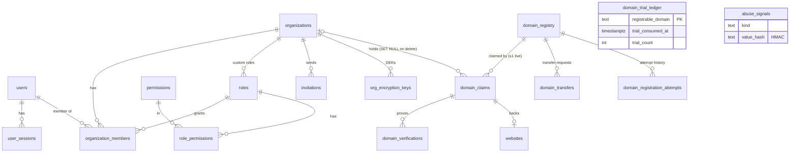
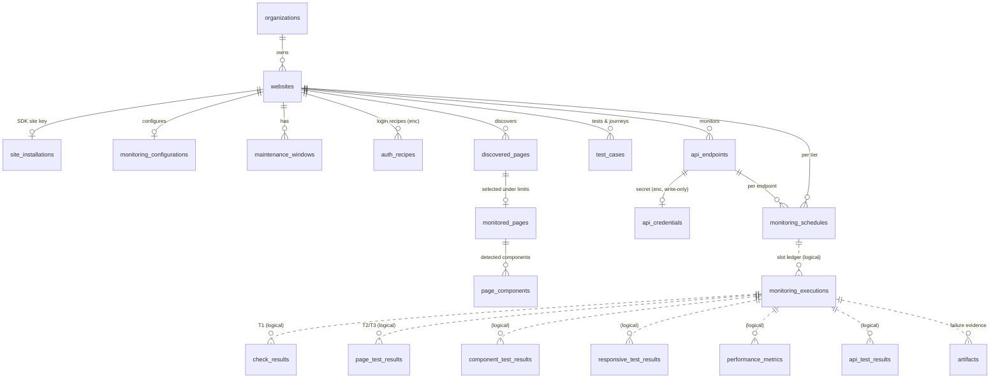
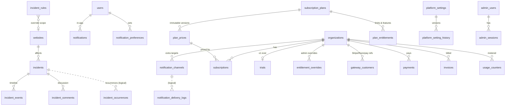

# Database Schema

> Status: **Phase 3 — implemented and verified in Docker Postgres 16** · Last updated 2026-11-13
>
> Source of truth: [`packages/db/prisma/schema.prisma`](../packages/db/prisma/schema.prisma) (87 tables) plus the SQL layer in [`packages/db/sql/`](../packages/db/sql). Invariant tests: [`packages/db/tests/invariants.sql`](../packages/db/tests/invariants.sql).

## 1. How the schema is built

| Layer | What | Why it is separate |
|---|---|---|
| `prisma/schema.prisma` | Tables, columns, FKs, regular and unique indexes, enums | Typed client for app code |
| `scripts/partition-migration.mjs` | Rewrites `CREATE TABLE` for 16 high-volume tables into `PARTITION BY RANGE` parents | Prisma cannot declare partitioning |
| `sql/010_partitions.sql` | `partitions` schema, partition config, `ensure_all()`, `apply_retention()` | Children live outside `public`, so Prisma never reports drift |
| `sql/020_rls.sql` | RLS policies, `app_current_org()`, `app_is_system()`, `resolve_site_key()` | Defense-in-depth tenant isolation (D-13) |
| `sql/030_constraints.sql` | Partial unique indexes and CHECK constraints | Database-level guarantees for product rules #1 and #7 |
| `sql/040_audit.sql` | Hash-chain trigger, append-only triggers, `audit_verify()` | Tamper-evident audit (D-16) |
| `sql/050_grants.sql` | Per-role grants, column-level secret protection, `admin_v_*` views | Least privilege and the Super Admin privacy model (§17) |
| `sql/070_websites.sql` *(Phase 3)* | Claim/verification/transfer functions, ingest functions, `wim_app` write restrictions, website status trigger, org-deletion claim release, admin website views | Database-level protection of domain ownership (§11) |
| `sql/060_identity.sql` *(Phase 2)* | `app_enter_org()`, user-scoped RLS, audit-log read policies, pre-auth lookup functions, RBAC integrity triggers, platform statistics views | Database-level authorization for identity, teams and roles (§10) |

All SQL files are **idempotent** and re-applied on every deploy (`pnpm --filter @wim/db migrate:deploy`).
`prisma migrate diff` against the live database reports **an empty migration**, so the SQL layer and Prisma coexist without drift.

**Local workflow (Docker):**

```bash
cp .env.example .env
pnpm infra:up                                   # Postgres :55432, Redis :56379, S3 :58333, Mailpit :58025
cd packages/db && set -a && . ../../.env && set +a
pnpm exec prisma migrate deploy && PATH="$PWD/node_modules/.bin:$PATH" node scripts/apply-sql.mjs
# invariants (transaction, rolled back):
docker compose -f ../../infra/compose/docker-compose.dev.yml exec -T postgres \
  psql -U wim_owner -d wim -v ON_ERROR_STOP=1 -f - < tests/invariants.sql
```

When a new migration creates a partitioned table, run `prisma migrate dev --create-only`, then `node scripts/partition-migration.mjs <file>`, and add the table to `PARTITIONED` in the script and to `partitions.config`.

## 2. Entity-relationship diagram

The diagram is split by domain. Dashed notes mark relations that are **logical only** (no FK, because the child is partitioned and dropped by retention).

### 2.1 Tenancy, identity, domains



### 2.2 Websites, monitoring, results



### 2.3 Incidents, notifications, billing, platform



## 3. Mapping from specification entities (§17 of the brief)

| Spec entity | Table(s) | Notes |
|---|---|---|
| users, organizations, organization_members | `users`, `organizations`, `organization_members` | A user can belong to many orgs (G4) |
| roles, permissions | `roles`, `permissions`, `role_permissions` | System roles have `org_id NULL` |
| websites | `websites` | One website per live claim (`domain_claim_id UNIQUE`) |
| domain_registry | `domain_registry` | Permanent, one row per identity key |
| domain_verification | `domain_claims` + `domain_verifications` | A claim is an org's attempt to own an identity; verifications are the proofs |
| domain_registration_history | `domain_registration_attempts` + claim history in `domain_claims` | Includes rejected duplicates for admin review |
| site_installations | `site_installations` | Public site key with a rotation grace period |
| monitoring_configurations | `monitoring_configurations` | Per-tier intervals, crawl rules, thresholds |
| monitored_pages, discovered_pages | `monitored_pages`, `discovered_pages` | Discovered = all found; monitored = selected under plan limits |
| monitoring_schedules | `monitoring_schedules` | Database-driven scheduler (D-04) |
| monitoring_jobs | *BullMQ (transport)* + `monitoring_executions` | The durable job ledger is the execution table; BullMQ is not the record |
| monitoring_executions | `monitoring_executions` ⧉ | Daily partitions, ledger for requirement #6 |
| page_test_results / component_test_results / responsive_test_results / performance_metrics | same names ⧉ | Daily partitions, 14-day raw retention |
| api_endpoints, api_credentials, api_test_results | same names (results ⧉) | Credentials are envelope-encrypted and write-only for the API role |
| incidents, incident_occurrences, incident_comments, incident_events | same names (occurrences ⧉) | |
| notifications, notification_preferences, notification_delivery_logs | same names (logs ⧉) + `notification_channels`, `email_suppressions`, `email_templates` | |
| subscriptions, subscription_plans, subscription_entitlements | `subscriptions`, `subscription_plans`, `plan_prices`, `plan_entitlements`, `entitlement_overrides` | Spec's *subscription_entitlements* = plan entitlements plus per-org overrides |
| trials | `trials` + `domain_trial_ledger` + `abuse_signals` | Org-level trial; domain-level ledger survives deletion |
| payments, invoices, payment_webhook_events | same names + `gateway_customers`, `payment_gateway_configs` | |
| audit_logs | `audit_logs` + `audit_anchors` | Hash-chained, append-only |
| admin_settings | `platform_settings` + `platform_setting_history` | Typed, versioned |
| feature_flags | `feature_flags` | |
| system_health_logs | `system_health_logs` ⧉ + `worker_heartbeats`, `job_failures` | |
| *(added)* | `metrics_hourly` ⧉, `metrics_daily` ⧉, `website_health_scores` ⧉ | Rollups and the health score |
| *(added)* | `sdk_events` ⧉, `artifacts`, `report_jobs`, `data_requests`, `outbox_events`, `break_glass_requests`, `security_events` ⧉, `login_attempts` ⧉, `api_host_authorizations`, `blocked_domains`, `domain_policy_suffixes`, `domain_transfers`, `maintenance_windows`, `auth_recipes`, `test_cases`, `page_components` | See ARCHITECTURE.md |

⧉ = range-partitioned.

## 4. Key constraints (database-level guarantees)

| Guarantee | Mechanism | Verified by |
|---|---|---|
| A website identity is never registered twice, across tenants (rule #1) | `domain_registry.identity_key UNIQUE`, plus partial unique `domain_claims_one_live_claim ON (domain_registry_id) WHERE status IN ('PENDING','VERIFIED','LAPSED')` | invariants §2 |
| Released history does not block legitimate re-registration | Only *live* statuses are in the partial index. `RELEASED`, `EXPIRED`, `TRANSFERRED_OUT` rows remain as history. | invariants §2 |
| One trial per org, ever | `trials.org_id UNIQUE` | — |
| A trial cannot be reset by deleting the account (rule #2) | `domain_trial_ledger` has no FK to orgs and is never deleted. `domain_claims.org_id ON DELETE SET NULL`. | Phase 8 E2E |
| One active incident per fingerprint (rule #7) | Partial unique `incidents_one_active_per_fingerprint` | invariants §3 |
| One current subscription per org | Partial unique `subscriptions_one_current_per_org` | — |
| Webhook idempotency (rule #11) | `payment_webhook_events UNIQUE(gateway, event_id)` | Phase 8 |
| Exactly-once execution recording (rule #6) | `monitoring_executions UNIQUE(schedule_id, slot, queued_at)` plus deterministic BullMQ `jobId`. The scheduler computes `queued_at` from the slot, so retries land on the same key. | Phase 4 |
| Break-glass dual control | `CHECK approved_by_id <> requested_by_id`, `duration_min ≤ 240` | invariants §9 |
| Interval floors (defense against bypassing entitlement checks) | CHECKs on `monitoring_configurations`, `monitoring_schedules` | — |

## 5. Partitioning and retention

| Table | Key | Granularity | Default drop age |
|---|---|---|---|
| `monitoring_executions` | `queued_at` | day | 62 d |
| `check_results`, `page_test_results`, `component_test_results`, `responsive_test_results`, `performance_metrics`, `api_test_results` | timestamp | day | 14 d |
| `sdk_events` | `received_at` | day | 7 d |
| `metrics_hourly`, `website_health_scores` | `bucket` / `computed_at` | month | 62 d |
| `metrics_daily` | `bucket` | month | 400 d (covers the longest plan retention) |
| `incident_occurrences`, `notification_delivery_logs`, `system_health_logs` | timestamp | month | 93 d |
| `login_attempts` | `occurred_at` | month | 365 d |
| `security_events` | `occurred_at` | month | 730 d |

- `partitions.ensure_all()` keeps yesterday through +7 days (daily) or +2 months (monthly) ready. It is called hourly by `worker-maintenance` and once at deploy.
- `partitions.apply_retention()` detaches and drops whole partitions older than `partitions.config.retain`. Admin retention settings update that column. Per-org retention shorter than the partition age is enforced by query clamping, and by a purge job on rollups.
- There are no FKs into partitioned tables. Referential cleanup is done by the purge jobs. This is deliberate: retention drops must be O(1).
- Note: PK and unique constraints on partitioned tables must include the partition key, which is why their PKs are composite (`(id, checked_at)` etc.).

## 6. Row-level security

```
SET LOCAL app.current_org_id = '<org uuid>';   -- every request / job transaction
SET LOCAL app.system = 'on';                   -- wim_worker only: scheduler, maintenance, billing
```

| Policy | Tables | Effect |
|---|---|---|
| `tenant_isolation` | Every table with `org_id` (dynamic), plus `organizations` by `id` | Rows visible and writable only for the current org. No context means zero rows. |
| `system_access` (wim_worker) | Same | Cross-tenant access only when `app.system = 'on'` |
| `tenant_read` / `tenant_write` | `roles`, `incident_rules`, `api_host_authorizations` | Platform default rows (`org_id NULL`) are readable. Writes are allowed only to the own org. |
| `admin_metadata` (wim_admin) | `organizations`, `websites`, `trials`, `entitlement_overrides`, `incident_rules`, `api_host_authorizations` | Combined with **column-level grants**: the admin sees status and metadata columns only |
| *(no RLS, by design)* | `audit_logs`, `security_events`, `outbox_events`, `job_failures`, `data_requests`, `domain_registration_attempts`, global tables | Protected by grants instead (see §7) |

`resolve_site_key(text)` is a `SECURITY DEFINER` function. It is the only way for `ingest` to map a public site key to its org before a tenant context exists. It returns IDs for ACTIVE websites only.

> **Production note:** the dev `wim_owner` is the container superuser, which bypasses RLS. In production, `wim_owner` is a non-superuser schema owner (DEPLOYMENT.md §Postgres roles), and runtime roles are never owners.

## 7. Roles and grants

| Role | Used by | Highlights |
|---|---|---|
| `wim_owner` | migrations only | Owns schema, functions and views |
| `wim_app` | api, realtime, ingest | Full CRUD under RLS. **Cannot SELECT** `api_credentials.secret_enc`, `auth_recipes.credentials_enc`, or `notification_channels.config_enc` (write-only secrets; the Prisma client must `omit` them). Cannot modify plans, settings, flags, the domain ledger, or the audit log. |
| `wim_worker` | scheduler, http, incident, notify, billing, maintenance | Broad access under RLS, plus the system context. No admin tables. Audit is append-only. |
| `wim_browser` | worker-browser | Reads job config, inserts results and artifacts, updates execution status columns only. No system context, so it is always confined to one org. |
| `wim_admin` | admin API | No grant on any tenant **content** table (`incidents`, `api_credentials`, results, `sdk_events`, …). Reads `admin_v_organizations`, `admin_v_websites`, `admin_v_incident_stats`, `admin_v_execution_stats`. Writes platform config. Column-scoped `UPDATE (status, suspended_reason)` on orgs and websites. |
| `wim_readonly` | BI / support replica | Admin views only |
| `wim_breakglass` | (NOLOGIN) owner of break-glass `SECURITY DEFINER` functions, Phase 9 | |

## 8. Audit log chain

On insert, the trigger takes a per-stream advisory lock and sets `seq = last+1`, `prev_hash = last.hash` (or 64 zeros), and `hash = sha256(prev_hash || '|' || canonical(row))`. The canonical form is a `jsonb` text with epoch-microsecond timestamps, so it does not depend on the session TimeZone. `UPDATE`, `DELETE` and `TRUNCATE` raise for every role. The only exception is archival delete by `wim_owner` with `app.audit_archive = 'on'`, which happens after anchors are exported.

`SELECT * FROM audit_verify('org:<id>')` returns no rows when the chain is intact, or returns the first broken `seq`. The invariant tests disable the trigger as a simulated attacker, edit row 2, and confirm detection at `seq = 2`.

## 9. Conventions

- IDs are `uuid`. The app generates UUIDv7 for index locality, with `gen_random_uuid()` as the DB fallback.
- All timestamps are `timestamptz(6)`, in UTC.
- Money is an integer in minor units (`amount_minor`) plus a `char(3)` currency.
- `*_enc` is AES-256-GCM envelope ciphertext with the key version in the header and the `key_version` column. `*_hash` is SHA-256 for tokens, or keyed HMAC for abuse signals and emails in logs.
- Emails are `citext`. IP addresses are stored as prefixes only (`/24`, `/48`) outside of `check_results.resolved_ip` (the target server's IP, not a person's).
- JSON columns hold **redacted** data only. Redaction happens in workers before insert.

## 10. Phase 2 additions

**Migration `phase2_auth`:** `users.totp_pending_secret_enc`, `users.totp_last_used_step` (TOTP replay protection),
`admin_users.totp_last_used_step / failed_login_count / locked_until`, `invitations.accepted_at / accepted_by_id /
last_sent_at`, and two tables:

| Table | Purpose |
|---|---|
| `account_recovery_requests` | Lost-2FA reset: `PENDING_EMAIL → WAITING (eligible_at) → COMPLETED`, or `CANCELLED/EXPIRED`; confirm and cancel tokens stored as SHA-256 |
| `platform_data_keys` | Platform-scoped DEKs (`user-secrets`, `admin-secrets`, `platform-config`), wrapped by a KEK held outside the database |

The init migration now relies on `citext`/`pgcrypto` existing in `template1` (created by `infra/postgres/init`), so
Prisma's shadow database and the integration-test database get them automatically.

**`sql/060_identity.sql` objects**

| Object | Kind | Effect |
|---|---|---|
| `app_enter_org(org, user, permission)` | SECURITY DEFINER fn (wim_app) | The customer API's only way into a tenant: raises `wim:not_member` / `wim:missing_permission`, else sets `app.current_org_id` + `app.current_user_id` |
| `app_current_user()` | fn | Reads `app.current_user_id` |
| `user_isolation` policies | RLS | `user_sessions`, `recovery_codes`, `account_recovery_requests` visible only to their user |
| `tenant_isolation` on `notifications`, `notification_preferences` | RLS | Now requires org **and** user |
| `audit_insert`, `audit_read_own`, `audit_read_admin`, `audit_read_system` | RLS | Inserts allowed for runtime roles; customers read only their org stream or their own user stream |
| `session_lookup(token_hash)` | SECURITY DEFINER fn | Session resolution before the user is known |
| `user_memberships(user)`, `invitation_by_token_hash(hash)`, `invitation_for_invitee(id, email)`, `pending_invitations_for_email(email)`, `recovery_request_by_token(hash)` | SECURITY DEFINER fns | Narrow cross-tenant identity lookups; return only ids/names needed by the flow |
| `role_scope_read` / `role_scope_write` | RLS on `role_permissions` | System-role permissions readable but immutable for runtime roles |
| `role_permissions_guard` | trigger | Custom roles can never hold owner-only permissions |
| `role_in_org_guard` | trigger on `organization_members`, `invitations` | Role must be a system role or belong to the same org |
| `organization_members_keep_owner` | deferred constraint trigger | An org always keeps at least one OWNER (checked at commit) |
| `admin_v_platform_stats`, `admin_v_signups_daily` | views (wim_admin, wim_readonly) | Platform-wide aggregate counts only |
| grants | | `wim_admin` may insert `login_attempts`, `security_events`, read/insert `platform_data_keys` |

**Verified** (see `docs/DEVELOPMENT_ROADMAP.md` Phase 2 results): Phase 1 invariants still pass on `wim` and `wim_test`;
`prisma migrate diff` reports no drift.

## 11. Phase 3 additions

**Migration `phase3_websites`** (columns only; no new tables):

| Table | Added columns |
|---|---|
| `websites` | `description`, `category`, `monitoring_timezone`, `verified_at`, `trial_outcome` |
| `domain_claims` | `token_issued_at`, `verification_attempts`, `last_attempt_at`, `verified_method`, `inherited_from_claim_id` |
| `domain_verifications` | `org_id` (tenant RLS via the 020 loop), `scope_granted` |
| `domain_registration_attempts` | `reason` |
| `domain_transfers` | `from_org_id`, `requested_by_id`, `verification_token`, `token_expires_at`, `verification_attempts`, `verified_at`, `last_check_detail`, `applied_at`, `to_website_id` |
| `site_installations` | `key_created_at`, `revoked_at`, `telemetry_paused`, `heartbeat_count`, `last_invalid_at/_reason/_origin`, `last_check`, `last_checked_at` |
| `trials` | `plan_id` now nullable (plans arrive in Phase 8) |

**New role** `wim_ingest` (created by `infra/postgres/init`): `EXECUTE` on `ingest_lookup`, `ingest_heartbeat`, `ingest_events` only.

**`sql/070_websites.sql`**

| Object | Effect |
|---|---|
| Grants | `wim_app`: no INSERT/UPDATE/DELETE on `domain_claims`, `domain_registry`, `domain_verifications`, `domain_transfers`, `domain_trial_ledger`, `trials`; UPDATE on `websites` limited to name/description/category/timezone; UPDATE on `site_installations` limited to key/pause/config columns; no DELETE on websites |
| `websites_status_from_claim` trigger | A new website's status is derived from its claim (`ACTIVE` only for a VERIFIED claim), whoever inserts it |
| RLS | `domain_registration_attempts` (tenant reads own; admin/system aggregate), `domain_transfers` (requester reads own; owner only via `incoming_domain_transfers()`; admin full) |
| `register_domain_claim()` | Blocked-domain check, lazy expiry, registry upsert, duplicate / namespace / pending-limit checks, claim insert, ledger registration count, attempt log — under an advisory lock per registrable domain |
| `regenerate_claim_token()`, `reserve_verification_attempt()`, `restart_website_claim()`, `archive_website()` | Token rotation (no expiry extension), attempt budget, restart after expiry, archive + release + key revoke |
| `domain_claim_status()` | `UNCLAIMED / YOURS / PENDING_ELSEWHERE / CLAIMED_ELSEWHERE / BLOCKED` — never the holder |
| `request_/cancel_/contest_domain_transfer()`, `reserve_transfer_attempt()`, `incoming_domain_transfers()` | Transfer lifecycle on the customer side |
| `expire_stale_domain_claims()` | Sweep (worker every 10 min; also lazy) |
| `release_claims_on_org_delete` trigger | Org hard delete releases claims and stamps the ledger before `org_id` is nulled |
| `ingest_lookup/heartbeat/events()` | The only database surface of the SDK endpoint |
| `admin_v_website_stats`, `admin_v_registration_daily`, `admin_v_domain_transfers` | Aggregates and the transfer review queue (metadata only) |

## 12. Phase 4A additions

**Migration `phase4a_revalidation`** (columns only): `domain_claims.next_revalidation_at`, `revalidation_state`
(`OK|FAILING|LAPSED`), `last_revalidation_at`, `last_revalidation_outcome`
(`SUCCEEDED|TEMPORARY_FAILURE|DEFINITIVE_FAILURE|SERVICE_UNAVAILABLE`), `revalidation_failures`,
`transient_failures`, `failing_since`, index `(status, next_revalidation_at)`. Revalidation history reuses
`domain_verifications` (`is_reverification = true`); service-side failures go to `system_health_logs`
(`component = 'revalidation'`). No new tables, no new roles; Phase 1 invariants re-verified.

## 13. Phase 4B additions

**Migration `phase4b_scheduler`** (columns/enum values only):
* `ExecutionStatus` += `SCHEDULED`, `RETRYING`, `DEAD_LETTERED`.
* `monitoring_executions` += `enqueued_at`, `lease_expires_at`, `failure_category`
  (`TRANSIENT|TIMEOUT|PERMANENT|SECURITY|INELIGIBLE|CANCELLED`), `cancel_requested_at`; index `(org_id, status)`.
  `queued_at` is the **window start** for scheduled executions and `slot` its epoch second, so the existing unique
  `(schedule_id, slot, queued_at)` is the durable one-execution-per-window guarantee. Trigger `REPLAY` added.
* `monitoring_schedules` += `paused_reason` (`WEBSITE_PAUSED|WEBSITE_INACTIVE|OWNERSHIP_LAPSED|ORG_SUSPENDED|NOT_ENTITLED|TIER_DISABLED|WEBSITE_LIMIT`).
* `job_failures` (dead-letter ledger) += `execution_id`, `website_id`, `job_type`, `failure_category`,
  `replay_requested_at`, `replay_requested_by_id`, `replay_reason`, `replay_execution_id`; resolution values
  `REPLAYED|REPLAY_REFUSED|DISCARDED`.

**`sql/080_scheduler.sql`:** `wim_app` loses write access to schedules/executions; functions
`set_website_monitoring_paused()` and `request_execution_cancel()` (SECURITY DEFINER, membership + `website:write`
checked in the database); aggregate views `admin_v_execution_health` (per tier: depth by state, 1 h/24 h outcomes,
retries, avg/p50/p95 duration, p95 queue wait, expired leases) and `admin_v_schedule_health`; `wim_admin` may update
only the replay-request columns of `job_failures`.

**Usage accounting** reuses `usage_counters` (daily per org): `exec.{http,browser,deepscan}.{ok,failed,retries,cancelled,skipped,ms,wait_ms}`
plus engine-specific keys (e.g. `deepscan.pages`). No new tables, no new roles; invariants pass on `wim` and `wim_test`.

## 14. Phase 4C additions

**Migrations `phase4c_http_monitoring`, `phase4c_interval_default`:**
* `check_results` += `method`, `final_url`, `content_type`, `response_headers`, `failure_category`, `available`, `details`
  (verdicts per check class, hop timings, TLS facts, truncation, HEAD fallback), `attempt`, `started_at`, `finished_at`;
  **unique `(execution_id, checked_at)`** — `checked_at` is the execution's window start (idempotency key).
* `monitoring_schedules` += `state` (per-website monitor state: consecutive failures/passes per check class, open
  incident ids, SSL notice threshold, inconclusive streak) and `state_window_at` (newest window applied; late results
  never move state backwards).
* `monitoring_configurations` += `http_check` (validated `HttpCheckConfig`); `t1_interval_sec` is now nullable with no
  default (NULL = entitled default; the old default 300 is cleared).
* `outbox_events` += unique `dedupe_key`.

**`sql/090_http_monitoring.sql`:** `check_results` retention 62 days; `partitions.ensure_all()` / `apply_retention()`
run as owner and are executable by `wim_worker` (the scheduler runs them hourly; `create_one` is owner-only); `wim_app`
loses write access to `check_results`, `incident_occurrences`, `outbox_events` and INSERT/DELETE on `incidents`,
`incident_events`; view `admin_v_http_check_health`.

### HTTP measurement definitions

| Measurement | Column | Source | Notes |
|---|---|---|---|
| DNS resolution time | `dns_ms` | **egress gateway** (it resolves; reported in the CONNECT response) | Per hop; the final hop's value is stored. Failure → `DNS_FAILURE` (resolver error / SERVFAIL) or `NO_ADDRESSES` (NXDOMAIN / no records) |
| TCP connect time | `connect_ms` | **egress gateway** (gateway → target) | Excludes the worker → gateway leg |
| Gateway round trip | `details.timings.gatewayMs` | worker | CONNECT request → tunnel established (includes DNS + connect) |
| TLS handshake | `tls_ms` | worker (end-to-end TLS inside the tunnel) | NULL for plain HTTP — never fabricated |
| Time to first byte | `ttfb_ms` | worker | Request written → response headers received |
| Total | `total_ms` | worker | Whole probe incl. redirects and the bounded body read |
| Status, content type, size, safe headers | `http_status`, `content_type`, `bytes`, `response_headers` | worker | `bytes` = body bytes on the wire; reading stops at `monitoring.http.maxBodyBytes` (×4 on the wire) and the result is marked `truncated` (not a failure). Headers allow-listed: content-type/-length/-encoding, cache-control, server, age, via, x-cache, retry-after, location (sanitised) |
| Redirect chain, final URL | `redirect_chain`, `final_url` | worker | Sanitised: scheme, host, path; query values replaced by `[redacted]`; no credentials/fragments |
| Certificate | `ssl_valid`, `ssl_expires_at`, `ssl_issuer`, `details.tls` | worker | Trust (chain + hostname) by Node's root store; `error` = OpenSSL code (`CERT_HAS_EXPIRED`, `DEPTH_ZERO_SELF_SIGNED_CERT`, `ERR_TLS_CERT_ALTNAME_INVALID`, …), `hostnameMatch`, `daysRemaining`, protocol |
| Pinned address | `resolved_ip` | gateway | The validated address actually connected to |

Not collected by the synthetic HTTP engine (and never shown as if it were): rendering, LCP/CLS/INP, JS errors, resource
failures (→ Tier B browser monitoring, 4D); real visitors' experience (→ the RUM SDK). Measurements are taken from our
infrastructure (one region), so they are **synthetic availability and server-response metrics, not real-user
performance**. Connection reuse, HTTP/2 and HTTP/3 are deliberately not used (each check is a fresh connection).

### Uptime methodology

**Uptime** for a period = up ÷ (up + down) over persisted checks with an availability verdict (`check_results.available`):
* **up**: any HTTP response that isn't a 5xx (401/403/404 and content failures are *up* — the server answered);
  configurable (`serverErrorsAreDowntime: false` counts 5xx as up-but-failing).
* **down**: DNS failure / no addresses, connection refused/timeout, response timeout, invalid HTTP, untrusted TLS
  certificate, 5xx.
* **excluded**: inconclusive checks (our gateway, resolvers or workers failed — `GATEWAY_INFRASTRUCTURE`, `SECURITY_REJECTION`),
  destinations refused by policy (`INVALID_CONFIGURATION`), skipped/cancelled/dead-lettered executions, and windows
  with no execution (paused, not entitled, scheduler down).
* `coveragePercent` = measured checks ÷ scheduled executions in the period, so "100 % from 3 checks" is visible as such.
  No data → `uptimePercent: null`. Never extrapolated, never smoothed.

## 15. Phase 4D additions

**Migration `phase4d_browser`:**
* **`execution_results`** (not partitioned): `execution_id` PK, org, website, tier, `window_start`, outcome, attempt,
  `recorded_at`. Written first in every result transaction; a second logical result for an execution is impossible
  (PK). Backfilled from existing `check_results`.
* `page_test_results`: `monitored_page_id` nullable (configured path, no deep-scan page needed), + `page_path`, `width`,
  `height`, `final_url`, `failure_kind`, `failure_category`, `available`, `navigation`, `rendering`, `network`,
  `scripts`, `details`, `attempt`, `started_at`, `finished_at`; unique `(execution_id, viewport, tested_at)`.
* `performance_metrics`: `monitored_page_id` nullable, + `page_path`, `navigation_timing`, `long_tasks`; unique
  `(execution_id, viewport, measured_at)`.
* `responsive_test_results`: `monitored_page_id` nullable, + `page_path`; unique `(execution_id, viewport, tested_at)`.
* `monitoring_configurations.browser_check`; `artifacts.purpose`, `artifacts.viewport`.

**`sql/100_browser_monitoring.sql`:** trigger `result_requires_ledger` on the four result tables (row must match a
ledger row of its tier, window, org and website); ledger rows can't be updated by workers; browser tables retained 62
days; `wim_app` read-only on results and artifacts; view `admin_v_browser_check_health`. Invariant 1b proves the rule
(different timestamp, same timestamp, second ledger row, cross-tier).

### Synthetic browser measurement definitions

| Measurement | Where it is stored | How it is measured | Caveats |
|---|---|---|---|
| Navigation outcome, main-document status, redirects, final URL (sanitised), readiness strategy/result, duration | `page_test_results.navigation` | Playwright navigation in Chromium | Off-site redirects are classified `REDIRECTED_OFF_SITE`, never evaluated |
| TTFB, load | `performance_metrics.ttfb_ms`, `load_ms` | Navigation Timing in the page | Includes the hop through the egress gateway |
| FCP, LCP | `fcp_ms`, `lcp_ms` | `PerformanceObserver` (`paint`, `largest-contentful-paint`) installed before page scripts | Chromium ignores low-entropy images as LCP candidates (as in real browsers) |
| CLS | `cls` | `layout-shift` observer, web-vitals session windows (gap < 1 s, ≤ 5 s), inputs excluded | Only shifts until observation ends (readiness + bounded settle) |
| TBT | `tbt_ms` | Long tasks after FCP, blocking part > 50 ms, until observation ends | Approximation (no TTI); lab metric |
| INP | **never** | — | Requires real interactions: only the RUM SDK reports it |
| DNS / TCP of the target | not from the browser | The browser talks to the gateway; target DNS/connect are measured by the HTTP engine (4C) | Browser `connect` timing is the browser→gateway leg |
| Rendering | `page_test_results.rendering` | Visible text, visible media/inputs, first-viewport coverage, broken images (`complete && naturalWidth === 0`), failed fonts | Blank = objective (no visible text and no visible media); low coverage = heuristic warning |
| Layout | `responsive_test_results` | `scrollWidth − clientWidth` (objective horizontal overflow > 4 px); text extending past the viewport outside clipping containers (heuristic) | Hidden or deliberately clipped content is not reported |
| JavaScript | `page_test_results.scripts` | Uncaught exceptions (`pageerror`), unhandled rejections (in-page listener), console errors | Grouped by normalised signature (URLs → host, numbers → N) |
| Network | `page_test_results.network` | Failed requests and HTTP ≥ 400 responses grouped by host + resource type + error; first-party = same registrable domain | Gateway refusals appear as `GATEWAY_<outcome>` |

All numbers are **synthetic**: one Chromium, in our infrastructure, through the egress gateway, without the visitor's
cache, device, network or geography. They show regressions and failures; they are not Core Web Vitals field data.

## 16. Phase 4E additions

**Migrations** `phase4e_deepscan`, `phase4e_signal_source`, `phase4e_pages_dropped`, `phase4e_crawl_defaults`:

* **`deep_scans`** — one row per deep-scan execution: `execution_id` PK, org, website, trigger (SCHEDULE / MANUAL),
  `status` (RUNNING / COMPLETED / PARTIAL / CANCELLED / INCONCLUSIVE), `complete`, `stop_reason`, `config` (snapshot:
  scope, normalisation, effective limits, deadline), `discovery` (robots per host, sitemap counters, sitemap issues),
  page counters (`pages_discovered`, `_completed`, `_failed`, `_skipped`, `_dropped`, `_inconclusive`),
  `resources_checked`, `requests`, `bytes`, `browser_ms`, `findings_opened`, `findings_resolved`, `comparison`,
  `baseline_execution_id`, `started_at`, `updated_at`, `finished_at`.
* **`deep_scan_urls`** — the frontier and per-URL results: bigint id, `execution_id` → `deep_scans` (cascade), org,
  website, `url_hash` (SHA-256 of the normalised URL), `url`, `kind` (PAGE / RESOURCE / EXTERNAL), `resource_type`,
  `state` (QUEUED / DONE / FAILED / SKIPPED / INCONCLUSIVE), `skip_reason`, `depth`, `source` (START / SITEMAP / CRAWL /
  BROWSER), `in_sitemap`, `referrers`, `first_referrer`, `status_code`, `final_url`, `redirect_chain`, `content_type`,
  `bytes`, `duration_ms`, `facts` (structural facts and hashes — never the body), `error`, `checked_at`; unique
  `(execution_id, url_hash)`.
* **`scan_findings`** — grouped findings: unique `(website_id, fingerprint)`; `category`, `group_key`, `severity`,
  `status` (OPEN / RESOLVED), `subject`, `title`, `evidence`, `recommendation`, `detection_method`, `confirmed`,
  `occurrence_count`, `reopen_count`, first/last detected and resolved timestamps and executions.
* **`scan_finding_events`** — OPENED / RECURRED / REOPENED / RESOLVED per finding and execution; unique
  `(finding_id, execution_id, type)`.
* `monitoring_configurations.deep_scan` (customer configuration JSON); `query_param_mode` default `KEEP_MEANINGFUL`
  (rows with the Phase 1 default IGNORE_ALL migrated); `max_pages` / `max_depth` became nullable with no default —
  NULL means "the plan limit" (the Phase 1 defaults 25 / 3 were never customer choices but silently capped every plan;
  rows still holding them were reset to NULL). `mc_crawl_bounds` accepts NULL.
* `signal_source` gains `DEEP_SCAN` (incidents opened by deep scans).

**`sql/110_deep_scan.sql`:** role `wim_scanner` and its grants; RLS policies `scanner_system` (system context only);
triggers `deep_scan_matches_execution` (scan ↔ T3 execution of the same org and website), `deep_scan_final_needs_ledger`
(COMPLETED / PARTIAL / INCONCLUSIVE need the T3 ledger row; a final status never changes), `deep_scan_child_tenant`
(frontier rows match their scan; findings match the website's org); partial unique index
`deep_scans_one_running_per_website`; `wim_app` read-only on all deep tables, `execution_results` and (new)
`usage_counters`; function `request_deep_scan(website, cooldown)` (SECURITY DEFINER, membership + monitoring:write +
eligibility + cooldown, inserts the MANUAL execution); view `admin_v_deepscan_health` (aggregates only).

**Ledger.** A deep scan's result is the T3 row in `execution_results`, written first in the finalisation transaction;
a replayed execution finds it and does nothing. Usage (`deepscan.pages`, `bytes`, `requests`, `resources`, `scans`,
`partial_scans`, `duration_ms`, `external_links_seen`) is added in the same transaction as the work it counts — per page
when the page's frontier row leaves QUEUED, per scan at finalisation.

**Retention.** Hourly (advisory-locked): scans older than `monitoring.deepscan.retentionDays` (default 90) and their
frontier rows; RESOLVED findings resolved longer ago than that, with their events. Open findings are kept.

## 17. Customer dashboard additions (approved-4G scope delivered early; originally labelled "Phase 4F")

**Migration `phase4f_dashboard`:** `notification_preferences.enabled` (per-channel switch, default true); indexes for
the dashboard's keyset queries — `incidents (org_id, last_detected_at DESC, id)`, `incident_events (org_id, created_at DESC)`,
`execution_results (org_id, window_start DESC)` and `(org_id, recorded_at)`, `deep_scans (org_id, updated_at)`. The schema
comments on `monitoring_configurations.t2_interval_sec` / `t3_interval_sec` were corrected (NULL = entitled default,
not "tier disabled", as the scheduler has always treated it).

**`sql/120_dashboard.sql`:**
* `acknowledge_incident(incident)` — SECURITY DEFINER; the incident must belong to the session's organisation and the
  user must hold `incident:write` (`app_enter_org`); only OPEN / REOPENED become ACKNOWLEDGED (with an event); repeats
  return `ALREADY`; never resolves.
* `wim_app`: INSERT / UPDATE / DELETE revoked on `incidents` and `incident_events` (customers transition incidents only
  through the function); on `notifications` only `UPDATE (read_at)`; `notification_delivery_logs` read-only.
* `result_retention_days()` — retention of the result tables for the usage page (no other partition configuration).
* Views `admin_v_monitoring_outcomes` (per tier: results, passed / failed / inconclusive, retried over 24 h and 7 d) and
  `admin_v_usage_totals` (per usage key: today, 30 days, organisations today) — no organisation, website or URL columns;
  readable by `wim_admin` / `wim_readonly`.

**Invariant 1c** (Phase 4E) also covers the customer role's read-only access to usage and findings.

## 18. Phase 4F additions (approved scope: components, functional tests, responsive matrix)

**Migration `phase4f_components`:**
* `ComponentType` + `CARD_GROUP`.
* `page_components` (Phase 1 table, first used now) + `website_id`, `status` (PRESENT / REMOVED), `label`, `detail`
  (identity-relevant facts, no page content), `detail_hash`, `viewports`, `missed_runs`, `last_execution_id`,
  `removed_at`; `dom_path_hash` = hash of the structural key, unique per monitored page and type.
* `component_events` (new): ADDED / CHANGED / REMOVED / RESTORED per component and execution, with before / after detail;
  unique `(page_component_id, execution_id, type)`.
* `component_test_results` + `test_kind`, `target`, `safety`, `duration_ms` and indexes by website and execution.
* `responsive_test_results` + `obscured_controls`, `offscreen_controls` (the Phase 1 columns `overlaps`, `clipped_text`,
  `oversized_images`, `nav_state` are now filled).
* `monitored_pages` rows are created by the browser worker for the checked page, linked to the same `discovered_pages`
  row the deep scan maintains (same URL normalisation and hash).

**`sql/130_components.sql`:** `result_requires_ledger` trigger on `component_test_results` (a functional result needs its
execution's T2 ledger row); tenancy triggers (`monitored_page_tenant`, `page_component_tenant` on components and events);
the customer role is read-only on `page_components`, `component_events`, `component_test_results`, `monitored_pages`,
`test_cases`; the admin role has no access to components, events or functional results. Invariant 1d.

## 19. Phase 4G: performance rollups

* Migration `20261114180000_phase4g_performance`: `metrics_hourly.p75`, `metrics_daily.p75`; table `rollup_state`
  (`name` PK, `watermark`, `last_run_at`, `last_stats`); indexes `metrics_hourly/daily (org_id, metric, bucket)` and
  `performance_metrics (org_id, measured_at DESC)`.
* Migration `20261114180100_phase4g_component_visibility`: `page_components.visibility jsonb` (viewport → visible).
* Rollup rows: `subject_type` WEBSITE (subject = website) or PAGE (subject = `monitored_pages.id`), metric key
  `perf.<metric>.<viewport>`; columns count / sum / min / max / p50 / p75 / p95 / histogram (log buckets).
  `performance_metrics.monitored_page_id` and `responsive_test_results.monitored_page_id` are now populated.
* `sql/140_performance.sql`: `wim_app` SELECT only on `metrics_hourly/daily` (RLS by org); `rollup_state` worker-only;
  trigger `rollup_subject_tenant` refuses a rollup whose website/page is not in the row's organisation.
  Invariant 1e asserts both.
* Retention unchanged: raw `performance_metrics` 62 days, `metrics_hourly` 62 days, `metrics_daily` 400 days.

## 20. Phase 4H: platform operations

* Migration `20261115090000_phase4h_operations`:
  * `worker_heartbeats` + `processed`, `failed`, `timeouts`, `last_job_at`, `deps` (probe results), `meta` (gauges).
  * `platform_health` (component PK, state, reasons, metrics, since, evaluated_at/by; row `__evaluator` = evaluation claim + streak memo).
  * `platform_alerts` (fingerprint, rule, component, severity, state, reason, details, opened/last seen/acknowledged/recovered, occurrences, reopen_count, suppressed_by, notify_state) — unique `(fingerprint) WHERE state <> 'RECOVERED'`.
  * `platform_alert_events` (append-only).
  * `usage_reconciliation_runs`, `usage_discrepancies` (unique per run/org/check), `usage_adjustments` (append-only).
* `sql/150_operations.sql`: schema `ops`; grants (customers none; admin read + column-scoped acknowledge + request runs);
  CHECK constraints on states; `ops.alert_recipients()`, `ops.apply_usage_adjustment(...)`,
  `ops.accept_usage_discrepancy(...)`, `ops.retention_view()`, `ops.set_retention(...)` with `ops.retention_floor_days`;
  view `admin_v_usage_daily`; append-only triggers on adjustments, alert events and `platform_setting_history`;
  `wim_admin` loses `SELECT (canonical_origin)` on websites.
* New `system_health_logs` metrics: `worker/start`, `worker/sample` (every 2 min per worker), `ops/state` (transitions),
  `maintenance/partitions_failed`, `queue/lease_lost_on_success`, `usage/reconciliation`, `queue/dead_letter` (email).
* Usage gauges written hourly: `websites.registered`, `websites.verified`, `storage.screenshot_bytes`.
