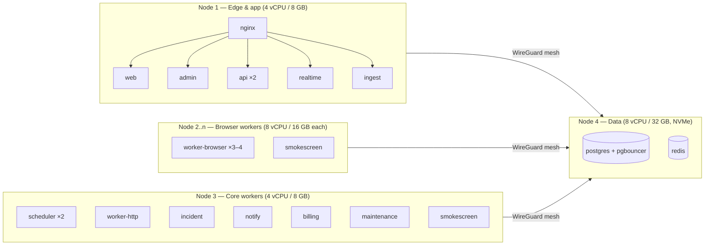
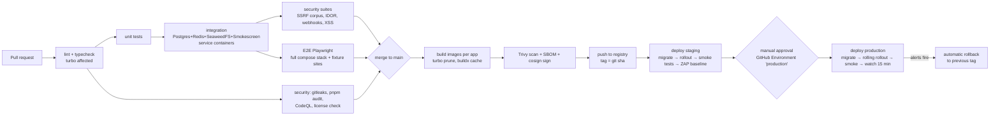

# Deployment

> Status: **Phase 1 — Proposed, pending review** · Last updated 2026-11-13
>
> Related: [ARCHITECTURE.md](ARCHITECTURE.md) (service topology §3, cost model §6, workers §7) · [SECURITY.md](SECURITY.md) (egress §5, browser isolation §6, keys §12)

> **Running it today:** the single-server production kit for Oracle Cloud (Always Free, ARM) behind Cloudflare is in
> [`infra/oracle/`](../infra/oracle) with the step-by-step guide [DEPLOY_ORACLE.md](DEPLOY_ORACLE.md) (§26 below).

This document defines how the platform is built, deployed, operated and scaled. It starts on a **single VPS** and migrates to **managed cloud infrastructure** without architectural changes, because every service is already a separate container with externalized state.

---

## Table of contents

1. [Environments](#1-environments)
2. [Topology stages](#2-topology-stages)
3. [Docker Compose production topology](#3-docker-compose-production-topology)
4. [Container images](#4-container-images)
5. [Nginx](#5-nginx)
6. [TLS certificates](#6-tls-certificates)
7. [PostgreSQL](#7-postgresql)
8. [Redis](#8-redis)
9. [Object storage](#9-object-storage)
10. [Database migrations](#10-database-migrations)
11. [CI/CD](#11-cicd)
12. [Observability](#12-observability)
13. [Scaling guide](#13-scaling-guide)
14. [Runbooks](#14-runbooks)
15. [Environment variable reference](#15-environment-variable-reference)

---

## 1. Environments

| Environment | Purpose | Infrastructure | Data | Payments / email |
|---|---|---|---|---|
| **local** | Development | `infra/compose/docker-compose.dev.yml`: Postgres (host port 55432), Redis (56379), SeaweedFS S3 (58333), Mailpit (58025 UI); Smokescreen, CoreDNS and fixture sites join in Phase 4; apps run on the host with `pnpm dev` (Turborepo) | Seeded fixtures (`pnpm db:seed`), clearly marked as demo data | Stripe test mode + Stripe CLI webhook forwarding; Razorpay test keys; Mailpit captures email |
| **staging** | Pre-production verification, E2E, DAST | Same compose topology as prod on a smaller VPS (4 vCPU / 16 GB) | Synthetic only. **Never a copy of production data.** | Gateway test modes; real email to an allowlisted domain only |
| **production** | Customers | §2 | Real | Live keys (configured in the admin panel, encrypted) |

Rules: each environment has its own KEK, DB, Redis, buckets, gateway keys and domains. No credentials are shared between environments.

---

## 2. Topology stages

### 2.1 Stage A — single VPS (launch, up to ~100 customers)

| Resource | Size |
|---|---|
| VPS | 8 vCPU / 32 GB RAM / 320 GB NVMe (e.g. Hetzner CCX33, DigitalOcean CPU-optimized, OVH) |
| Volumes | Separate encrypted block volume for Postgres data (200 GB) |
| Offsite | S3-compatible bucket for backups (different provider or region), bucket for artifacts and reports |

Approximate memory budget:

| Service | Replicas | Memory limit |
|---|---|---|
| nginx | 1 | 256 MB |
| web, admin | 1 each | 512 MB each |
| api | 2 | 768 MB each |
| realtime | 1 | 384 MB |
| ingest | 1 | 256 MB |
| scheduler | 1 (+1 standby) | 256 MB each |
| worker-http | 1 | 512 MB |
| worker-browser | 2 | 4 GB each (concurrency 4) |
| worker-incident, worker-notify, worker-billing | 1 each | 384 MB each |
| worker-maintenance | 1 | 768 MB |
| smokescreen | 1 | 256 MB |
| postgres | 1 | 8 GB (`shared_buffers` 2 GB) |
| pgbouncer | 1 | 128 MB |
| redis | 1 | 1.5 GB (`maxmemory` 1 GB) |
| prometheus, grafana, loki, alertmanager, promtail, node-exporter | 1 each | ~2.5 GB total |
| **Total** | | **≈ 27 GB** (headroom for OS and page cache) |

Capacity at this size: ≈ 6,000 T1 probes/min and ≈ 60–90 browser page renders/min, roughly 30–40 Professional-tier customers on browser checks (ARCHITECTURE §6.2). Browser capacity is the first bottleneck.

### 2.2 Stage B — split VPS (~100–1,000 customers)



- Nodes are connected via a **WireGuard** mesh (private subnet `10.77.0.0/24`). Postgres and Redis bind only to the WireGuard interface. A host firewall (nftables) drops everything else.
- Browser worker nodes have their own Smokescreen, and the host firewall allows outbound traffic **only** from the Smokescreen container plus WireGuard.
- Docker Swarm or plain compose per node with an Ansible-driven deploy.
- Postgres gets a streaming replica (hot standby) on a fifth node for failover and read-only analytics.

### 2.3 Stage C — cloud (1,000+ customers)

| Concern | VPS component | Cloud replacement (AWS example; GCP equivalents in parentheses) |
|---|---|---|
| Postgres | Self-managed + pgBackRest | RDS / Aurora PostgreSQL 16 (Cloud SQL / AlloyDB). Native partitioning works; RLS works. |
| Redis | Self-managed | ElastiCache for Redis OSS / Valkey, **cluster mode disabled** or with BullMQ hash-tag prefixes (Memorystore) |
| Object storage | S3-compatible | S3 + lifecycle + Object Lock (GCS + retention policies) |
| Compute | Compose | EKS (GKE) or ECS Fargate for app services; **browser workers on EKS node groups** (Fargate lacks the seccomp and shm control needed) |
| Ingress | Nginx | ALB + ingress-nginx (Cloud Load Balancing) |
| Egress | Smokescreen + network isolation | Smokescreen deployment + Kubernetes NetworkPolicies (deny all egress from worker pods except the proxy) + NAT gateway with a static egress IP (published so customers can allowlist our crawler) |
| Keys | KEK file | AWS KMS (Cloud KMS), IAM split: API = encrypt, workers = decrypt |
| Autoscaling | Manual | **KEDA** `ScaledObject` on BullMQ queue depth (Redis list length / `bull:{queue}:wait`) for worker-browser and worker-http; HPA on CPU for api/realtime |
| Secrets | `.env` files (root-only) | AWS Secrets Manager / External Secrets Operator |
| Observability | Prometheus/Grafana/Loki | Same stack (kube-prometheus-stack) or managed (Grafana Cloud, CloudWatch) |

KEDA example for browser workers:

```yaml
apiVersion: keda.sh/v1alpha1
kind: ScaledObject
metadata: { name: worker-browser }
spec:
  scaleTargetRef: { name: worker-browser }
  minReplicaCount: 2
  maxReplicaCount: 40
  cooldownPeriod: 300
  triggers:
    - type: redis
      metadata:
        address: redis:6379
        listName: "bull:r1:browser.render:wait"
        listLength: "20"        # ≈ 20 waiting jobs per replica (concurrency 4)
    - type: redis
      metadata:
        address: redis:6379
        listName: "bull:r1:browser.deepscan:wait"
        listLength: "10"
```

Note: BullMQ ≥ 5 stores prioritized jobs in a sorted set (`bull:{queue}:prioritized`). Phase 4 exports a Prometheus `wim_queue_waiting{queue}` metric, and KEDA scales on that metric via the Prometheus scaler instead of the raw Redis key.

**Migration path A → B → C** needs no application changes: services read all endpoints from env vars, state lives in Postgres, Redis and S3 only, and all images are already separate.

---

## 3. Docker Compose production topology

### 3.1 Networks

| Network | `internal` | Members | Purpose |
|---|---|---|---|
| `edge` | no | nginx | Only network with published ports (80, 443) |
| `app` | **yes** | nginx, web, admin, api, realtime, ingest | Edge → app traffic |
| `data` | **yes** | api, realtime, ingest, scheduler, all workers, pgbouncer, postgres, redis, seaweedfs (if self-hosted) | Data access |
| `egress` | **yes** | worker-http, worker-browser, smokescreen | Monitoring traffic can **only** reach the proxy |
| `outbound` | no | smokescreen, worker-notify, worker-billing, api (for gateway API calls and S3) | Internet access for the proxy and for trusted outbound integrations |
| `observability` | **yes** | prometheus, grafana, loki, promtail, alertmanager, + every service's metrics port | Internal metrics |

Monitoring workers are **never** on `outbound`. Because the `egress` network is `internal: true`, Docker creates no default gateway for it, so a compromised browser can reach only Smokescreen (and the narrow `data` services, protected by DB and Redis ACLs).

Additional host firewall rule (DOCKER-USER chain) drops traffic from any container bridge to `169.254.169.254` and to the host's own IPs except published ports.

### 3.2 Service sketch (`infra/compose/docker-compose.prod.yml`)

```yaml
x-hardening: &hardening
  read_only: true
  security_opt: ["no-new-privileges:true"]
  cap_drop: ["ALL"]
  user: "10001:10001"
  restart: unless-stopped
  logging: { driver: json-file, options: { max-size: "20m", max-file: "5" } }
  tmpfs: ["/tmp:size=64m,noexec,nosuid"]

x-app-env: &app-env
  env_file: [/etc/wim/common.env]

services:
  nginx:
    image: ${REGISTRY}/wim-nginx:${TAG}
    <<: *hardening
    user: "101:101"
    cap_add: ["NET_BIND_SERVICE"]
    ports: ["80:8080", "443:8443"]
    networks: [edge, app]
    volumes: ["/etc/letsencrypt:/etc/letsencrypt:ro"]
    deploy: { resources: { limits: { cpus: "1", memory: 256M } } }

  web:      { image: "${REGISTRY}/wim-web:${TAG}",      <<: [*hardening, *app-env], networks: [app],                deploy: { resources: { limits: { cpus: "1",   memory: 512M } } } }
  admin:    { image: "${REGISTRY}/wim-admin:${TAG}",    <<: [*hardening, *app-env], networks: [app],                deploy: { resources: { limits: { cpus: "0.5", memory: 512M } } } }
  api:
    image: ${REGISTRY}/wim-api:${TAG}
    <<: [*hardening, *app-env]
    env_file: [/etc/wim/common.env, /etc/wim/api.env]
    networks: [app, data, outbound, observability]
    deploy: { replicas: 2, resources: { limits: { cpus: "1", memory: 768M } } }
    healthcheck: { test: ["CMD", "/app/healthcheck", "http://localhost:3000/health/ready"], interval: 10s, timeout: 3s, retries: 3 }
  realtime: { image: "${REGISTRY}/wim-realtime:${TAG}", <<: [*hardening, *app-env], networks: [app, data, observability], deploy: { resources: { limits: { cpus: "0.5", memory: 384M } } } }
  ingest:   { image: "${REGISTRY}/wim-ingest:${TAG}",   <<: [*hardening, *app-env], networks: [app, data, observability], deploy: { resources: { limits: { cpus: "0.5", memory: 256M } } } }

  scheduler:
    image: ${REGISTRY}/wim-scheduler:${TAG}
    <<: [*hardening, *app-env]
    networks: [data, observability]
    deploy: { replicas: 2, resources: { limits: { cpus: "0.5", memory: 256M } } }   # leader-elected; 1 active

  worker-http:
    image: ${REGISTRY}/wim-worker-http:${TAG}
    <<: [*hardening, *app-env]
    env_file: [/etc/wim/common.env, /etc/wim/worker-decrypt.env]   # only workers get decrypt capability
    environment: { HTTP_PROXY: "http://smokescreen:4750", HTTPS_PROXY: "http://smokescreen:4750" }
    networks: [egress, data, observability]
    deploy: { resources: { limits: { cpus: "1", memory: 512M } } }

  worker-browser:
    image: ${REGISTRY}/wim-worker-browser:${TAG}
    <<: [*hardening, *app-env]
    user: "10002:10002"
    security_opt: ["no-new-privileges:true", "seccomp=/etc/wim/seccomp/chromium.json"]
    tmpfs: ["/tmp:size=512m,noexec,nosuid", "/home/pwuser/.cache:size=256m"]
    shm_size: 1g
    pids_limit: 512
    environment: { BROWSER_PROXY: "http://smokescreen:4750", BROWSER_CONCURRENCY: "4", BROWSER_RECYCLE_AFTER: "200" }
    networks: [egress, data, observability]
    deploy: { replicas: 2, resources: { limits: { cpus: "2", memory: 4G } } }
    stop_grace_period: 75s

  worker-reports:            # same image, PDF pool, NO egress network at all
    image: ${REGISTRY}/wim-worker-browser:${TAG}
    <<: [*hardening, *app-env]
    command: ["node", "dist/reports.js"]
    security_opt: ["no-new-privileges:true", "seccomp=/etc/wim/seccomp/chromium.json"]
    shm_size: 512m
    networks: [data]
    deploy: { resources: { limits: { cpus: "1", memory: 2G } } }

  worker-incident:    { image: "${REGISTRY}/wim-worker-incident:${TAG}",    <<: [*hardening, *app-env], networks: [data, observability] }
  worker-notify:      { image: "${REGISTRY}/wim-worker-notify:${TAG}",      <<: [*hardening, *app-env], networks: [data, outbound, observability] }
  worker-billing:     { image: "${REGISTRY}/wim-worker-billing:${TAG}",     <<: [*hardening, *app-env], networks: [data, outbound, observability] }
  worker-maintenance: { image: "${REGISTRY}/wim-worker-maintenance:${TAG}", <<: [*hardening, *app-env], networks: [data, outbound, observability], deploy: { resources: { limits: { cpus: "1", memory: 768M } } } }

  smokescreen:
    image: ${REGISTRY}/wim-smokescreen:${TAG}    # built from stripe/smokescreen at pinned commit
    <<: *hardening
    command: ["--listen-ip=0.0.0.0", "--listen-port=4750", "--egress-acl-file=/etc/smokescreen/acl.yaml",
              "--deny-range=…", "--statsd=…"]           # full deny list from SECURITY.md §5.2, rendered from infra/smokescreen
    networks: [egress, outbound]
    deploy: { resources: { limits: { cpus: "1", memory: 256M } } }

  pgbouncer:
    image: bitnami/pgbouncer@sha256:…
    networks: [data]
  postgres:
    image: postgres:16-bookworm@sha256:…
    networks: [data]
    shm_size: 1g
    volumes: ["/srv/wim/pgdata:/var/lib/postgresql/data", "/etc/wim/postgres:/etc/postgresql:ro"]
    command: ["postgres", "-c", "config_file=/etc/postgresql/postgresql.conf"]
    deploy: { resources: { limits: { cpus: "3", memory: 8G } } }
  redis:
    image: redis:7.4-bookworm@sha256:…
    command: ["redis-server", "/usr/local/etc/redis/redis.conf"]
    networks: [data]
    volumes: ["/srv/wim/redis:/data", "/etc/wim/redis/redis.conf:/usr/local/etc/redis/redis.conf:ro", "/etc/wim/redis/users.acl:/usr/local/etc/redis/users.acl:ro"]
    deploy: { resources: { limits: { cpus: "1", memory: 1536M } } }

networks:
  edge:          {}
  app:           { internal: true }
  data:          { internal: true }
  egress:        { internal: true }
  outbound:      {}
  observability: { internal: true }
```

Secrets: env files under `/etc/wim/*.env` are `root:root 0600`, provisioned by Ansible from an encrypted vault (`ansible-vault` / SOPS + age). The KEK file is mounted read-only only into services that need it (`/run/secrets/kek`, Docker secrets).

---

## 4. Container images

### 4.1 Strategy

- **Multi-stage builds** with `turbo prune --docker <app>` so each image contains only its app and its workspace dependencies.
- Stages: `pruner` (turbo prune) → `deps` (`pnpm fetch` + `pnpm install --frozen-lockfile --offline`, cached by lockfile) → `build` (`pnpm turbo build --filter=<app>`, `prisma generate`) → `runtime` (production dependencies only, via `pnpm deploy --prod`).
- **Runtime base**:
  - api, realtime, ingest, scheduler, worker-http, worker-incident, worker-notify, worker-billing, worker-maintenance: `gcr.io/distroless/nodejs22-debian12:nonroot` (digest-pinned). No shell, no package manager. A health check binary is compiled into the image (`/app/healthcheck`, a tiny Node script invoked via the distroless node entrypoint).
  - web, admin: `node:22-bookworm-slim` running Next.js `output: 'standalone'`, non-root user.
  - worker-browser: `mcr.microsoft.com/playwright:v<pinned>-noble@sha256:…`, Playwright npm version matching the image version **exactly** (CI check), Chromium only (`--with-deps chromium`), runs as `pwuser`.
  - nginx: `nginxinc/nginx-unprivileged:stable` (digest-pinned).
- Prisma: use the `binaryTargets` matching each runtime (`debian-openssl-3.0.x`); the migration image is separate (`wim-migrate`).
- Labels: OCI labels for source, revision, and created date. Images are signed with cosign. SBOM generated with Syft.
- No secrets in build args. `.dockerignore` excludes `.env*`, `.git`, `node_modules`, and test artifacts.

### 4.2 Example (`infra/docker/api.Dockerfile`)

```dockerfile
FROM node:22-bookworm-slim@sha256:… AS base
RUN corepack enable
WORKDIR /repo

FROM base AS pruner
COPY . .
RUN pnpm dlx turbo@2 prune @wim/api --docker

FROM base AS build
COPY --from=pruner /repo/out/json/ ./
COPY --from=pruner /repo/out/pnpm-lock.yaml ./pnpm-lock.yaml
RUN --mount=type=cache,id=pnpm,target=/root/.local/share/pnpm/store pnpm install --frozen-lockfile
COPY --from=pruner /repo/out/full/ ./
RUN pnpm turbo build --filter=@wim/api && pnpm --filter=@wim/api deploy --prod /out

FROM gcr.io/distroless/nodejs22-debian12:nonroot@sha256:…
WORKDIR /app
COPY --from=build --chown=nonroot:nonroot /out ./
USER nonroot
EXPOSE 3000
CMD ["dist/main.js"]
```

---

## 5. Nginx

`infra/nginx/` contains `nginx.conf`, `snippets/{tls,security-headers,proxy}.conf`, and a server block per host.

### 5.1 Essentials

```nginx
# nginx.conf (http block)
server_tokens off;
client_max_body_size 1m;              # default; overridden per location
client_body_timeout 10s;  client_header_timeout 10s;  keepalive_timeout 30s;
large_client_header_buffers 4 16k;

# Real client IP (only if behind a trusted LB in stage C)
# set_real_ip_from <lb-cidr>; real_ip_header X-Forwarded-For; real_ip_recursive on;

limit_req_zone $binary_remote_addr zone=login:10m     rate=10r/m;
limit_req_zone $binary_remote_addr zone=register:10m  rate=5r/h;
limit_req_zone $binary_remote_addr zone=api:20m       rate=20r/s;
limit_req_zone $binary_remote_addr zone=ingest_ip:20m rate=5r/s;
limit_req_zone $binary_remote_addr zone=webhooks:10m  rate=30r/s;
limit_conn_zone $binary_remote_addr zone=ws_conn:10m;
limit_req_status 429;

map $http_upgrade $connection_upgrade { default upgrade; '' close; }

# snippets/tls.conf
ssl_protocols TLSv1.2 TLSv1.3;
ssl_ciphers ECDHE-ECDSA-AES128-GCM-SHA256:ECDHE-RSA-AES128-GCM-SHA256:ECDHE-ECDSA-AES256-GCM-SHA384:ECDHE-RSA-AES256-GCM-SHA384:ECDHE-ECDSA-CHACHA20-POLY1305:ECDHE-RSA-CHACHA20-POLY1305;
ssl_prefer_server_ciphers off;
ssl_session_timeout 1d; ssl_session_cache shared:TLS:10m; ssl_session_tickets off;
ssl_stapling on; ssl_stapling_verify on;
resolver 1.1.1.1 9.9.9.9 valid=300s; resolver_timeout 5s;

# snippets/security-headers.conf  (CSP is set by the Next.js apps with per-request nonces)
add_header Strict-Transport-Security "max-age=63072000; includeSubDomains; preload" always;
add_header X-Content-Type-Options "nosniff" always;
add_header X-Frame-Options "DENY" always;
add_header Referrer-Policy "strict-origin-when-cross-origin" always;
add_header Permissions-Policy "camera=(), microphone=(), geolocation=(), usb=()" always;
add_header Cross-Origin-Opener-Policy "same-origin" always;
```

### 5.2 Server blocks

```nginx
server { listen 8080; server_name _; location /.well-known/acme-challenge/ { root /var/www/acme; } location / { return 301 https://$host$request_uri; } }

# Customer app + API + WebSocket (same origin)
server {
  listen 8443 ssl; http2 on; server_name app.example-platform.com;
  include snippets/tls.conf; include snippets/security-headers.conf;
  ssl_certificate /etc/letsencrypt/live/app/fullchain.pem; ssl_certificate_key /etc/letsencrypt/live/app/privkey.pem;

  location = /api/v1/auth/login    { limit_req zone=login burst=5 nodelay;    proxy_pass http://api:3000; include snippets/proxy.conf; }
  location = /api/v1/auth/register { limit_req zone=register burst=2 nodelay; proxy_pass http://api:3000; include snippets/proxy.conf; }
  location /api/   { limit_req zone=api burst=40 nodelay; client_max_body_size 1m; proxy_pass http://api:3000; include snippets/proxy.conf; }
  location /ws     { limit_conn ws_conn 10; proxy_pass http://realtime:3001; proxy_http_version 1.1;
                     proxy_set_header Upgrade $http_upgrade; proxy_set_header Connection $connection_upgrade;
                     proxy_read_timeout 75s; include snippets/proxy.conf; }
  location /       { proxy_pass http://web:3000; include snippets/proxy.conf; }
}

# Admin (separate origin, optional IP allowlist)
server {
  listen 8443 ssl; http2 on; server_name admin.example-platform.com;
  include snippets/tls.conf; include snippets/security-headers.conf;
  add_header Referrer-Policy "no-referrer" always;
  include /etc/nginx/admin-allowlist.conf;   # "allow 203.0.113.10; ... deny all;" — empty file = disabled
  location /api/v1/admin/auth/login { limit_req zone=login burst=3 nodelay; proxy_pass http://api:3000; include snippets/proxy.conf; }
  location /api/ { proxy_pass http://api:3000; include snippets/proxy.conf; }   # api only serves /api/v1/admin/* on this Host
  location /     { proxy_pass http://admin:3000; include snippets/proxy.conf; }
}

# SDK ingest
server {
  listen 8443 ssl; http2 on; server_name ingest.example-platform.com;
  include snippets/tls.conf;
  client_max_body_size 64k;
  location /v1/ { limit_req zone=ingest_ip burst=20 nodelay; proxy_pass http://ingest:3002; include snippets/proxy.conf; }
}

# CDN for monitor.js (immutable versioned files; can move to a real CDN in stage C)
server {
  listen 8443 ssl; http2 on; server_name cdn.example-platform.com;
  include snippets/tls.conf;
  root /srv/cdn;
  add_header Access-Control-Allow-Origin "*" always;
  add_header Cross-Origin-Resource-Policy "cross-origin" always;
  location ~ ^/monitor\.v\d+\.\d+\.\d+\.js$ { add_header Cache-Control "public, max-age=31536000, immutable"; }
  location = /monitor.v1.js               { add_header Cache-Control "public, max-age=300"; }
}

# Webhooks (raw body preserved; no cookies)
server {
  listen 8443 ssl; http2 on; server_name hooks.example-platform.com;
  include snippets/tls.conf;
  client_max_body_size 512k;
  location /webhooks/ { limit_req zone=webhooks burst=60; proxy_request_buffering on; proxy_pass http://api:3000; include snippets/proxy.conf; }
  location / { return 404; }
}
```

`snippets/proxy.conf` sets `Host`, `X-Request-Id` (`$request_id`), `X-Forwarded-For`, `X-Forwarded-Proto`, and timeouts (`proxy_connect_timeout 5s; proxy_read_timeout 30s`). The API trusts `X-Forwarded-*` only from the Nginx network.

---

## 6. TLS certificates

- **certbot** (webroot mode, served via the port 80 block) issues certificates for `app`, `admin`, `ingest`, `cdn`, `hooks`. Use ECDSA P-256 keys (`--key-type ecdsa`) and automatic renewal via systemd timer, with a deploy hook running `docker compose exec nginx nginx -s reload`.
- A wildcard is not needed. If one is preferred, use DNS-01 with a scoped DNS API token.
- CAA DNS record limiting issuance to Let's Encrypt. Certificate expiry is monitored (our own platform monitors itself, plus a Prometheus blackbox-exporter probe).
- **Alternative**: Caddy, which handles automatic HTTPS and OCSP stapling natively. It is a valid choice that reduces config. Nginx is chosen for its mature rate limiting and team familiarity; switching later is low-risk.
- Stage C: ACM certificates on the ALB, or cert-manager in Kubernetes.

---

## 7. PostgreSQL

### 7.1 Roles

Created by `infra/postgres/init/01-roles.sql`. All are `NOINHERIT` where appropriate, and none is a superuser except the bootstrap `postgres` role (local socket only).

| Role | Used by | Privileges |
|---|---|---|
| `wim_owner` | Migrations (`wim-migrate` job) only | Owns all schemas and tables. `CREATE` on DB. Never used at runtime. |
| `wim_app` | api, realtime, ingest | DML on tenant and app tables; **no** `BYPASSRLS`; `INSERT, SELECT` only on `audit_logs`; no access to `org_keys` plaintext (none exists), ciphertext columns writable but `SELECT` limited per SECURITY §12 |
| `wim_worker` | scheduler, all workers except browser | DML on monitoring, incident, notification, billing tables; `SET LOCAL` RLS context per job; `SELECT` on ciphertext columns (decrypt happens in-process with the KEK) |
| `wim_browser` | worker-browser | `SELECT` on configs needed for jobs; `INSERT` on result tables; `UPDATE` on `monitoring_executions` status columns only |
| `wim_admin` | api admin module | `SELECT` on `admin_v_*` views and non-sensitive tables; DML on plans, settings, flags, admin tables; **no** grants on credential, result payload, SDK event, or comment tables |
| `wim_readonly` | Grafana, analytics, support SQL | `SELECT` on rollups, metadata views; no PII tables |
| `wim_backup` | pgBackRest / wal-g | `REPLICATION`, `pg_read_all_data` is **not** granted; uses physical backup via replication protocol |

### 7.2 Configuration (stage A, 8 GB container)

```ini
shared_buffers = 2GB
effective_cache_size = 6GB
work_mem = 16MB
maintenance_work_mem = 512MB
max_connections = 200            # app connects through pgbouncer
wal_level = replica
max_wal_size = 4GB
min_wal_size = 1GB
checkpoint_completion_target = 0.9
random_page_cost = 1.1           # NVMe
effective_io_concurrency = 200
default_statistics_target = 200
jit = off                        # predictable latency for OLTP
autovacuum_vacuum_scale_factor = 0.05
autovacuum_analyze_scale_factor = 0.02
log_min_duration_statement = 500ms
log_lock_waits = on
shared_preload_libraries = 'pg_stat_statements'
password_encryption = scram-sha-256
ssl = on                          # required once stage B (cross-node)
archive_mode = on
archive_command = 'pgbackrest --stanza=wim archive-push %p'
```

`pg_hba.conf`: `hostssl` / `host ... scram-sha-256` only from the `data` network CIDR (stage A) or WireGuard CIDR (stage B); `local` peer for `postgres`.

### 7.3 PgBouncer

- **Transaction pooling** (`pool_mode = transaction`), `default_pool_size = 20` per role/DB, `max_client_conn = 1000`.
- **Compatibility with RLS context:** we use `SET LOCAL app.current_org_id` (or `set_config('app.current_org_id', $1, true)`) **inside an explicit transaction**. Transaction-local settings are discarded at commit, so they are safe under transaction pooling. Session-level `SET` is **forbidden** (lint rule + code review), because it would leak tenant context across pooled clients.
- Prisma: `?pgbouncer=true` on the runtime URL (disables prepared statement caching where needed; PgBouncer ≥ 1.21 with `max_prepared_statements` supports protocol-level prepared statements). Migrations use a **direct** URL (`MIGRATION_DATABASE_URL`), bypassing PgBouncer.
- Advisory locks used by the scheduler (`pg_try_advisory_xact_lock`) are transaction-scoped for the same reason.

### 7.4 Backups

Tool: **pgBackRest** (wal-g is an equivalent alternative; pick one per environment, not both).

| Item | Policy |
|---|---|
| Full backup | Weekly (Sunday 02:00 UTC) |
| Differential | Daily 02:00 UTC |
| WAL archiving | Continuous (`archive_command`); `archive_timeout = 60s` ⇒ RPO ≤ 1 min |
| Repository | S3-compatible bucket in a **different provider/region**, client-side encryption (`repo1-cipher-type=aes-256-cbc`, passphrase in vault), bucket with versioning + object lock (governance, 35 days) |
| Retention | 4 full backups (~30 days) + WAL for PITR within that window |
| Verification | `pgbackrest check` daily; `pgbackrest verify` weekly; **restore drill monthly** |
| Targets | RPO ≤ 1 minute, RTO ≤ 2 hours (stage A), ≤ 30 minutes with a hot standby (stage B) |

Redis is **not** a system of record: queues are rebuilt from Postgres (the scheduler re-enqueues due schedules; executions stuck in `QUEUED` beyond a timeout are re-dispatched). Redis AOF is kept for faster recovery, but its loss is tolerated.

### 7.5 Restore procedure (PITR)

1. **Declare** the incident, enable maintenance mode (admin setting or `MAINTENANCE_MODE=true` in Nginx-served static page), and stop the scheduler and all workers: `docker compose stop scheduler worker-*`.
2. Stop api, realtime, ingest: `docker compose stop api realtime ingest`.
3. Determine the target time (`--target="2026-11-13 09:41:00+00"`) from logs or audit events.
4. Stop Postgres; move the current data dir aside (`mv /srv/wim/pgdata /srv/wim/pgdata.broken-$(date +%s)`) — **never delete it** until the restore is verified.
5. Restore: `pgbackrest --stanza=wim --delta --type=time --target="…" --target-action=promote restore`.
6. Start Postgres; watch the logs until recovery completes and the server promotes.
7. Verify: `SELECT max(occurred_at) FROM audit_logs;` is near the target time; run `pnpm audit:verify` for the platform stream; spot-check row counts versus the last metrics snapshot; run `pnpm db:check` (migration table matches the deployed version).
8. Start api, realtime, ingest; then the scheduler and workers. The scheduler catches up missed slots by jumping forward (recorded as MISSED, per ARCHITECTURE §7.2), not by replaying every missed run.
9. Reconcile billing: run `worker-billing reconcile --since <target>` to re-fetch gateway state for anything that changed after the restore point. Webhook events after the target time are re-delivered by replaying stored events from the gateway dashboard/API.
10. Disable maintenance mode; post-incident review. Delete the broken data dir after 7 days.

**Monthly drill:** restore the latest backup into an isolated staging DB, run the verification steps (7), record duration (actual RTO) and data recency (actual RPO) in the ops log.

---

## 8. Redis

```conf
# redis.conf
bind 0.0.0.0                       # only on internal docker network / WireGuard
protected-mode yes
port 6379
aclfile /usr/local/etc/redis/users.acl
appendonly yes
appendfsync everysec
aof-use-rdb-preamble yes
save 900 1 300 100
maxmemory 1gb
maxmemory-policy noeviction        # REQUIRED by BullMQ: eviction silently corrupts queues
timeout 0
tcp-keepalive 60
rename-command FLUSHALL ""         # also enforced via ACL
rename-command FLUSHDB ""
rename-command DEBUG ""
```

ACL users (`users.acl`), each with a strong password from the vault:

| User | Access |
|---|---|
| `default` | `off` |
| `wim_api` | `~bull:* ~session:* ~ent:* ~rl:* ~cfg:* &events* &config:* +@all -@dangerous` |
| `wim_worker` | `~bull:* ~lock:* ~sem:* ~ent:* ~cfg:* ~stream:* &events* &config:* +@all -@dangerous` |
| `wim_ingest` | `~stream:telemetry ~rl:* ~sitekey:* +xadd +get +set +incr +expire +eval +evalsha +ping` |
| `wim_metrics` | `+info +ping +client\|list +llen +zcard +xlen ~bull:*` (Prometheus exporter) |

Logical separation is by **key prefix**, not by DB number (BullMQ and Redis Cluster both work best on DB 0):

| Prefix | Use |
|---|---|
| `bull:{r1}:*` | BullMQ queues (hash tags keep each queue in one slot for cluster compatibility) |
| `session:*` | Session cache (60 s TTL) |
| `ent:*` | Resolved entitlement cache |
| `rl:*` | Rate limiting |
| `lock:*`, `sem:*` | Locks (fingerprint, scheduler leader), tenant semaphores |
| `cfg:*` | Config cache; pub/sub channel `config:changed` |
| `stream:events`, `stream:telemetry` | Redis Streams (`MAXLEN ~ 1000000`) |

Stage B+: a separate Redis instance for cache/rate-limit (where `allkeys-lru` is acceptable) and one for queues (`noeviction`).

---

## 9. Object storage

| Bucket | Content | Settings |
|---|---|---|
| `wim-artifacts-{env}` | Screenshots, HAR, traces (`orgs/{orgId}/…`) | Private, block public access, SSE, lifecycle: delete after 7 days |
| `wim-reports-{env}` | Generated PDF/CSV reports and data exports | Private, lifecycle 7 days |
| `wim-public-{env}` | Platform logo, favicon | Public read via CDN; write only from the api role |
| `wim-audit-anchors-{env}` | Daily audit anchors | **Object Lock, compliance mode, 2 years** |
| `wim-backups-{env}` | pgBackRest repository | Different provider/region, versioning + object lock (governance 35 days), client-side encryption |

Local and staging use SeaweedFS with the same bucket layout.

---

## 10. Database migrations

- **Prisma Migrate** generates and tracks SQL migrations in `packages/db/prisma/migrations`. Raw SQL that Prisma cannot express (partitioning, RLS policies, partial unique indexes, triggers, grants, views) is written **inside** migration files (Prisma supports editing generated SQL and creating empty migrations with `--create-only`), so a single ordered history exists.
- Deploy runs a one-shot container: `docker compose run --rm wim-migrate pnpm prisma migrate deploy` with `MIGRATION_DATABASE_URL` as `wim_owner`, **before** new app containers start. Migrations are never run by app containers at boot.
- Partition creation for future periods is done by `worker-maintenance` (creates partitions 7 days ahead), not by migrations, so deploys don't depend on the calendar.
- **Expand/contract** for zero-downtime changes:
  1. **Expand** (release N): add new columns/tables (nullable or with defaults), add new indexes `CONCURRENTLY` (in a separate migration without a transaction), write to both old and new.
  2. **Backfill** in batches via a maintenance job (not in the migration).
  3. **Switch** reads to the new structure (release N+1).
  4. **Contract** (release N+2): drop old columns, after one full release cycle.
- Rules: no `ALTER TABLE … ADD COLUMN … DEFAULT volatile` on large tables, no long locks (`SET lock_timeout = '5s'` at the top of each migration, with retry), `NOT VALID` foreign keys followed by `VALIDATE CONSTRAINT`.
- CI runs migrations against a fresh DB **and** against a snapshot of the previous release's schema, then runs `prisma migrate diff` to ensure the schema matches `schema.prisma` (drift check).

---

## 11. CI/CD

GitHub Actions (`infra/ci/` mirrored to `.github/workflows/`). All third-party actions pinned by commit SHA. `permissions:` set minimal per job.



| Workflow | Trigger | Steps |
|---|---|---|
| `ci.yml` | PR, push | `pnpm install --frozen-lockfile` → `turbo run lint typecheck test --affected` → integration (service containers: `postgres:16`, `redis:7.4`, `seaweedfs`, Smokescreen built from source) → security suites → E2E (compose up) → upload Playwright traces on failure |
| `security.yml` | PR + nightly | gitleaks, `pnpm audit --audit-level=high`, CodeQL, Trivy filesystem scan, license allowlist (`license-checker`) |
| `release.yml` | push to `main` | Build all affected images in parallel (matrix), Trivy image scan (fail on fixable HIGH/CRITICAL), Syft SBOM, cosign sign (keyless OIDC), push to GHCR / ECR, deploy staging |
| `deploy-prod.yml` | manual approval (environment protection, 2 reviewers) | Verify cosign signatures → run `wim-migrate` → rolling update (one replica at a time; compose `docker compose up -d --no-deps <svc>` per service via SSH/Ansible, or `kubectl rollout` in stage C) → smoke tests → 15-minute watch window on error rate and scheduler lag |
| `rebuild-browser.yml` | weekly cron | Rebuild worker-browser on the latest pinned Playwright patch release, run the browser test suite, open a PR with the new digest |
| `sdk.yml` | tag `sdk-v*` | Build `monitor.js`, enforce the size budget (< 6 KB gzip), compute the SRI hash, publish immutable `monitor.vX.Y.Z.js` to the CDN host, update docs |

Deploy order: `wim-migrate` → `api` → `realtime`/`ingest` → workers (`worker-browser` drained gracefully via `stop_grace_period`) → `scheduler` → `web`/`admin`. All releases must be backward compatible with the previous release's DB schema (expand/contract) so rollback is always possible.

---

## 12. Observability

| Component | Role |
|---|---|
| **Prometheus** | Scrapes `/metrics` on each service (internal `observability` network), node-exporter, cAdvisor, postgres-exporter, redis-exporter, Smokescreen (statsd → statsd-exporter), Nginx (stub_status exporter), blackbox-exporter (external HTTPS probes of our own endpoints) |
| **Grafana** | Dashboards: platform overview, queues (depth, wait p95, processing p95, failure rate per queue), scheduler lag, browser workers (memory, recycles, launch failures, pages/min), egress (allowed/denied per minute), DB (connections, slow queries, replication lag, bloat), Redis (memory, ops), notifications (sent/failed per channel), billing webhooks (received/failed/lag). Exposed only via the admin network or SSO-protected. |
| **Loki + Promtail** | JSON logs from all containers, already redacted at source; 30-day retention |
| **Alertmanager** | Routes to ops email and an on-call webhook (PagerDuty/Opsgenie/Slack). Platform alerts also become admin "SYSTEM" incidents (ARCHITECTURE §20). |
| **OpenTelemetry Collector** (optional) | Traces from api → queue → workers; export to Tempo or Jaeger |

Key alert rules:

| Alert | Condition |
|---|---|
| `SchedulerLagHigh` | Oldest due schedule > 60 s for 2 min |
| `SchedulerNoLeader` | No leader heartbeat for 30 s |
| `QueueBacklog` | `wim_queue_waiting{queue=~".*browser.*"}` growing for 15 min |
| `DLQGrowth` | DLQ count increased by > 10 in 10 min |
| `WorkerHeartbeatMissing` | Any registered worker not seen for 60 s |
| `BrowserMemoryHigh` | Container memory > 90% of limit for 5 min |
| `NotificationFailureRate` | Failed / total > 5% over 15 min |
| `WebhookSignatureFailures` | > 10 per hour |
| `EgressDenySpike` | Proxy denies > 5× baseline (possible SSRF attempts) |
| `PostgresReplicationLag` | > 30 s (stage B+) |
| `BackupStale` | Last successful backup > 26 h |
| `CertExpirySoon` | < 14 days |
| `APIErrorRate` | 5xx > 1% for 5 min |

Health checks: each service exposes `/health/live` (process responsive) and `/health/ready` (dependencies reachable), used by compose `healthcheck` and Kubernetes probes. Workers expose the same on an internal port and report readiness only after connecting to Redis and the DB (and, for browser workers, after a successful `chromium.launch()`).

---

## 13. Scaling guide

| Service | Scales by | Signal | Notes |
|---|---|---|---|
| web, admin | Replicas | CPU, p95 latency | Stateless |
| api | Replicas | CPU, p95 latency | Stateless; DB connections via PgBouncer |
| realtime | Replicas | Connections per pod (~10k) | Socket.IO Redis adapter; Nginx/ALB sticky sessions **not** required with WebSocket-only transport |
| ingest | Replicas | Requests/s (~2k req/s per replica) | Writes only to a Redis Stream |
| scheduler | **No** horizontal scaling (leader-elected) | Lag | One leader handles ~5,000 due schedules/s; scale vertically or shard by `hash(schedule_id) mod N` later |
| worker-http | Replicas × concurrency (200) | Queue depth `probe.*` | ≈ 6,000 probes/min per 1-vCPU replica |
| worker-browser | Replicas (concurrency 4 per 2 vCPU / 4 GB) | Queue depth + wait time `browser.*` | ≈ 30–45 renders/min per replica. **Primary cost driver.** Scale out on dedicated nodes. |
| worker-incident | Replicas | `incident.signals` depth | Per-fingerprint locks allow parallelism |
| worker-notify | Replicas | `notify.dispatch` depth | Provider rate limits bound throughput |
| worker-maintenance | 1–2 | Job duration | Rollups are partitioned by hour and idempotent |
| smokescreen | Replicas | Connections | Stateless; one per browser node in stage B |
| postgres | Vertical → read replica → separate results DB | CPU, IOPS, connections | Analytics reads to replica; results tables can move to their own instance (repository interface isolates them) |
| redis | Vertical → split cache/queue instances | Memory, ops/s | Keep `noeviction` on the queue instance |

Capacity rule of thumb (from ARCHITECTURE §6.2): **1 browser worker replica (2 vCPU / 4 GB) ≈ 15–20 Professional-tier customers** under default tier frequencies. Plan the browser fleet as `ceil(active_professional_equivalents / 15) + 1` (N+1 headroom).

---

## 14. Runbooks

Each runbook lives in `docs/runbooks/` once Phase 10 is reached. Summaries:

### 14.1 Deploy

1. Confirm the staging deploy of the same SHA is green (smoke tests, E2E, ZAP baseline).
2. Approve `deploy-prod.yml`. The workflow verifies image signatures, runs `wim-migrate`, then performs the rolling update in the deploy order (§11).
3. Watch the Grafana "Release" dashboard for 15 minutes: API 5xx, scheduler lag, queue wait, worker errors.
4. Record the release in `CHANGELOG.md` (done by the release workflow from conventional commits).

### 14.2 Rollback

1. Re-run `deploy-prod.yml` with the previous image tag (`TAG=<previous-sha>`). No migration down-steps: expand/contract guarantees the previous release works with the current schema.
2. If a migration itself is faulty: stop workers and the scheduler, apply a forward-fix migration (never edit applied migrations), redeploy.
3. Last resort: PITR restore (§7.5).

### 14.3 Rotate KEK

The key ring (`KEK_RING_FILE`) holds every KEK still needed plus the id used for new wraps.

1. Add a new key: `{"current": "prod-2", "keys": {"prod-1": "<old>", "prod-2": "<openssl rand -base64 32>"}, "hmacPepper": "<unchanged>"}`. Deploy (rolling); new wraps use `prod-2`, old DEKs still unwrap with `prod-1`.
2. Re-wrap every DEK in `platform_data_keys` and `org_encryption_keys` under the current KEK with `rewrapDek()` (`@wim/crypto`; a `keys:rewrap` CLI around it is scheduled with the maintenance worker in Phase 4). The operation is idempotent; covered by `apps/api/test/integration/encryption.test.ts`.
3. Verify every `kek_id` equals the new id, then remove the old key from the ring and destroy it (keep an offline escrow copy for the backup-retention window, then destroy).
4. Never rotate `hmacPepper` casually: it keys email/recovery-code hashes. Rotation requires re-hashing (recovery codes are regenerated by users; abuse signals expire).

### 14.4 Rotate an org DEK (or all DEKs)

1. `pnpm keys:rotate-dek --org <id>` (or `--all`): creates a new DEK version, re-encrypts that org's secrets in batches, marks the old DEK `RETIRED`.
2. Verify with `pnpm keys:verify --org <id>`. The old DEK is destroyed automatically after 7 days.

### 14.5 Rotate payment gateway secrets

1. In the gateway dashboard, create the new API key and a new webhook signing secret (Stripe supports multiple endpoint secrets during rollover; Razorpay: update the webhook secret).
2. In the admin panel → Payment Gateways → replace the API key and **add** the new webhook secret (both old and new are accepted during the overlap window, default 24 h). The change is audited and hot-reloaded (no deploy).
3. Verify: send a test webhook from the gateway; confirm `payment_webhook_events` records it as verified.
4. Revoke the old key in the gateway dashboard; remove the old webhook secret in the admin panel.

### 14.6 Restore database

See §7.5.

### 14.7 DLQ growth

1. Admin panel → Platform → Failed jobs (reads `job_failures`): group by queue and error class.
2. Common causes: browser launch failures (image or shm issue → check `worker-browser` logs, `shm_size`), DB connection exhaustion (PgBouncer pool saturation), a poison payload (schema mismatch after a deploy → roll back or fix the consumer).
3. After fixing, replay: `pnpm queue:dlq:replay --queue <name> --since <time>` (idempotent because executions are keyed by `(schedule_id, slot)`). Discard poison jobs with `pnpm queue:dlq:discard --id <id>` (audited).

### 14.8 Scheduler lag

1. Check `SchedulerNoLeader`: if no leader, check Redis reachability and the standby scheduler logs. Leader lock TTL is 10 s, so failover should be automatic.
2. If there is a leader but lag grows: check the claim query duration (`pg_stat_statements` for the due-schedules query), index health on `monitoring_schedules(next_run_at) WHERE status='ACTIVE'`, and DB load. Temporarily raise the batch size (`scheduler.batchSize` setting, hot-reloaded).
3. If downstream queues are saturated (lag is actually queue wait), scale workers instead (§13).

### 14.9 Browser worker memory leaks

1. Symptoms: `BrowserMemoryHigh`, OOM kills (`docker inspect` → `OOMKilled: true`), growing job duration.
2. Immediate: lower `BROWSER_RECYCLE_AFTER` (e.g. 50) via the admin engine settings (hot-reloaded); restart affected containers one at a time (`docker compose restart worker-browser` with `--no-deps`, one replica at a time).
3. Diagnose: check for leaked contexts (`wim_browser_open_contexts` metric should be ≤ concurrency), zombie Chromium processes (`pids` near the limit), specific sites causing bloat (correlate job IDs with memory spikes in logs). Add the offending site pattern to per-host limits if needed.
4. Fix forward and restore the recycle setting.

---

## 15. Environment variable reference

Bootstrap configuration only. Everything operational (plans, intervals, SMTP, gateways, feature flags, thresholds) lives in the database and is managed in the admin panel (ARCHITECTURE §19). All variables are validated with Zod at startup; invalid config fails fast.

| Variable | Services | Required | Example / default | Status | Description |
|---|---|---|---|---|---|
| `NODE_ENV` | all | yes | `production` | Phase 2 | `production` requires `COOKIE_SECURE=true` (boot fails otherwise) |
| `REGION` | all | yes | `ap-south-1` | Phase 2 | Deployment region label (initial: Mumbai); code is region-independent |
| `LOG_LEVEL` | all | no | `info` | Phase 2 | pino level (redaction always on) |
| `PORT` / `HOST` | api | no | `4000` / `0.0.0.0` | Phase 2 | Listen address (internal network only) |
| `APP_URL` | api, worker-notify, web | yes | `https://app.<domain>` | Phase 2 | Customer origin: Origin/CSRF check, email links |
| `ADMIN_URL` | api, admin | yes | `https://admin.<domain>` | Phase 2 | Admin origin |
| `API_URL` | api, web | yes | `https://app.<domain>/api` | Phase 2 | Public API base |
| `SDK_URL` | api, web | yes | `https://cdn.<domain>/monitor.js` | Phase 2 (used in Phase 3) | SDK host for install snippets |
| `EMAIL_FROM_DOMAIN` / `EMAIL_FROM_LOCAL_PART` | worker-notify | yes | `<domain>` / `no-reply` | Phase 2 | Sender address (SPF/DKIM/DMARC must cover the domain) |
| `COOKIE_SECURE` | api | yes | `true` | Phase 2 | `Secure` + `__Host-` cookie prefix |
| `TRUST_PROXY` | api | yes | `true` behind Nginx | Phase 2 | Honour `X-Forwarded-For` (IP prefixes, rate limits) |
| `DATABASE_URL` | api | yes | `postgresql://wim_app:…@pgbouncer:6432/wim` | Phase 2 | Customer API role |
| `ADMIN_DATABASE_URL` | api | yes | `postgresql://wim_admin:…@pgbouncer:6432/wim` | Phase 2 | Admin module's restricted role |
| `WORKER_DATABASE_URL` | workers | yes | `postgresql://wim_worker:…@pgbouncer:6432/wim` | Phase 2 | Worker role |
| `MIGRATION_DATABASE_URL` | wim-migrate | migrate only | `postgresql://wim_owner:…@postgres:5432/wim` | Phase 2 | Migrations + SQL layer + seed; bypasses PgBouncer |
| `REDIS_URL` | api, workers | yes | `rediss://…@redis:6379/0` | Phase 2 | Sessions cache, rate limits, queues, config pub/sub |
| `QUEUE_PREFIX` | api, workers | no | `wim` | Phase 2 | BullMQ key prefix |
| `KEK_RING_FILE` | api, workers, CLI | yes (one of) | `/run/secrets/kek_ring.json` | Phase 2 | Key ring `{current, keys{id: base64}, hmacPepper}` — mounted read-only, never in the DB or image |
| `KEK_RING_JSON` | same | yes (one of) | base64 JSON | Phase 2 | Alternative for orchestrators that inject secrets as env |
| `EMAIL_PROVIDER` | worker-notify | yes | `resend` \| `ses` \| `smtp` | Phase 2 | Provider-independent email transport |
| `RESEND_API_KEY` | worker-notify | if resend | — | Phase 2 | From the secret manager |
| `AWS_REGION` / `SES_CONFIGURATION_SET` | worker-notify | if ses | `ap-south-1` | Phase 2 | SES credentials via the AWS default chain (instance role) |
| `SMTP_HOST` / `SMTP_PORT` / `SMTP_SECURE` / `SMTP_USER` / `SMTP_PASS` | worker-notify | if smtp | Mailpit in dev | Phase 2 | |
| `EMAIL_WORKER_CONCURRENCY` | worker-notify | no | `5` | Phase 2 | |
| `EGRESS_GATEWAY_URL` | worker-http, worker-browser | **yes in production** | `http://egress-gateway:8080` | Phase 4A | Workers refuse to start in production without it |
| `EGRESS_TOKEN_SECRET` | egress-gateway, worker-http, worker-browser (never browser-runner) | yes | 32+ random bytes | Phase 4A | Signs per-job capability tokens |
| `EGRESS_PORT`, `EGRESS_ALLOWED_PORTS`, `EGRESS_MAX_CONNECTIONS_PER_ORG`, `EGRESS_MAX_CONNECTIONS_TOTAL`, `EGRESS_MAX_TUNNEL_BYTES`, `EGRESS_TUNNEL_MAX_MS`, `EGRESS_IDLE_MS`, `EGRESS_CONNECT_TIMEOUT_MS` | egress-gateway | no | `8080`, `80,443`, `50`, `2000`, `50 MiB`, `120 s`, `30 s`, `8 s` | Phase 4A | Gateway limits |
| `DNS_RESOLVERS` | egress-gateway | yes | `1.1.1.1,8.8.8.8` | Phase 4A | The only resolvers used for customer destinations |
| `EGRESS_TEST_ALLOW_CIDRS`, `EGRESS_TEST_PORT_MAP` | egress-gateway | **never in production** | — | Phase 4A | Fixture networks; refused unless `NODE_ENV=test` |
| `REVALIDATION_CONCURRENCY`, `REVALIDATION_RATE_PER_SECOND`, `REVALIDATION_SWEEP_EVERY_MS` | worker-http | no | `4`, `5`, `60000` | Phase 4A | Revalidation worker pool, global rate limit, sweep cadence (policy itself is in platform settings) |
| `HTTP_MONITORING_CONSUMER` | worker-http | no | `true` | Phase 4C | Consume `http-monitoring` (only when the gateway is configured; there is no direct mode) |
| `WORKER_ID` | worker-http | no | `worker-http-<pid>` | Phase 4C | Heartbeat identity |
| `HTTP_MONITOR_TEST_CA_FILE` | worker-http | **never in production** | — | Phase 4C | Fixture CA for tests; refused unless `NODE_ENV=test` |
| `BROWSER_RUNNER_URL` | worker-browser | yes | `http://browser-runner:3000` | Phase 4D | Runner control API (browser-control network) |
| `RUNNER_GATEWAY_URL` | browser-runner | yes | `http://egress-gateway:8080` | Phase 4D | Chromium's proxy — the runner's own config, never the caller's |
| `RUNNER_MAX_SESSIONS`, `RUNNER_MAX_SESSION_MS`, `RUNNER_ADVERTISE_HOST` | browser-runner | no | `2`, `180000`, `browser-runner` | Phase 4D | Concurrent browsers, hard per-session kill, host in returned WS endpoints |
| `RUNNER_SANDBOX` | browser-runner | no | `true` | Phase 4D | Chromium sandbox (needs `infra/security/seccomp/chromium.json`) |
| `EGRESS_MAX_CONNECTIONS_PER_EXECUTION` | egress-gateway | no | `300` | Phase 4D, #35 | Cumulative connections per execution **and capability kind** (e.g. a deep scan's browser rendering `deepscan-browser` and its crawl `deepscan` each have their own budget; per-org/total caps still bound everything). A used-up budget is refused `429` + `X-Egress-Refusal: EXECUTION_BUDGET` |
| `EGRESS_MAX_CONNECTIONS_PER_DEEPSCAN` | egress-gateway | no | `2500` | #35 | The deep-scan crawl's (kind `deepscan`) own lifetime budget. Every request hop is a fresh CONNECT and a HEAD answered 4xx is retried as GET, so size it ≥ 2 × `monitoring.deepscan.maxRequests` (default 1000). When used up the scan stops `PARTIAL` / `REQUEST_BUDGET` (results kept; not INFRASTRUCTURE) |
| `SCHEDULER_TICK_MS` | scheduler | no | `5000` | Phase 4B | Cycle cadence (sync, fair dispatch, reconcile, replays) |
| `SCHEDULER_INSTANCE_ID` | scheduler | no | hostname + random | Phase 4B | Heartbeat identity |
| `S3_*` | api, workers | yes | — | Phase 4 | Object storage (artifacts, reports) |
| `KEY_PROVIDER` / `KMS_KEY_ID` | api, workers | — | `aws-kms` | Phase 10 | KMS-backed KeyProvider (same interface as `LocalKeyProvider`) |
| `EGRESS_PROXY_URL`, `BROWSER_*`, `WORKER_CONCURRENCY`, `METRICS_PORT`, `OTEL_EXPORTER_OTLP_ENDPOINT` | monitoring workers | — | | Phase 4+ | As designed in §3/§12 |

> **Phase 2 note on email credentials:** the provider choice and its credential currently come from the deployment's
> secret configuration (`EMAIL_PROVIDER`, `RESEND_API_KEY` / AWS role). Managing the email provider from the admin panel
> (encrypted in `platform_settings`) is part of Phase 9 (Notification configuration); the `EmailProvider` interface
> already supports it.

**Intentionally not environment variables** (stored encrypted in the DB, managed in the admin panel, hot-reloaded): Stripe and Razorpay API keys and webhook secrets, SMTP host/user/password or email provider API key, platform name/logo/support email, trial settings, plan limits, monitoring engine settings, retention periods, feature flags.

## 16. Phase 4A: monitoring network topology (supersedes the §3 sketch for monitoring services)

The browser now runs in its own `browser-runner` container (`infra/docker/browser-runner.Dockerfile`) that is **not**
on the `data` network, and Smokescreen is replaced by `apps/egress-gateway` (`infra/docker/egress-gateway.Dockerfile`,
non-root, read-only, verified to refuse test allowances in production). Network membership, the gateway policy and the
isolation proof are specified in SECURITY.md §25; the reference topology is
`infra/security/isolation/docker-compose.yml` (same networks as production with fixed test subnets).

Host firewall (VPS): allow outbound internet only from the gateway container's `outbound` bridge (plus the
email/payment egress of api and worker-notify); drop forwarding from every internal Docker network. Re-run
`infra/security/run-isolation-tests.sh` against staging after any network change.

## 17. Phase 4B: scheduler and queues

* **Service `scheduler`** (`infra/docker/scheduler.Dockerfile`, non-root, read-only rootfs, `cap_drop: ALL`): networks
  `data` only; env `WORKER_DATABASE_URL`, `REDIS_URL`, `QUEUE_PREFIX`, `SCHEDULER_TICK_MS`. Run **2+ replicas** — it
  is leaderless; PostgreSQL prevents duplicate executions. SIGTERM finishes the current cycle, then exits.
* **Execution consumers** attach per tier with `createExecutionWorker()` (`@wim/queue`): the HTTP engine in
  `worker-http` (4C), browser and deep-scan engines in `worker-browser` (4D/4E). SIGTERM stops intake, hands in-flight
  executions back without consuming an attempt, removes the heartbeat and exits.
* **Policy is configuration, not code:** admin settings `monitoring.*` (tier switches — all **off** until each engine
  ships — intervals, per-org limits, global backpressure), `scheduler.*` (batch, reconcile delay, lease) and
  `queue.<name>` (concurrency, global concurrency, rate/s, attempts, backoff base/max, timeout, retention). Plan
  entitlements and org overrides use the same `monitoring.*` keys.
* **Redis**: AOF on (`appendonly yes`, as in dev compose), `noeviction`. Losing Redis loses no scheduling state:
  executions live in PostgreSQL and are re-enqueued by reconcile (verified by deleting the queue keys).
* **Runbook additions:** dead letters → admin *Monitoring → Dead letters* (fix the cause, then request replay);
  scheduler lag → `admin_v_schedule_health.overdue` and `lastSuccessfulCycleAt`; unavailable workers → heartbeat
  older than 60 s (pruned after 1 h).

## 18. Phase 4C: HTTP availability monitoring

* `worker-http` now also consumes `http-monitoring` (same container and networks: `data` + `http-egress`). Scale it
  horizontally; concurrency/rate/attempts/timeouts are the `queue.http-monitoring` setting.
* The **scheduler** additionally relays the notification outbox to the email queue every cycle and runs partition
  maintenance hourly — keep at least one scheduler replica running.
* Enabling: set `monitoring.http.enabled = true` in admin settings (off by default). Tune `monitoring.http.*`
  (thresholds, body cap, canary URL — set it to a reliable public URL you control so resolver/egress outages are
  classified as ours, interruption notice, circuit threshold).
* Runbook: many `INCONCLUSIVE` / `infraFailures24h` in admin health → check the gateway, its resolvers and the canary;
  `securityRejections24h` > 0 → `EGRESS_TOKEN_SECRET` mismatch between worker and gateway (jobs dead-letter, never retry).

## 19. Phase 4D: browser monitoring

* **Services:** `browser-runner` (`infra/docker/browser-runner.Dockerfile`; networks `browser-control` + `browser-egress`;
  **must** run with `seccomp=infra/security/seccomp/chromium.json`, `no-new-privileges`, `cap_drop: ALL`, read-only,
  tmpfs `/tmp` 512m + `/dev/shm` 256m, 1 GiB, 1 CPU, 512 pids) and `worker-browser` (`infra/docker/worker-browser.Dockerfile`;
  `data` + `browser-control` + `http-egress`). Scale runners for capacity (each: `RUNNER_MAX_SESSIONS` browsers);
  `queue.browser-monitoring.concurrency` × workers should not exceed total runner sessions.
* **Enabling** (never automatic): platform switch `monitoring.browser.enabled` **and** an entitlement per organisation
  (`monitoring.browser.entitled` via plan entitlement or admin override; `monitoring.browser.defaultEntitled` stays false).
  Customers can opt a website out (`browser_check.enabled = false`). Costs: `monitoring.browser.maxWebsites`,
  `maxViewportsPerRun`, `screenshotBytesPerDay`, `artifactRetentionDays`, queue policy (timeout bounds every page).
* **Accounting** (`usage_counters`, per org per day): `browser.executions`, `browser.ms` (browser time of recorded
  results), `browser.viewports`, `browser.screenshots`, `browser.screenshot_bytes`, `browser.inconclusive`, and failed-attempt
  overhead `browser.retry_ms`, `browser.infra_failures`. Billable keys are written once per logical result (ledger).
* **Operational verification:** `infra/compose/docker-compose.browser-ops.yml` runs the topology against the dev stack.
* **Staging proof (required before launch):** run `infra/security/run-isolation-tests.sh` (or the same probes adapted to
  the orchestrator) **on staging with the production networking** — cloud security groups, host firewall, and, on
  Kubernetes, default-deny NetworkPolicies for worker/runner pods. CI proves the Compose topology on Linux; it does not
  prove the deployed network. Not done yet.

## 20. Phase 4E: deep website scanning

* **Service:** `worker-deepscan` (`infra/docker/worker-deepscan.Dockerfile`; non-root `node`, read-only rootfs,
  `cap_drop: ALL`, `no-new-privileges`; networks `data` + `http-egress`, plus `browser-control` **only** if
  browser-assisted discovery is offered; never `browser-egress`). Environment: `SCANNER_DATABASE_URL` (role
  `wim_scanner` — create its login per environment; the dev/CI password in `infra/postgres/init/002_scanner_role.sql`
  must never be used elsewhere), `REDIS_URL`, `QUEUE_PREFIX`, `EGRESS_GATEWAY_URL`, `EGRESS_TOKEN_SECRET`, optional
  `BROWSER_RUNNER_URL`, `WORKER_ID`. No S3 credentials (it stores no artifacts). It refuses to start without its
  configuration (verified with the built image). Scale horizontally; replicas share work through the queue and resume
  each other's scans from the database frontier.
* **Enabling** (never automatic): `monitoring.deepscan.enabled` **and** `monitoring.deepscan.entitled` per organisation
  (plan entitlement or admin override; `defaultEntitled` stays false). Optional extras need their own entitlements:
  `monitoring.deepscan.browserPages > 0` (browser-assisted discovery, consumes runner sessions) and
  `monitoring.deepscan.externalLinks` (external link status checks). Customers can pause per website.
* **Limits and cost controls** (plan ⊕ override ⊕ settings; customers can only lower): `maxWebsites` 3, `maxPages` 100,
  `maxDepth` 5, `maxDurationSec` 600, `maxRequests` 1000, `maxResponseBytes` 2 MiB, `pagesPerDay` 2000,
  `maxConcurrentScans` 1, `minRequestDelayMs` 1000, `maxExternalLinks` 100, `manualCooldownSec` 900, `retentionDays` 90;
  queue `queue.deep-scan` (concurrency 2, global 10, 2/s, 2 attempts, backoff 60 s – 30 min, timeout 15 min).
* **Accounting** (`usage_counters`, per org per day): `deepscan.pages`, `bytes`, `requests`, `resources`, `scans`,
  `partial_scans`, `duration_ms`, `external_links_seen`, `browser_ms`; failed-attempt overhead (not billable)
  `deepscan.failed_attempts` and `deepscan.overhead_requests` (requests whose results were never committed because our
  infrastructure failed). Pages are counted once, when their frontier row
  leaves QUEUED (crash/redelivery-safe; reconciled exactly in the ops run).
* **Operational verification:** `infra/compose/docker-compose.deepscan-ops.yml` runs the production `worker-deepscan`
  image (2 replicas, `wim_scanner`) with the gateway, scheduler and fixture sites against the dev stack.
* **Runbook.** *Scans stuck RUNNING:* a RUNNING scan whose execution is final is cancelled (`ABANDONED`) by the next
  scan of the website; check `admin_v_deepscan_health.running` and worker heartbeats. *Many PARTIAL /
  INFRASTRUCTURE:* the gateway or its upstream is unhealthy — check gateway `/health` and logs; affected scans resolve
  nothing and are retried on the next window. *A customer reports crawler load:* lower their limits with an override
  (`requestDelayMs` floor via `minRequestDelayMs`, `maxPages`), or pause the website; robots.txt `Disallow` and
  `Crawl-delay` are honoured. *Abuse:* revoke `monitoring.deepscan.entitled`; queued executions become ineligible and
  are skipped.

### Release checklist — still open (not resolved by Phase 4E)

| # | Item (from Phase 4D unless noted) | Status |
|---|---|---|
| 1 | Build and validate the actual production `worker-browser` image | **Open.** 4E built and smoke-tested the new `worker-deepscan` image only. |
| 2 | Run the isolation probes against the deployed staging network, firewall and orchestrator | **Open.** Only the local Docker Desktop topology was probed (now including `worker-deepscan`). |
| 3 | Narrow the broad `wim_browser` database role | **Open.** Not changed in 4E (`wim_scanner` was created narrow from the start). |
| 4 | Run the GitHub CI isolation job successfully | **Open.** Job definition exists; it has not been observed running (no remote CI run in this environment). |
| 5 | Review the third-party resource authorisation model and limits (browser capability not host-bound) | **Open.** Unchanged; browser-assisted discovery in 4E uses the same model and is therefore also entitlement-gated and off by default. |
| 6 | (4E) Production login for `wim_scanner` and secret distribution | **Open.** Only dev/CI credentials exist. |
| 7 | (4E) Load test of the crawler at production limits and many tenants | **Open.** Fairness was tested at small scale only (2 tenants). |

## 21. Customer dashboard (approved-4G scope delivered early; originally labelled "Phase 4F")

* **No new services.** The dashboard is part of `apps/web` and `apps/admin`; live updates poll the API (no realtime
  service is needed or deployed). Polling cost: one small query set per open organisation tab every 15 s.
* **Migration** `phase4f_dashboard` + `sql/120_dashboard.sql` (run by `migrate:deploy`).
* **worker-deepscan** gained `DEEPSCAN_TEST_CA_FILE` (test-only; refused unless `NODE_ENV=test`, like
  `HTTP_MONITOR_TEST_CA_FILE`), used by the Phase 4F end-to-end run against the HTTPS fixture site.
* **End-to-end run** (`tests/e2e/phase4f.spec.ts`) needs: API, scheduler, gateway (`EGRESS_TEST_PORT_MAP=80:14300,443:14443`),
  worker-http and worker-deepscan with the fixture CA, worker-notify, web, admin, and `apps/scheduler/scripts/fault-env.mjs`
  (`FAULT_HOSTS=<host>`, DNS 15353, HTTP 14300, HTTPS 14443, control 15999) with `E2E_4F_HOST=<host>`.

### Release checklist — still open

| # | Item | Status |
|---|---|---|
| 1 | Build and validate the actual production `worker-browser` image | **Open** (unchanged in 4F). |
| 2 | Isolation probes against the deployed staging network, firewall and orchestrator | **Open.** |
| 3 | Narrow the broad `wim_browser` database role | **Open.** |
| 4 | Run the GitHub CI isolation job successfully | **Open** (not observed running). |
| 5 | Review and finalise third-party resource authorisation (browser) | **Open.** |
| 6 | Production `wim_scanner` login and secret distribution | **Open.** |
| 7 | Production-limit load test across many tenants | **Open.** |
| 8 | (4F) Load test of dashboard polling and the history merge on a large organisation | **Open.** Tested with 600 history rows and 25 incidents only. |

## 22. Phase 4F (approved scope): components, functional tests, responsive matrix

* **No new services or networks.** Runs inside `worker-browser` + `browser-runner` as deployed in 4D.
* **Cost:** detection and layout inspection add a few hundred ms per viewport; functional tests are opt-in and bounded
  by `functional.budgetMs` (default 30 s) inside the existing job timeout — raise `queue.browser-monitoring.timeoutMs`
  for websites that enable them (the integration suite uses 120 s). `monitoring.browser.maxViewportsPerRun` may now be 6.
* **Migration** `phase4f_components` + `sql/130_components.sql`.
* **Release checklist:** unchanged — all eight items in §21 remain open; nothing in 4F provides evidence for any of them.

## 23. Phase 4G: performance thresholds, trends and rollups

* **No new services.** Rollups run inside the scheduler at most once a minute when `monitoring.rollups.enabled`
  (advisory-locked; safe with several scheduler replicas). Backfill: `backfillPerformanceRollups(db, from, to, websiteIds?)`
  from `@wim/queue` — one short transaction per website, idempotent.
* **Settings:** `monitoring.performance.thresholds`, `.alertOn`, `.customThresholdsDefault`, `.failureThreshold`,
  `.recoveryThreshold`, `monitoring.rollups.enabled`. Entitlement key `monitoring.performance.customThresholds`.
* **Migrations** `phase4g_performance`, `phase4g_component_visibility` + `sql/140_performance.sql`.
* **E2E with real browsers** (`tests/e2e/phase4g.spec.ts`): additionally `browser-runner` (`NODE_ENV=test`,
  `RUNNER_TEST_TRUST_SPKI=<sha256 SPKI of the fixture leaf>`) and `worker-browser`.

### Release checklist — still open (nothing in 4G provides evidence for items 1–7)

| # | Item | Status |
|---|---|---|
| 1 | Production `worker-browser` image | **Open** |
| 2 | Staging isolation probes | **Open** |
| 3 | Narrow `wim_browser` role | **Open** |
| 4 | GitHub CI isolation job | **Open** |
| 5 | Third-party resource authorisation review | **Open** (4G blocks third-party scripted requests during interactions only; page-load third-party policy unchanged) |
| 6 | Production `wim_scanner` login and secrets | **Open** |
| 7 | Production-limit multi-tenant load test | **Open** |
| 8 | Dashboard polling and history-merge load test | **Open** — local evidence only: 24 orgs × 6 sites, 4 tenants polling concurrently on one Docker Postgres; not production limits |
| 9 | (4G) First-party GET side effects during opt-in functional tests | **Open** — guard hardened; residual risk cannot be closed by client-side controls |

## 24. Phase 4H: platform operations

* **No new services.** Health evaluation runs in the scheduler (and as a watchdog in worker-notify); heartbeats in every
  execution worker, the scheduler and worker-notify.
* **New environment (worker-notify):** `ADMIN_URL` (links in alert e-mails), `OPS_FALLBACK_ALERT_EMAILS` (comma-separated;
  used only when PostgreSQL is unreachable — **must be set in production**), `OPS_WATCHDOG` (`on`), `OPS_WATCHDOG_MS`,
  `WORKER_ID`.
* **Network:** workers now call `GET /health` on the egress gateway and the browser runner (both already reachable from
  them) and `HEAD` the artifact bucket; worker-notify verifies the SMTP connection. No new paths.
* **Settings:** `ops.health.*`, `ops.alerts.*`, `ops.usage.reconcileDaily`, `monitoring.functional.enabled` (default
  false — functional tests are off until an operator enables them).
* **Migration** `phase4h_operations` + `sql/150_operations.sql`; invariant 1f.
* **Runbook:** [OPERATIONS_RUNBOOK.md](OPERATIONS_RUNBOOK.md).

### Production blockers after 4H

| # | Item | 4H status | Evidence required to close |
|---|---|---|---|
| 1 | Production `worker-browser` image | **Open** — not addressed (needs the production build pipeline) | Image built by CI from the release Dockerfile, digest recorded; runner + worker started from it in staging; sandbox on, seccomp profile applied, non-root; isolation suite run against it |
| 2 | Staging isolation probes | **Open** — no staging environment available here | `run-isolation-tests.sh` executed against deployed staging networks/firewall, report archived |
| 3 | Narrow `wim_browser` role | **Open** — not addressed | Grant set reduced to what worker-browser uses; invariant asserting it; browser suites green |
| 4 | GitHub CI isolation job | **Open** — not observed running | A green run of the isolation workflow on GitHub, linked |
| 5 | Third-party resource authorisation review | **Open** — 4H only blocks third-party calls during interactions | Written review + implemented policy for page-load third-party requests, with tests |
| 6 | Production `wim_scanner` login and secrets | **Open** — needs the production secret store | Role/login created in production, secret distributed via the secret manager, rotation documented |
| 7 | Production-limit multi-tenant load test | **Open** — only local evidence (4G, 4H) | Load test on production-like infrastructure at the plan limits, results archived |
| 8 | Dashboard polling / history-merge load test | **Open** — local evidence only | Same, for customer dashboard polling at target concurrency |
| 9 | First-party GET side effects (functional tests) | **Open — mitigated in 4H** (default off, acknowledgement, destination policy) | Cannot be closed by client-side controls; needs an accepted-risk decision by the product owner, or an isolation mechanism |

## 25. Controlled staging deployment plan (release readiness)

Customer monitoring stays **off** throughout: `monitoring.http/browser/deepscan/functional.enabled` default `false` and
are switched on only at step 9, by a Super Admin, after every gate below has passed.

### Prerequisites (none available in the release-readiness environment)
* Kubernetes (or equivalent) cluster with an **enforcing** NetworkPolicy CNI (Calico/Cilium), Chromium seccomp profile
  installed on nodes (`infra/security/seccomp/chromium.json` → `profiles/chromium.json`), IMDS blocked for pods.
* Nodes running the browser runner must permit unprivileged user namespaces (Chromium's sandbox; on Ubuntu 23.10+
  `kernel.apparmor_restrict_unprivileged_userns=0` or an AppArmor profile for the runner). Found by the first CI run:
  without it Chromium cannot start (`BROWSER_UNAVAILABLE`). The sandbox is never disabled instead.
* Managed PostgreSQL 16 with TLS, PITR backups (pgBackRest or provider-native), a separate migration identity.
* Redis 7 with AUTH and persistence; S3-compatible bucket for artifacts (and a separate one for backups).
* Secret manager + orchestrator integration (docs/SECRETS_AND_CREDENTIALS.md); mail provider with SPF/DKIM.
* Image registry; images built **by CI** (amd64), referenced **by digest**, never `:latest`.

### Order
1. **Images:** CI builds `api, web, admin, ingest, scheduler, worker-http, worker-browser, worker-deepscan, worker-notify,
   browser-runner, egress-gateway`; record every digest in the release record.
2. **Secrets:** provision every role's login + URL (with `sslmode=verify-full`), `EGRESS_TOKEN_SECRET` (shared by the
   gateway and the workers that mint tokens — never the runner), KEK ring, mail credentials, S3 keys (worker-browser and
   API only), `OPS_FALLBACK_ALERT_EMAILS`.
3. **Network:** apply `infra/staging/networkpolicies.yaml` (fill `RESOLVER_CIDR_PLACEHOLDER`, `MAIL_PROVIDER_CIDR_PLACEHOLDER`)
   **before** any workload starts; default-deny first.
4. **Database:** run the migration job (`prisma migrate deploy` → `scripts/apply-sql.mjs` → seed), as `wim_owner`, then
   `packages/db/tests/invariants.sql` — must print `ALL DATABASE INVARIANTS PASSED`. Take a backup immediately after.
5. **Data plane:** egress gateway → browser-runner (`infra/staging/browser-runner.deployment.yaml`) → workers → scheduler
   → worker-notify. Each must pass its readiness probe; workers log `database role verified` (browser, scanner).
6. **Control plane:** API, ingest, web, admin. API `/health/ready` 200.
7. **Isolation gate (blocker 2):** `infra/staging/run-staging-isolation.sh` with the deployed probe image → archive
   `$OUT` (0 violations required).
8. **Operations gate:** Super Admin → Platform health shows every component HEALTHY or explicitly UNKNOWN with a reason;
   kill one worker pod → `worker.heartbeat_expired` alert e-mail received; stop the scheduler → watchdog alert received;
   restore. Confirm the fallback e-mail path once by blocking the database for one pod (or in a disposable environment).
9. **Enable monitoring** for internal test websites only (HTTP first, then browser, then deep scan), observe for 24 h:
   `customer-monitoring` component HEALTHY, reconciliation of the first full day clean.
10. **Load gate (blockers 7/8):** `apps/api/test/load/monitoring-load.mjs` at the plan limits (§ load profile in
    RELEASE_READINESS.md), on this environment.

### Health checks
API `/health/ready` (Postgres + Redis); runner `/health`; gateway `/health`; workers and scheduler: heartbeat rows and
the Platform health page (no HTTP endpoint); ingest `/health/live` + Redis heartbeat.

### Rollback
* Application: redeploy the previous digests (images are immutable; the release record lists them).
* Database: every migration in Phase 4 is additive (new tables/columns, grants, policies). Roll application back first;
  schema rollback only via restore. `sql/*.sql` are idempotent and re-applied by the previous release's migration job.
* Monitoring kill switches (live within ~30 s): `monitoring.*.enabled = false`; functional tests: `monitoring.functional.enabled = false`.

### Backup and restore
pgBackRest per "Backups" earlier in this document (weekly full, daily differential, WAL archiving). **Restore drill before production:** restore the
latest backup into a scratch instance, run invariants and a reconciliation of the last day, record duration (RTO) and the
WAL position reached (RPO).

### Monitoring and alert verification
Step 8 above; additionally the daily usage reconciliation run (01:00 UTC) completes with status DONE.

### Incident response
OPERATIONS_RUNBOOK.md §3 (per alert), SECURITY.md incident procedures; revoke credentials per
SECRETS_AND_CREDENTIALS.md §5.

### Data retention verification
Operations config → History retention lists every partitioned table with its floor; after 24 h confirm
`maintenance/partitions_ok`, `artifact_cleanup_ok` and `deepscan_retention_ok` metrics appear (cleanup.failing healthy).

### Production blockers after the release-readiness exercise

See [RELEASE_READINESS.md](RELEASE_READINESS.md) for the evidence of each item. Summary: **3 and 5 closed at the code
level with local evidence (deployment confirmation in staging still required); 1, 2, 4, 6, 7, 8 open (need CI,
staging, secret manager or production-like infrastructure); 9 open (product risk decision).**


### Discrepancies found during the staging execution attempt (2026-11-15)
* **Step 1:** the workflow did not publish images or record digests — it now publishes to GHCR on `main` and stores
  `published-digests.txt`; deployments must use those `@sha256` references. Local images are not release artifacts.
* **Secret scan:** the first CI run would have failed on test fixtures; `.gitleaks.toml` now allowlists test directories only.
* **Architecture:** local builds were arm64; amd64 builds succeed, but the Chromium sandbox checks cannot be confirmed
  under emulation — the native amd64 isolation run (CI) is a precondition for step 7.
* **Step 4:** invariants now include 1g (browser role) and 1h (scanner role); both must pass on staging.
* Evidence and the owner's dependency list: RELEASE_READINESS.md §11–§15.

## 26. Single-server production on Oracle Cloud (Stage A, implemented)

Step-by-step guide: **[DEPLOY_ORACLE.md](DEPLOY_ORACLE.md)**. The kit implements Stage A (§2.1) on one Oracle Cloud
Ampere A1 VM (4 OCPU / 24 GB, arm64, ₹0) behind Cloudflare, replacing Render + the Mac-hosted workers:

* `infra/oracle/docker-compose.prod.yml` — PostgreSQL 16 (TLS-only `pg_hba`, `verify-full` from every service), Redis 7
  (password, AOF, noeviction), one-shot `migrate` (roles → `prisma migrate deploy` → `packages/db/sql` → seed), api, web,
  admin, ingest, scheduler, worker-http/-deepscan/-notify/-browser, browser-runner (Chromium seccomp profile), egress
  gateway, nginx. Networks mirror §16 / SECURITY.md §25 (`app`, `data`, `http-egress`, `browser-egress`,
  `browser-control` internal; only nginx publishes ports). Memory limits fit 24 GB; json-file log rotation.
* Images: `infra/docker/{api,web,admin,ingest,worker-http,worker-notify,migrate}.Dockerfile` (new; multi-stage,
  `pnpm deploy --prod`, non-root, multi-arch) plus the existing scheduler / worker-deepscan / worker-browser /
  browser-runner / egress-gateway Dockerfiles. Next.js apps build `output: "standalone"` when
  `NEXT_OUTPUT_STANDALONE=1` (set only by their Dockerfiles).
* Edge: `infra/oracle/nginx/` — one server block per hostname (`sentinel-client|admin|api|ingest.ziptat.in`), Cloudflare
  Origin Certificate, optional Authenticated Origin Pulls, real client IP from `CF-Connecting-IP` (Cloudflare ranges
  only), HSTS, gzip. **F-1:** nginx overwrites `X-Forwarded-For` with the single real client IP; `TRUST_PROXY` now also
  accepts proxy IPs/CIDRs (`@wim/core` `parseTrustProxy`) and is set to nginx's fixed address `10.253.10.2`.
* Host: `setup.sh` (Docker, swap, unattended upgrades, fail2ban, iptables `DOCKER-USER` allow-list for Cloudflare,
  generated secrets in `/opt/sitesentinel/.env`, internal PostgreSQL CA), `deploy.sh` (build, migrate, up, health
  checks; `deploy.sh <ref>` = rollback), `backup.sh` (daily `pg_dump -Fc` → gpg AES-256 → S3, keep 14) and `restore.sh`
  (restore drill into a scratch database; Render migration with `--plain`).
