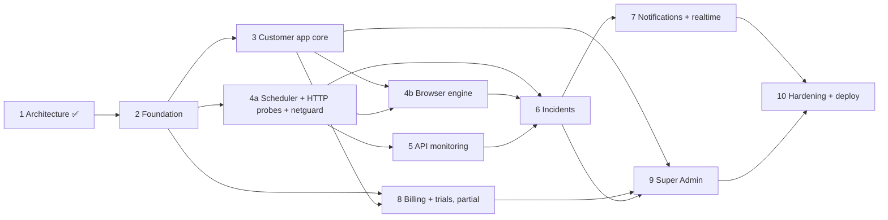

# Development Roadmap

> Last updated 2026-11-13. A phase is **complete only when its exit criteria are verified**, not when its code exists.

## Dependency graph

The critical path is 2 → 3 → 4a → 4b → 6 → 7 → 10. Billing (8) can run in parallel with 4–7 once 3 lands. **Nothing goes to the public internet before the Phase 4a egress isolation and SSRF suite pass**, because that is the biggest risk (R1).

## Phases

### Phase 1: Architecture ✅ (2026-11-13)
- **Delivered:** ARCHITECTURE, DATABASE_SCHEMA, API_DOCUMENTATION, SECURITY, DEPLOYMENT, and this roadmap. The Prisma schema (85 tables), SQL layer (partitions, RLS, partial uniques, hash-chained audit, grants, admin views), and the Docker dev infrastructure are also in place.
- **Verified:** the schema validates, migrations and the SQL layer apply cleanly to Docker Postgres 16, `prisma migrate diff` shows no drift, and `tests/invariants.sql` passes 11 assertion groups (duplicate domains, incident grouping, RLS, write-only secrets, audit tamper detection, admin privacy, worker context, break-glass).

### Phase 2: Foundation — implemented (2026-11-13), verification results below
- **Delivered:**
  - pnpm + Turborepo monorepo and strict TypeScript 5.9.
  - Packages: `@wim/crypto`, `@wim/logger`, `@wim/core` (RBAC catalog and escalation policy, typed settings registry), `@wim/contracts` (Zod schemas and DTOs), `@wim/email` (SMTP, Resend and SES adapters plus branded templates), `@wim/db` (Prisma 7 client, `withMember`, `withTenant`, `withUser` and `withSystem` helpers).
  - Apps: NestJS 12 `apps/api` on Fastify, `apps/worker-notify` (BullMQ email worker that issues tokens), and the Next.js `apps/web` and `apps/admin` shells.
  - Features: authentication, sessions, email verification, password recovery, TOTP 2FA with recovery codes and a delayed lost-device reset, organizations, invitations, roles and custom roles, tenant isolation at the API and database levels, envelope encryption with the key ring held outside the database, database-backed settings with hot reload, and the hash-chained audit trail.
  - Super Admin: login with mandatory TOTP, aggregate overview, customer metadata, audit viewer with chain verification, and audited settings.
  - Supporting work: a migration, `sql/060_identity.sql`, the admin CLI and a CI workflow.
- **Exit criteria (from Phase 1)**, with results run against Docker Postgres 16, Redis 7.4 and Mailpit:
  - The E2E flow register → verify (real email) → login → create org → invite → accept passes (`orgs-rbac.test.ts`, `harness.inviteAndAccept`).
  - An IDOR matrix covers every org-scoped route and is discovered automatically from Nest metadata (`tenant-isolation.test.ts`).
  - The log-redaction test passes (`logger.test.ts`).
  - Session revocation takes effect on the next request (`auth.test.ts`).
- **Verification results (final run, 2026-11-13, Docker Postgres 16.6 / Redis 7.4 / Mailpit):**
  - `pnpm turbo run typecheck`: 18/18 tasks passed. A clean forced `turbo run build` passed 10/10, including the production builds of web and admin.
  - Unit tests: 43/43 passed (crypto 20, core 13, email 8, logger 2).
  - Integration tests, `apps/api`: 70/70 passed (auth 15, mfa 13, orgs-rbac 13, tenant-isolation 14, admin 11, encryption 4).
  - E2E, Playwright, against the **production** builds with the nonce CSP: 3/3 passed.
  - Browser check: no CSP violations; the 2FA QR code renders.
  - Phase 1 invariants: pass on `wim` and `wim_test`.
  - `prisma migrate diff`: empty.
- **Known gaps carried forward:** ESLint is not configured, and the CI workflow has not been executed. The admin overview shows 0 workers, because heartbeats arrive with the Phase 4 workers. `GET /me/invitations` has no shared contract type.

### Phase 3: Website registration, verification and SDK — implemented (2026-11-13), results below
- **Delivered (backend):** `@wim/core` domain identity (PSL, IDNA, aliases, reserved names), tokens, site keys, trial decision, SDK config schema and installation state; `@wim/netguard` (SSRF-safe DNS + HTTP); `@wim/test-fixtures` (real DNS + HTTP fixture servers); `apps/worker-http` (verification, installation checks, transfers, claim sweep); `@wim/sdk` (browser SDK v1.0.0); `apps/ingest` (SDK delivery, config, heartbeats, telemetry); API website, verification, SDK and transfer routes; Super Admin website statistics and transfer review; migration `phase3_websites`; `sql/070_websites.sql`; new role `wim_ingest`; transfer emails.
- **Results (final run, Docker Postgres 16.6 / Redis 7.4 / Mailpit):**
  - Clean forced build: 15/15 tasks. Typecheck: 27/27 tasks.
  - Unit tests: 141/141 (core 59, netguard 49, crypto 20, email 8, sdk 3, logger 2).
  - Integration tests: 118/118 (Phase 2: 70; Phase 3: websites 25, sdk-installation 16, transfers-admin 7).
  - E2E (Playwright, production builds): 5/5 (Phase 2: 3; Phase 3: 2). The Phase 3 test uses the real verification worker with fixture DNS/HTTP servers and loads the real SDK in Chromium on the customer domain.
  - Phase 1 invariants: pass on `wim` and `wim_test`. `prisma migrate diff`: empty.
  - Responsive check: no horizontal overflow at 1366 px or 375 px (screenshots in `.playwright-mcp/phase3-*`).
- **Known gaps carried forward:** periodic re-verification of verified claims (LAPSED) and network-level egress isolation (Phase 4); SDK `Origin` is forgeable by non-browser clients, so telemetry is never ownership proof; the admin decision UI shows org names but no per-customer detail page yet (Phase 9).

### Phase 4: Monitoring engine — plan in [PHASE4_PLAN.md](PHASE4_PLAN.md)

**4A Network isolation and ownership revalidation — implemented (2026-11-13).**
- Delivered: `apps/egress-gateway`; netguard gateway client (capability tokens, gateway DNS, `safeFetch(egress)`), IPv6 allow-list, browser guards; verification worker routed through the gateway (mandatory in production); isolation environment and probes (`infra/security/`); production Dockerfiles for the gateway and browser runner; ownership revalidation (policy in `@wim/core`, worker, queue, sweep, emails, API and customer UI); migration `phase4a_revalidation`.
- Results (Docker Postgres 16.6 / Redis 7.4 / Mailpit):
  - Network isolation proof: 83/83 checks pass, 0 violations.
  - Unit tests: 196/196 (core 81, netguard 56, gateway 26, crypto 20, email 8, sdk 3, logger 2).
  - Integration tests: 127/127 (Phase 2–3 suites now run through the real gateway, plus 9 revalidation tests).
  - E2E: 5/5, with the verification worker routed through the gateway.
  - Type-check: 29/29. Phase 1 invariants pass on both databases. No Prisma drift. Gateway image builds and refuses test allowances in production.
- Found and fixed: Node `BlockList` matches IPv4-mapped IPv6 against IPv4 rules (test allowance bypass; IPv6 rules now separate); `::/96` IPv4-compatible addresses weren't denied (IPv6 is now an allow-list); the engine could open `file:` URLs (guarded navigation); the browser container had been given the signing secret in the test topology (removed; asserted).

**4B Scheduler and queue infrastructure — implemented (2026-11-13).**
- Delivered: `apps/scheduler` (leaderless), `@wim/queue` (queue registry and policies, execution runtime with lifecycle, eligibility re-check, semaphores, retries, DLQ, replay, usage accounting, heartbeats), scheduling policy in `@wim/core`, migration `phase4b_scheduler` + `sql/080_scheduler.sql`, customer monitoring endpoints (status, pause/resume, cancel), admin monitoring health / dead letters / replay, scheduler Dockerfile, scheduler in the isolation proof.
- Results (Docker Postgres 16.6 / Redis 7.4):
  - Unit tests: 241/241 (core 112, netguard 56, gateway 26, crypto 20, queue 14, email 8, sdk 3, logger 2).
  - Integration tests: 156/156 across 12 files (new: scheduler 24, monitoring API 5).
  - E2E: 5/5; the gateway logged 3 attributed ALLOWED decisions, which confirms verification traffic used it.
  - Isolation: 101 checks, 0 violations.
  - Type-check 33/33, build 18/18, invariants pass (wim, wim_test), no Prisma drift.
- Operational run on the dev Docker stack: 2 scheduler instances → 36 scheduled executions, 0 duplicates; worker SIGKILL → recovered (attempt 2); Redis container restart and deletion of all queue keys → re-enqueued from PostgreSQL; transient failures → dead letter after 3 attempts → admin replay → succeeded; graceful worker shutdown → handed back, completed elsewhere without consuming an attempt; scheduler container smoke-tested as non-root on a read-only filesystem.
- Found and fixed: concurrent schedule creation by parallel instances (sync lock + skip duplicates); non-hermetic test isolation against other suites; customer URL hosts in failure text (now stripped); `prisma generate` race between build and type-check.

**4C HTTP availability engine — implemented (2026-11-13).**
- Delivered: gateway-only HTTP probe (`@wim/netguard`), HTTP policy in `@wim/core` (config, evaluation, failure classes, incident state machine, uptime), `@wim/incidents` (incident store + outbox), HTTP engine in `worker-http` (target resolution, canary, circuit, idempotent persistence), outbox relay and partition maintenance in the scheduler, monitoring emails and in-app notifications in `worker-notify`, customer monitoring/incident APIs, admin HTTP aggregates, the controlled fault website and test PKI (`@wim/test-fixtures`), gateway host binding and timing headers; migrations `phase4c_http_monitoring`, `phase4c_interval_default`, `sql/090`.
- Results (Docker Postgres 16.6 / Redis 7.4 / Mailpit):
  - Unit tests: 272/272 (core 143, netguard 56, gateway 26, crypto 20, queue 14, email 8, sdk 3, logger 2).
  - Integration tests: 180/180 across 14 files (new: HTTP engine 17, HTTP API and notifications 7).
  - E2E: 5/5.
  - Isolation: 106 checks, 0 violations.
  - Type-check 35/35, build 19/19, invariants pass on both databases, no Prisma drift.
- Operational run on the Docker dev stack: scheduler → job → worker → gateway (attributed decisions) → persisted results with real timings; outage → incident on the 2nd failure → one email; worker SIGKILL and restart → no window lost; Redis restart → history intact, no duplicates; gateway stopped → inconclusive results, no customer incident, operator metric; recovery → auto-resolved after 2 passes → one recovery email; production-mode gateway → real DNS/TLS measurements for a public site, a public name resolving to loopback refused; browser and deep-scan executions: 0.
- Found and fixed: Node `http.request` ignores `createConnection` with `agent: false`, and would have resolved DNS locally; Node 25 segfaults when a socket is destroyed before the TLS socket wrapping it (destroy order now innermost-first); the Phase 1 `t1_interval_sec` default of 300 would have silently slowed configured websites to 5-minute checks; a notify-worker TDZ bug; `partitions.*` were not executable by the worker role.

**4D Browser monitoring — implemented (2026-11-13).**
- **Inspection finding fixed first:** `check_results` only enforced `(execution_id, checked_at)`, so a second result for the same execution with another timestamp was accepted. A non-partitioned `execution_results` ledger and a trigger now make one logical result per execution a database rule (invariant 1b).
- **Delivered:**
  - `apps/browser-runner`: one sandboxed Chromium per execution, a gateway proxy from its own configuration, a hard kill timer.
  - `apps/worker-browser`: the trusted control plane, covering navigation and readiness, diagnostics, error grouping, viewports, synthetic performance, masked screenshots in private S3, and idempotent persistence, incidents and usage.
  - `@wim/storage`: an S3 SigV4 client.
  - Browser policy in `@wim/core` and the generic incident state machine.
  - Gateway: a per-execution connection budget.
  - Customer browser API and signed screenshot links; admin aggregates.
  - The browser fault website in the test fixtures.
  - The seccomp profile; runner and `worker-browser` Dockerfiles.
  - Isolation suite extended with the real runner, plus a CI job.
  - `docker-compose.browser-ops.yml`.
  - Migration `phase4d_browser` and `sql/100`.
- **Results:** see the Phase 4D report in the changelog for exact counts.
- **Found and fixed:**
  - The gateway's plain-HTTP path used the connect timeout as the response timeout, so slow responses got 504.
  - The 4A isolation gateway logged at `warn`, so the "nothing internal ALLOWED" check was vacuous; it now logs at `info` and asserts it saw allowed decisions.
  - Cancellation latency depended on lease length (up to 20 s); it is now 5 s or less.
  - Excluded results were persisted as "down".
  - Partition triggers saw the partition name, not the parent's.
  - OpenSSL 3.0 compatibility in the test PKI.

**4E Deep website scanning — implemented (2026-11-13).**
- **Delivered:**
  - `apps/worker-deepscan`: bounded, resumable crawler on the 4B runtime, as the new narrow `wim_scanner` role. Every request goes through the gateway with per-hop, host-bound capabilities.
  - Discovery: robots.txt, nested sitemaps, crawl, and optional browser-assisted SPA discovery through the 4D runner.
  - Static HTML analysis covering SEO, structure and automated accessibility checks.
  - Grouped findings with history, and incidents per finding group.
  - Comparison with the previous complete scan.
  - Entitlements and cost limits; usage, including failed-attempt overhead.
  - Customer API with pause, cancel, history, pages, findings and usage; admin aggregates.
  - Migrations `phase4e_*` and `sql/110`; the `worker-deepscan` Dockerfile; `docker-compose.deepscan-ops.yml`.
  - Isolation suite extended with the crawler.
- **Results:** see the Phase 4E entry in the changelog for exact counts.
- **Found and fixed:**
  - Phase 1 crawl defaults (25 pages, depth 3) silently capped every plan.
  - Gateway death mid-request produced false broken pages (found in the Docker run).
  - A scan that reached no page was "complete".
  - Partial scans reported PASSED.
  - `wim_app` could write `usage_counters`.
  - Sitemap entries cut at the size limit were used.
  - Large sitemaps inserted row by row.
  - Redirecting URLs were analysed as pages.
  - The comparison counted resolved accessibility findings as new.
- **Release checklist (still open):** DEPLOYMENT.md §20. All five Phase 4D blockers remain open.

**Customer monitoring dashboard — delivered early (2026-11-14) under a mistaken "4F" label; it is approved-4G scope (partial).** See PHASE4_PLAN.md §12–§14 for the reconciliation.
- **Delivered:**
  - Customer monitoring overview (per-website health with reasons, coverage-aware).
  - Website tabs: availability analytics (uptime, coverage, downtime, response-time and status charts, check history with details), browser monitoring (history with filters, execution detail, on-demand screenshots), deep scans (status, findings with filters, scan history, scan detail with discovered pages and comparison against any scan, finding detail), and monitoring settings (HTTP, browser and deep scan, entitlement explanations, per-tier intervals).
  - Incidents (filters, cursor pagination, detail with timeline, occurrences linked to results, delivery summary, acknowledgement).
  - Unified history, a notification centre and per-channel preferences, and usage and plan limits.
  - Live updates via an authenticated change feed; an admin monitoring-operations page.
  - Backend: 13 new or extended endpoints, `sql/120`, migration `phase4f_dashboard`, worker-notify channel and event routing.
- **Results:** see the Phase 4F entry in the changelog for exact counts.
- **Found and fixed:** see the changelog. All release blockers remain open (DEPLOYMENT.md §21).

**4F Component detection, safe functional tests, responsive matrix — implemented (2026-11-14), approved scope.**
- **Delivered:**
  - Component detection inside the existing Tier B browser check: 17 types, structural identity, deduplication, inventory and history, and removal after two complete runs.
  - Opt-in safe functional tests: search, navigation, non-submitting form validation, and safe buttons, behind a destructive-action deny-list and a network guard that aborts every non-GET request.
  - A responsive matrix over 6 viewports (landscape phone added): clipped content, overlapping, covered and off-screen controls, and navigation state including a mobile-menu probe.
  - A `functional` incident class.
  - API for components and history, and functional and responsive rows on the execution detail; minimal UI.
  - Migration `phase4f_components`, `sql/130`.
- **Results:** see the changelog.

**4G** (performance thresholds and trends, rollups, the remaining dashboard views): **implemented and verified locally (2026-11-14)** — PHASE4_PLAN.md §16; production blockers remain open (DEPLOYMENT.md §23).

**4H** (worker health, self-alerts, usage accounting, admin monitoring configuration, hardening): **implemented and verified locally (2026-11-15)** — PHASE4_PLAN.md §17, OPERATIONS_RUNBOOK.md. Production blockers 1–9 remain open (DEPLOYMENT.md §24); the platform is **not** production-ready.

### Phase 5: API monitoring
- **Scope:** endpoint CRUD, write-only credentials, host authorization (verified domain, host verification, allowlist), the assertion DSL (status, time, JSONPath, schema, headers), OAuth2 client-credentials token caching, redaction, API analytics.
- **Exit criteria:** no Authorization or secret values appear in any DB column, log line, or queue payload (scanner test). Non-GET requests to third-party hosts require acknowledgement.

### Phase 6: Incident management
- **Scope:** the signal contract, fingerprinting (per category), rules with defaults and overrides, threshold, flap and recovery logic, reopen windows, escalation, maintenance suppression, the transactional outbox, the incident UI (list, filters, timeline, occurrences, comments, transitions), and the health score.
- **Exit criteria:** 20 failures in 10 minutes produce 1 incident with 20 occurrences. Recovery requires K passes. A recurrence inside the window reopens the incident. A flapping simulation produces a single flapping alert. Property tests on the fingerprint normalizer.

### Phase 7: Notifications and realtime
- **Scope:** the `realtime` gateway, the event relay, the sound manager (gesture-armed, per-severity, mute), the badge and acknowledgement, the email channel (React Email templates, provider adapter, bounce webhooks, suppression), preferences, digests, quiet hours, delivery logs, delivery-failure surfacing.
- **Exit criteria:** a critical incident reaches an open dashboard in under 3 s at p95, and email arrives in Mailpit. A provider outage results in retries, then a DLQ entry, then an admin system alert.

### Phase 8: Billing and trials
- **Scope:** plans, price versions and entitlements (with the admin API from Phase 9's foundation), the entitlement resolver and guards, the trial activation policy, the domain ledger, hashed abuse signals and risk score, the `PaymentGateway` interface with Stripe and Razorpay adapters, checkout, webhooks (raw-body signature check, idempotency, out-of-order guard), the subscription state machine, grace periods, dunning, invoices, downgrade selection flow, and a daily reconciliation job.
- **Exit criteria:** webhook spoofing and replay tests are rejected. Delete account → new account → same domain → no trial. Upgrade, downgrade, cancel and failed-payment E2E pass in Stripe test mode and Razorpay test mode. Entitlement changes in admin apply without a redeploy (under 60 s).
- **Status (2026-11-15): implemented, locally verified, NOT complete** — design and details in [BILLING.md](BILLING.md). Ships with `billing.enabled = false`.
  - **Delivered:** subscription state machine with out-of-order guard, grace periods and dunning schedule (`@wim/core`); entitlement resolver (subscription → trial plan → free plan → platform defaults, plus overrides) inside `loadOrgContexts`, identical behaviour while billing is disabled; `@wim/billing` (PaymentGateway interface, Stripe and Razorpay REST adapters without SDKs, raw-body signature verification, idempotent transactional webhook processing, daily reconciliation in the scheduler); customer billing API and Billing page; Super Admin plans/prices/entitlements/overrides/gateway API and Plans + Payment gateways pages; example plans (B2) in the seed; `sql/180_billing.sql` (no Prisma migration needed).
  - **Exit criteria:** webhook spoofing and replay rejected ✅ (unit + integration). Delete account → new account → same domain → no trial ✅ (integration). Entitlement changes apply without a redeploy ✅ (read on every resolution; asserted on the next resolution). **Stripe / Razorpay test-mode E2E ❌ not run** — no test keys; gateways were exercised only through local HTTP fakes.
  - **Not done:** dunning reminder emails, customer portal links, refunds/credit notes, invoice PDFs, hashed abuse signals / risk score at checkout, the downgrade website-selection flow, final GST invoicing (B4b).

### Phase 9: Super Admin
- **Scope:** the `admin` app on a separate origin, admin auth with mandatory 2FA, admin RBAC, platform overview, customers, websites and domains (ledger, transfers, blocks, duplicate attempts), plans, engine config, health-score config, gateway config (write-only secrets), notification config and templates, platform settings and flags with hot reload, audit and security viewers with chain verification, break-glass (dual approval and customer consent), worker and queue dashboards with DLQ actions.
- **Exit criteria:** the admin privacy test (no endpoint returns customer content) is automated, along with the DB-role test from Phase 1. Every admin mutation produces an audit entry (contract test across all routes).

### Phase 10: Hardening and deployment
- **Scope:** production compose, Nginx, TLS, PgBouncer, backups (pgBackRest or wal-g) with a restore drill, the observability stack, load tests (scheduler, ingest, browser fleet), a full security test pass, dependency and image scanning, reports (CSV and PDF), data export and deletion workflows, and the final documentation pass.
- **Exit criteria:** a restore drill completes from backup to a working staging environment, timed and documented. All security suites pass. Load targets from ARCHITECTURE §6 are met on the reference VPS.

## Decisions that need product or business input

Resolved on 2026-11-13 (see ARCHITECTURE D-21): B1 name **SiteSentinel** (provisional, configurable) with environment-based URLs;
B3 **no card** for the 30-day trial, starting at first verified website; B4 GST + international tax architecture, provider
configuration later; B5 provider-independent email, Resend first, SES possible; B6 Mumbai (`ap-south-1`) first,
region-independent configuration. Still open:

| # | Decision | Needed by | Default assumed so far |
|---|---|---|---|
| B2 | Actual plan prices and limits per tier (monthly and annual) | Phase 8 | Seeded as editable examples, clearly marked |
| B4b | GSTIN, place-of-supply rules, international tax provider (Stripe Tax?) | Phase 8 | `billing.tax.mode = GATEWAY`, 18 % GST setting |
| B7 | Default domain policy `ROOT_EXCLUSIVE` vs `SUBDOMAIN_INDEPENDENT` | Phase 3 | `ROOT_EXCLUSIVE` |
| B8 | Legal review of the domain-ledger retention disclosure (SECURITY.md draft) | Before launch | Draft text provided |
| B9 | Production domain names (app / admin / api / cdn) and sender domain DNS (SPF/DKIM/DMARC) | Before staging | `localhost` in development |

