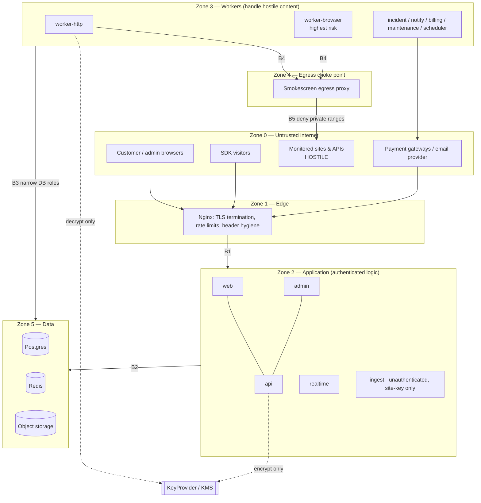

# Security

> Status: **Phase 1 — Proposed, pending review** · Last updated 2026-11-13
>
> Scope: threat model, security controls, and the security testing plan. Architectural context: [ARCHITECTURE.md](ARCHITECTURE.md). Decision IDs (`D-xx`) and risk IDs (`R-xx`) refer to that document.

Security principle for this platform: **every monitored website is hostile, every customer is potentially malicious, and every admin is potentially compromised.** Controls are layered so that no single bug yields cross-tenant access, internal-network access, or plaintext secrets.

---

## Table of contents

1. [Assets](#1-assets)
2. [Actors](#2-actors)
3. [Trust boundaries](#3-trust-boundaries)
4. [STRIDE threat model per component](#4-stride-threat-model-per-component)
5. [SSRF and egress control](#5-ssrf-and-egress-control)
6. [Browser isolation](#6-browser-isolation)
7. [Authentication](#7-authentication)
8. [Authorization and tenant isolation](#8-authorization-and-tenant-isolation)
9. [CSRF](#9-csrf)
10. [XSS and hostile content handling](#10-xss-and-hostile-content-handling)
11. [HTTP security headers and CORS](#11-http-security-headers-and-cors)
12. [Encryption and key management](#12-encryption-and-key-management)
13. [Secret redaction and logging](#13-secret-redaction-and-logging)
14. [Payment webhook security](#14-payment-webhook-security)
15. [SDK and ingest abuse](#15-sdk-and-ingest-abuse)
16. [File upload validation](#16-file-upload-validation)
17. [Audit log tamper evidence](#17-audit-log-tamper-evidence)
18. [Privacy](#18-privacy)
19. [Admin privacy and break-glass](#19-admin-privacy-and-break-glass)
20. [Dependencies and supply chain](#20-dependencies-and-supply-chain)
21. [Security testing plan](#21-security-testing-plan)
22. [Incident response and vulnerability disclosure](#22-incident-response-and-vulnerability-disclosure)

---

## 1. Assets

| Asset | Sensitivity | Where it lives |
|---|---|---|
| Customer credentials for monitored APIs and authenticated pages | **Critical** | `api_credentials`, `auth_recipes` (AES-256-GCM ciphertext, org DEK) |
| Payment gateway secrets, SMTP passwords, webhook secrets | **Critical** | `payment_gateway_configs`, `platform_settings` (platform DEK) |
| KEK / key material, HMAC pepper | **Critical** | KeyProvider (file/env on VPS, KMS in cloud). **Never in the DB.** |
| User passwords, sessions, 2FA secrets, reset tokens | **Critical** | Argon2id hashes; SHA-256 token hashes; TOTP secret encrypted |
| Internal network (DB, Redis, metadata service, Docker host) | **Critical** | Private networks; must be unreachable from monitoring traffic |
| Customer monitoring data (results, screenshots, HAR, SDK events, response samples) | High (may contain PII) | Postgres partitions, object storage |
| Incident data and comments | High | Postgres |
| Subscription and billing state | High (integrity) | Postgres (source of truth for entitlements, D-14) |
| Domain registry and trial ledger | Medium (integrity) | Postgres |
| Audit log | High (integrity) | Append-only table + object-locked anchors |
| Platform reputation (not becoming a DDoS/scan proxy) | High | Rate limits, verification gates |

## 2. Actors

| Actor | Capabilities | Primary concerns |
|---|---|---|
| **Anonymous internet** | Reach public endpoints: app login and registration, ingest, CDN, webhooks | Credential stuffing, registration spam, ingest flooding, webhook spoofing, scanning |
| **Customer user** (legitimate) | Authenticated, member of one or more orgs with a role | Accidental over-privilege; session theft via XSS |
| **Malicious customer** | Full control of their own org config: URLs, headers, test steps, selectors, SDK payloads | **SSRF**, cross-tenant access (IDOR), using workers as a proxy or scanner, entitlement bypass, trial abuse, stored XSS via names and config |
| **Compromised / malicious monitored website** | Controls everything a browser worker receives: HTML, JS, redirects, DNS, TLS, response sizes | Browser exploitation, SSRF via redirects/subresources/DNS rebinding, resource exhaustion, stored XSS via scraped content (console messages, titles, error text) |
| **SDK visitor** | Can read the public site key and forge telemetry | Data poisoning, quota exhaustion, injecting XSS payloads into error messages |
| **Super Admin** (legitimate) | Admin app with strict RBAC | Over-access to customer content (prohibited, §19) |
| **Insider / compromised admin** | Valid admin credentials or DB access | Data exfiltration, audit tampering, silent trial resets, privilege escalation |
| **Compromised worker** | Code execution inside a worker container (e.g. via a Chromium exploit) | Lateral movement to the DB, Redis, other tenants' jobs, KEK; pivot to the internal network |

## 3. Trust boundaries



| Boundary | Crossing | Enforcement |
|---|---|---|
| B1 | Internet → app | TLS 1.2+, Nginx rate limits, body limits, session auth, CSRF, input validation (Zod) |
| B2 | App → data | Per-service DB roles, RLS, tenant-scoped Prisma client, Redis ACLs |
| B3 | Workers → data | `wim_worker` role (no access to auth tables, admin settings or gateway secrets); the browser worker writes results through a narrow role with INSERT on result tables only |
| B4 | Workers → egress | Docker network topology: monitoring workers have **no default route** except the proxy |
| B5 | Egress → internet | Smokescreen deny ranges, DNS pin, port allowlist (80, 443, and customer-declared ports ≥ 1024 on verified hosts only) |

---

## 4. STRIDE threat model per component

Legend: **S**poofing, **T**ampering, **R**epudiation, **I**nformation disclosure, **D**enial of service, **E**levation of privilege.

### 4.1 web (customer Next.js app)

| STRIDE | Threat | Impact | Control | Verification |
|---|---|---|---|---|
| S | Session cookie theft via XSS | Account takeover | httpOnly + Secure + SameSite=Lax cookies, CSP with nonces, no tokens in JS-readable storage | E2E: `document.cookie` lacks the session; CSP header test |
| T | Stored XSS from website names, incident details, scraped console messages | Session riding, data theft | React escaping, ban on `dangerouslySetInnerHTML` (lint rule), hostile-content rendering rules (§10) | XSS payload corpus in fixture site → assert no script execution in dashboard |
| I | Server components leaking another tenant's data via a shared cache | Cross-tenant disclosure | No shared fetch cache for authenticated data (`cache: 'no-store'`); per-request API calls with the user's session | Integration test with two orgs |
| D | Expensive analytics queries | Slow app | Range clamping, rollup tables, API rate limits | Load test |
| E | Client-side-only feature gating | Plan bypass | Backend entitlement guards (§8) | API tests call gated endpoints directly |

### 4.2 admin (Super Admin app)

| STRIDE | Threat | Impact | Control | Verification |
|---|---|---|---|---|
| S | Admin credential phishing or stuffing | Platform compromise | Separate origin, mandatory TOTP or WebAuthn, optional IP allowlist, aggressive lockout, login alerting | Auth tests; lockout test |
| T | Unaudited config changes | Hidden sabotage | Every mutation is audited in the same transaction (hash chain) | Test: config change without an audit row is impossible (DB trigger) |
| R | Admin denies actions | No accountability | Hash-chained audit log + external anchors | Chain verification job |
| I | Access to customer content | Privacy breach | `wim_admin` DB role with views only; break-glass (§19) | Grant test: `wim_admin` `SELECT` on ciphertext/result tables fails |
| E | Customer session used on admin origin | Admin access | Separate cookie name, separate `admin_users` table, origin-bound cookies | Test: customer cookie rejected by admin API |

### 4.3 api (NestJS)

| STRIDE | Threat | Impact | Control | Verification |
|---|---|---|---|---|
| S | Forged session tokens | Impersonation | 256-bit random opaque tokens, stored as SHA-256, constant-time comparison | Unit tests |
| T | Mass assignment (`orgId`, `role`, `planId` in body) | Privilege escalation | Strict Zod DTOs (`.strict()`), `orgId` from route + membership only | Contract tests with extra fields → 400 |
| T | SQL injection | Data breach | Prisma parameterization; raw SQL only through `Prisma.sql` tagged templates; lint rule against `$queryRawUnsafe` | SAST (CodeQL), lint |
| R | Missing trail for sensitive actions | Disputes | Audit interceptor on annotated routes | Test per sensitive route |
| I | IDOR on child resources | Cross-tenant disclosure | Compound `(id, orgId)` lookups, RLS, 404 on foreign IDs | IDOR matrix (§21) |
| I | Verbose errors | Info leakage | Global exception filter: generic messages and correlation ID; stack traces never sent | Test 500 response shape |
| D | Login and registration flooding | Availability, spam | Nginx + Redis rate limits, CAPTCHA after thresholds (configurable) | Rate-limit tests |
| E | Entitlement bypass via race (create 2 websites concurrently at limit) | Plan bypass | Count check inside a SERIALIZABLE transaction or with `SELECT … FOR UPDATE` on the org usage row | Concurrency test |

### 4.4 realtime (Socket.IO)

| STRIDE | Threat | Impact | Control | Verification |
|---|---|---|---|---|
| S | Cross-site WebSocket hijacking | Event leakage | Origin check against the app origin + session cookie auth on handshake | Test with a foreign Origin |
| I | Joining another org's room | Cross-tenant events | Server-side room join only after membership verification; clients cannot request room names | Test: emit `join` for a foreign org → ignored |
| I | Revoked user keeps receiving events | Leakage | On session revoke or membership removal, publish `session:revoked` → disconnect sockets | Test |
| D | Connection floods | Exhaustion | Per-IP connection limits at Nginx, max sockets per user, ping timeout | Load test |

### 4.5 ingest (SDK telemetry)

| STRIDE | Threat | Impact | Control | Verification |
|---|---|---|---|---|
| S | Forged telemetry with a public site key | Data poisoning, false incidents | Rate limits per key/IP, Origin plausibility flags, SDK signals need multi-session thresholds before incident creation | Test: flood from a single IP doesn't create an incident |
| T | Malicious payloads (XSS in error messages) | Stored XSS | Zod schema, length caps, server-side masking, rendering rules (§10) | XSS corpus |
| D | Quota exhaustion / huge bodies | Cost, outage | 64 KB body cap at Nginx and app, monthly quota, Redis Stream max length (`MAXLEN ~`), shed load with 429 | Load test |
| I | Enumerating site keys → learning domains | Minor disclosure | Uniform response for unknown and inactive keys; keys are random 128-bit | Test |

### 4.6 scheduler

| STRIDE | Threat | Impact | Control | Verification |
|---|---|---|---|---|
| T | Customer sets an interval below plan minimum | Resource abuse | Interval validated at API and clamped at enqueue against resolved entitlements | Unit tests |
| D | Split-brain double scheduling | Duplicate load | Redis leader lock + `pg_try_advisory_lock` + jobId dedupe + `UNIQUE(schedule_id, slot)` | Chaos test: two schedulers |
| D | Scheduler stall | Missed checks | Lag metric + alert (> 60 s) | Alert test |

### 4.7 worker-http (T1 probes, API checks)

| STRIDE | Threat | Impact | Control | Verification |
|---|---|---|---|---|
| E/I | **SSRF** to internal services or metadata | Internal compromise, credential theft | netguard (resolve → validate → pin) + egress proxy + network isolation (§5) | SSRF corpus (§21.1) |
| I | Leaking a decrypted credential into logs or results | Secret exposure | Logger redaction, header allowlist for stored responses, redaction of response samples | Log-scan test with canary secrets |
| D | Slowloris, huge or compressed bombs | Worker exhaustion | Connect/TTFB/total timeouts, 2 MB cap, decompression ratio cap (100:1), max redirects 10 | Fixture site with bombs |
| E | Abuse as a scanner against third parties | Reputation, legal | Host authorization (C8), per-host global rate limit, verified ownership | Test: unverified host → rejected |

### 4.8 worker-browser (Playwright)

| STRIDE | Threat | Impact | Control | Verification |
|---|---|---|---|---|
| E | Chromium exploit → container code execution | Lateral movement | Sandbox on, seccomp, non-root, cap drop ALL, read-only rootfs, no-new-privileges, network isolation, no secrets in env, narrow DB role, recycling (§6) | Container config tests (`docker inspect` assertions in CI) |
| E/I | SSRF via subresources, WebSockets, WebRTC, service workers, redirects | Internal access | Proxy-only egress, Chromium flags, schemes blocked (§5.6) | Fixture pages attempting each vector |
| I | Cross-tenant state leakage (cookies, cache, storage) | Data leak | Fresh `BrowserContext` per job, no persistent profile, context closed in `finally`, browser recycled | Test: job B cannot see job A's cookie |
| D | Infinite loops, memory bombs, popups, crawl traps | Worker exhaustion | Job timeouts, memory cgroup, popup auto-close, trap detection, pids limit | Fixture traps |
| T | Destructive actions on customer sites | Customer harm | Click deny-list, mutation-request blocking, approval for journeys (ARCHITECTURE §9.3) | Fixture site with "Delete" button + POST endpoint |
| I | Malicious downloads | Malware on disk | `acceptDownloads: false`, tmpfs, downloads dir not mounted | Fixture download link |

### 4.9 Egress proxy (Smokescreen)

| STRIDE | Threat | Impact | Control | Verification |
|---|---|---|---|---|
| E | Proxy misconfiguration allows private ranges | SSRF | Deny list in config is version-controlled; CI test boots the proxy and probes the deny list | `tests/security/ssrf` against the real proxy |
| S | Other containers using the proxy | Uncontrolled egress | Proxy listens only on the `egress` network; per-client role via mTLS or source network | Network test |
| D | Proxy as a bottleneck | Monitoring outage | Horizontal replicas; metrics on connection counts and denies | Load test |

### 4.10 PostgreSQL

| STRIDE | Threat | Impact | Control | Verification |
|---|---|---|---|---|
| E | App role bypassing RLS | Cross-tenant | App roles are not table owners and have no `BYPASSRLS`; `FORCE ROW LEVEL SECURITY` | Integration test: query without context returns 0 rows |
| T | Audit log modification | Lost accountability | `REVOKE UPDATE, DELETE` on `audit_logs` from all app roles; trigger blocks updates; hash chain | Test: UPDATE fails |
| I | Backup theft | Mass breach | Backups encrypted (pgBackRest repo cipher / wal-g libsodium), restricted bucket, secrets ciphertext only | Restore drill checks |
| D | Write storms | Outage | Partitioning, batching, connection pooling | Load test |

### 4.11 Redis

| STRIDE | Threat | Impact | Control | Verification |
|---|---|---|---|---|
| T | Job injection (forged queue payloads) | Arbitrary checks, cross-tenant jobs | Redis on the private network only, ACL users per service, payload Zod validation in consumers, workers re-load config from the DB by ID instead of trusting payload contents | Consumer tests with forged payloads |
| I | Secrets in job payloads | Exposure | **No secrets in payloads**: workers fetch and decrypt credentials themselves | Payload schema review + test |
| D | Memory exhaustion | Queue loss | `maxmemory` alerting, `noeviction`, Stream `MAXLEN` | Monitoring |

### 4.12 Object storage

| STRIDE | Threat | Impact | Control | Verification |
|---|---|---|---|---|
| I | Public bucket / guessable keys | Screenshot leakage | Private bucket, block public access, presigned URLs (5 min TTL) issued after authz, keys prefixed `orgs/{orgId}/` with random IDs | Test: unsigned GET → 403 |
| T | Overwriting artifacts | Evidence tampering | Write credentials only on workers; audit anchors bucket with object lock (compliance mode) | Config check |

### 4.13 Payment webhooks

| STRIDE | Threat | Impact | Control | Verification |
|---|---|---|---|---|
| S | Spoofed "payment succeeded" | Free subscriptions | Signature verification on the raw body (§14) | Spoofing tests |
| T | Replay of an old valid event | State rollback | Timestamp tolerance (5 min, Stripe), `UNIQUE(gateway, event_id)`, object-version comparison | Replay test |
| D | Webhook floods | Queue backlog | Rate limit at Nginx; cheap signature check before enqueue | Load test |

### 4.14 Email

| STRIDE | Threat | Impact | Control | Verification |
|---|---|---|---|---|
| S | Phishing using our domain | Reputation | SPF, DKIM, DMARC `p=reject` | DNS check in deploy checklist |
| T | Header injection / HTML injection via incident titles or site names | Phishing content in our emails | Templating with escaping (React Email), CRLF stripping in headers, no customer-controlled links except their own verified domains, shown as text | Template tests with payloads |
| I | Alert emails leaking diagnostics | Data exposure to wrong recipients | Recipients must be verified (confirmation link) before receiving alerts; emails contain summaries + a link, not raw diagnostics | Test |
| D | Mail bombing via invitations or resets | Abuse | Per-user and per-target rate limits | Test |

---

## 5. SSRF and egress control

SSRF is the platform's highest-severity risk (R1). The design uses **defense in depth**: any one layer can fail without exposure.

### 5.1 Layers

1. **Input validation** (API): URL parsed with the WHATWG URL parser; `http`/`https` only; host canonicalized; IP-literal hosts rejected for website registration; ports restricted.
2. **Host authorization**: checks only run against verified identities or allowlisted API hosts (ARCHITECTURE C8, G9).
3. **netguard (in-process, worker-http)**: resolve → validate every resolved address → pin the connection to the validated IP → re-validate on every redirect hop.
4. **Egress proxy (Smokescreen)**: independently re-resolves, validates, and connects. Workers cannot bypass it because…
5. **Network isolation**: monitoring containers are attached **only** to the `egress` network (plus a narrow data path). They have no default route to the internet, the Docker host, or the metadata service.
6. **Cloud hardening**: IMDSv2 required with hop limit 1 (AWS), metadata concealment (GCP), host firewall dropping `169.254.169.254` from container bridges.

### 5.2 Deny list (applies to every resolved address, IPv4 and IPv6)

**IPv4**

| Range | Reason |
|---|---|
| `0.0.0.0/8` | "This network"; `0.0.0.0` reaches localhost on Linux |
| `10.0.0.0/8` | RFC 1918 private |
| `100.64.0.0/10` | Carrier-grade NAT (RFC 6598) |
| `127.0.0.0/8` | Loopback |
| `169.254.0.0/16` | Link-local, **includes cloud metadata `169.254.169.254`** and ECS `169.254.170.2` |
| `172.16.0.0/12` | RFC 1918 private (includes default Docker bridges) |
| `192.0.0.0/24` | IETF protocol assignments |
| `192.0.2.0/24` | TEST-NET-1 |
| `192.88.99.0/24` | Deprecated 6to4 relay anycast |
| `192.168.0.0/16` | RFC 1918 private |
| `198.18.0.0/15` | Benchmarking |
| `198.51.100.0/24` | TEST-NET-2 |
| `203.0.113.0/24` | TEST-NET-3 |
| `224.0.0.0/4` | Multicast |
| `240.0.0.0/4` | Reserved, including `255.255.255.255` broadcast |

**IPv6**

| Range | Reason |
|---|---|
| `::/128` | Unspecified |
| `::1/128` | Loopback |
| `::ffff:0:0/96` | IPv4-mapped. **Extract the embedded IPv4 and evaluate it against the IPv4 list.** Deny if the embedded address is denied. |
| `::/96` (deprecated IPv4-compatible) | Deny |
| `64:ff9b::/96`, `64:ff9b:1::/48` | NAT64. Embedded IPv4 could be private, so deny by default. |
| `100::/64` | Discard-only |
| `2001::/23` | IETF protocol assignments (including Teredo `2001::/32`, which can embed IPv4) |
| `2001:db8::/32` | Documentation |
| `2002::/16` | 6to4. Embedded IPv4 is evaluated; deny if private; deny by default. |
| `fc00::/7` | Unique local (**includes AWS IMDS IPv6 `fd00:ec2::254`**) |
| `fe80::/10` | Link-local |
| `fec0::/10` | Deprecated site-local |
| `ff00::/8` | Multicast |

**Hostnames always denied** (before resolution): `localhost`, `*.localhost`, `metadata.google.internal`, `metadata.goog`, `metadata`, `instance-data`, `*.internal`, `*.local`, `*.localdomain`, `*.home.arpa`, any single-label name, and the platform's own internal service names (`api`, `postgres`, `redis`, …). Admin-managed extra deny entries are stored in `platform_settings.egress.denyHosts`.

**Port policy:** 80 and 443 by default. Other ports (≥ 1024 only, never 6379, 5432, 2375/2376, 10250, 9200, …) only for customer-declared URLs on verified hosts.

### 5.3 Encoding tricks

All of these must be normalized and rejected, and are part of the test corpus:

- Decimal (`http://2130706433/`), octal (`http://0177.0.0.1/`), hex (`http://0x7f.0.0.1/`, `http://0x7f000001/`), short forms (`http://127.1/`, `http://10.1/`), mixed (`http://0x7f.1/`)
- IPv6 forms: `http://[::1]/`, `http://[::ffff:127.0.0.1]/`, `http://[0:0:0:0:0:ffff:7f00:1]/`, zone IDs (`[fe80::1%25eth0]`)
- Trailing dot (`localhost.`), uppercase, IDN homographs, `@` credential confusion (`http://example.com@127.0.0.1/`), backslashes (`http:\\127.0.0.1`)
- Wildcard DNS services resolving to private IPs (`127.0.0.1.nip.io`, `*.localtest.me`)

**Rule:** never make decisions on the hostname string for IPs. Always parse with the WHATWG URL parser (which normalizes numeric IPv4 forms), then **decide on the resolved binary address** using `ipaddr.js`-style range checks after IPv4-mapped unwrapping.

### 5.4 DNS rebinding

- netguard resolves **once**, validates **all** returned A and AAAA records (if any is denied, the whole request is denied, which avoids "one public, one private" round-robin tricks), and passes the chosen IP to the socket via a custom `lookup`. The Host header and TLS SNI keep the original hostname.
- Smokescreen likewise resolves, validates, and dials the same address.
- There is no reuse of DNS results across jobs beyond TTL, but there is **no second resolution between check and connect**.
- Browser: Chromium's own resolver is not trusted. All browser traffic goes through the proxy (`--proxy-server`), and the proxy performs the resolution.

### 5.5 Redirects

- worker-http follows redirects **manually** (max 10). Each `Location` is resolved against the current URL and re-validated (scheme, host policy, DNS, IP). Only `http`/`https` schemes are allowed.
- Cross-host redirects to unverified hosts are followed for availability measurement only (result recorded), never with customer credentials attached: credentials are stripped on any host change.
- Browser redirects pass through the proxy, which validates each new connection.

### 5.6 Browser-specific egress controls

Launch configuration for `worker-browser` (Chromium):

```
--proxy-server=http://smokescreen:4750
--proxy-bypass-list=<-loopback>            # do NOT bypass proxy even for loopback
--disable-quic                              # QUIC/UDP would bypass the HTTP proxy
--force-webrtc-ip-handling-policy=disable_non_proxied_udp
--webrtc-ip-handling-policy=disable_non_proxied_udp
--disable-background-networking
--disable-component-update
--disable-sync
--no-pings
--disable-domain-reliability
--dns-prefetch-disable
--disable-extensions
--disable-default-apps
--mute-audio
```

Context options: `serviceWorkers: 'block'`, `acceptDownloads: false`, `permissions: []` (no geolocation, camera, notifications), `ignoreHTTPSErrors: false` (TLS errors are *results*), `javaScriptEnabled: true`, `bypassCSP: false`, and a fixed user agent suffix identifying the platform.

Request interception (`context.route('**/*')`) as an **additional** layer, not the primary one:

- Block schemes: `file:`, `ftp:`, `chrome:`, `chrome-extension:`, `devtools:`, `view-source:`, `data:` for top-level navigations, `filesystem:`, `blob:` for top-level navigations, `ws:`/`wss:` to non-verified hosts.
- Abort non-GET document and XHR mutations during SAFE tests (ARCHITECTURE §9.3).
- Cap requests per page (default 500) and total bytes per page (default 50 MB).

Popups and new pages are closed immediately unless part of an approved journey. `window.print`, `alert`, `confirm` and `prompt` dialogs are auto-dismissed.

The **PDF/report pool** runs with `--proxy-server` pointing at a non-routable address and has no egress network at all (D-19). Templates are rendered from internal HTML with `page.setContent()`, and all external requests are aborted.

---

## 6. Browser isolation

| Control | Setting |
|---|---|
| Image | `mcr.microsoft.com/playwright:<pinned version>-noble`, digest-pinned, rebuilt weekly for Chromium security updates |
| User | Non-root `pwuser` (UID ≥ 10000) |
| Sandbox | Chromium sandbox **enabled**. Use the Playwright-recommended seccomp profile (`seccomp_profile.json` allowing user namespaces) instead of `--no-sandbox`. |
| Capabilities | `cap_drop: [ALL]`, no `SYS_ADMIN` |
| Privileges | `security_opt: [no-new-privileges:true, seccomp=./seccomp/chromium.json]` |
| Filesystem | `read_only: true`; `tmpfs: /tmp (size=512m, noexec, nosuid)`, `/home/pwuser/.cache` tmpfs; no host mounts; no Docker socket |
| Resources | `mem_limit: 4g`, `memswap_limit: 4g`, `cpus: 2`, `pids_limit: 512`, `shm_size: 1g` (Chromium needs `/dev/shm`) |
| Network | Attached only to `egress` (proxy) and `workers` (Redis + DB via a narrow role). No published ports. |
| Secrets | No KEK in env. Credentials are fetched per job through a decrypt RPC on worker-http (or a dedicated `secrets-broker` in later phases), scoped to the job's `orgId` + credential ID, and held only in memory. |
| Lifecycle | Fresh `BrowserContext` per job; `Browser` recycled every 200 jobs or at RSS > 2.5 GB; the container is restarted daily by the orchestrator |
| Cleanup | `finally { await context.close() }`; watchdog kills browser processes exceeding the job timeout + 30 s |
| Detection | Alert on unexpected child processes, outbound connections not via the proxy (dropped by network; counter via iptables log), crash loops |

---

## 7. Authentication

### 7.1 Passwords

- **Argon2id** (`@node-rs/argon2`) with parameters `m = 64 MiB, t = 3, p = 1`. This exceeds the OWASP minimum (`m = 19 MiB, t = 2, p = 1`). Parameters are stored in the encoded hash, so they can be upgraded transparently on the next login (rehash-on-verify).
- Policy: minimum 12 characters, maximum 128; no composition rules; rejected if in a breached-password list (k-anonymity HIBP range API, fail-open with a log entry if unavailable) or contains the email local part.
- Constant-time verification; for unknown emails, a dummy hash is still verified to prevent user enumeration by timing.

### 7.2 Sessions (D-09)

- Token: 32 random bytes (base64url), sent as cookie `__Host-wim_sid` (`Secure; HttpOnly; SameSite=Lax; Path=/`; no Domain). The admin cookie is `__Host-wim_admin_sid` on the admin origin, `SameSite=Strict`.
- Stored as `SHA-256(token)` in `sessions` with user ID, created, last-seen, expiry, IP prefix, UA summary, and `mfa_verified_at`. Cached in Redis (60 s TTL) for fast lookup.
- Idle timeout 7 days (customer) and 30 minutes (admin). Absolute timeout 30 days (customer) and 12 hours (admin).
- **Rotation**: a new token on login, on 2FA completion, on privilege change (role change, org switch to owner actions), and on password change. All other sessions are revoked on password change or reset, and the user can see and revoke sessions in settings.
- Sensitive actions (change email or password, disable 2FA, delete org, billing changes, credential edits) require **re-authentication** within the last 10 minutes.

### 7.3 Lockout and rate limiting

| Target | Limit |
|---|---|
| Login per IP | 20 / 15 min (Nginx + Redis sliding window) |
| Login per account | 5 failures → exponential delay (30 s, 1 m, 5 m, 15 m…); 20 failures in 24 h → temporary lock + email notification to the user. No permanent lock (avoids lockout DoS). |
| Registration per IP | 5 / hour; CAPTCHA (Turnstile/hCaptcha, configurable) after 2 |
| Password reset requests | 3 / hour per account, 10 / hour per IP; uniform response regardless of account existence |
| 2FA attempts | 5 / 15 min per session |

Failed attempts are written to `auth_events` (security events) and surfaced in the admin security view.

### 7.4 Email verification and password reset

- Verification and reset tokens: 32 random bytes, stored as SHA-256, **single-use**, bound to the user and purpose. Verification expires in 24 h, reset in **30 minutes**.
- Reset completion revokes all sessions and sends a notification email. Reset tokens are invalidated if the password or email changes.
- Unverified accounts cannot add websites or receive alerts.
- Email change requires confirmation from the **new** address and notifies the **old** one.

### 7.5 Two-factor authentication

- TOTP (RFC 6238, SHA-1, 6 digits, 30 s, ±1 step), the secret encrypted with the platform DEK, and replay prevention (last-used step stored).
- 10 single-use **recovery codes** (Argon2id-hashed), shown once.
- Optional per org: "require 2FA for all members".
- **Admin accounts: 2FA mandatory.** WebAuthn/passkeys supported (and recommended) for admins via `@simplewebauthn/server`. Admin 2FA cannot be disabled through the UI.

---

## 8. Authorization and tenant isolation

Layers (detailed in ARCHITECTURE §16):

1. **Session guard** → authenticated user.
2. **Org guard** → `orgId` from route, membership required, role loaded.
3. **Permission guard** → `@RequirePermission('website:update')`, mapping role → permissions in `core/rbac`.
4. **Entitlement guard** → `@RequiresEntitlement(key, usageFn)`, quota checked transactionally.
5. **Tenant-scoped Prisma extension** → injects `orgId` into every query on tenant models; throws without a context.
6. **Postgres RLS** with `FORCE ROW LEVEL SECURITY`, `SET LOCAL app.current_org_id`.
7. **404 for foreign IDs** (no existence oracle).

Admin authorization is completely separate (`admin_users`, admin RBAC, `wim_admin` DB role).

### 8.1 IDOR test matrix

An automated suite (`tests/security/idor.spec.ts`):

1. Seed org A (users with each role) and org B, each with every resource type (website, page, API endpoint, credential, incident, comment, notification channel, invoice, report, test case, transfer, member, invitation).
2. Enumerate all routes from the NestJS route metadata (so new routes are automatically included).
3. For each route × method × role in A, substitute B's resource IDs → expect **404** (or 403 for role-insufficient within one's own org).
4. Route coverage assertion: the test fails if any route has neither a test mapping nor an explicit `@PublicRoute()` / `@NoResourceId()` annotation.

---

## 9. CSRF

- The primary defense is a **same-origin architecture** plus `SameSite=Lax` cookies (customer) or `Strict` (admin).
- In addition, all state-changing requests (POST, PUT, PATCH, DELETE) require:
  - A custom header `X-WIM-CSRF` equal to a per-session CSRF token (synchronizer token, provided via `GET /api/v1/auth/csrf`, held in memory by the client), **and**
  - An `Origin` (or `Referer`) header matching the app origin. Missing Origin on a state-changing request is rejected.
- GET handlers are strictly side-effect free (lint and review rule; email-link actions like verification go through a POST confirmation page).
- Webhook endpoints are exempt from CSRF (they're authenticated by signature) and live under `/webhooks/*` with no cookie handling.

---

## 10. XSS and hostile content handling

**Principle: everything originating from a monitored website, from the SDK, or from customer-entered free text is hostile**, including page titles, console messages, error stacks, URLs, response excerpts, header values, DOM snippets, and component labels.

- React auto-escaping everywhere. ESLint rule `react/no-danger` set to error; the one allowed use (rendering our own sanitized Markdown for incident comments) goes through `DOMPurify` with a strict allowlist and is wrapped in a single audited component.
- Hostile strings are displayed in monospace "evidence" blocks: escaped, length-capped (2 KB with "show more"), control characters made visible, bidi override characters (`U+202A–U+202E`, `U+2066–U+2069`) stripped to prevent spoofing.
- **URLs** from monitored content are rendered as text by default. When rendered as links: only `http`/`https`, `rel="noopener noreferrer nofollow"`, `target="_blank"`, and an interstitial for non-customer domains. `javascript:` and `data:` URLs are never linkable.
- Screenshots are served as `image/png` from presigned URLs with `Content-Disposition: inline`, `X-Content-Type-Options: nosniff`, never as HTML. HAR and trace files are served as downloads (`attachment`), never rendered inline.
- Charts and tooltips use text nodes, never `innerHTML`.
- **CSP** (nonce-based, set by Next.js middleware per request):

```
default-src 'self';
script-src 'self' 'nonce-{random}' 'strict-dynamic';
style-src 'self' 'nonce-{random}';
img-src 'self' data: https://{object-storage-host};
connect-src 'self' wss://app.{domain} https://{payment-js-hosts};
frame-src https://js.stripe.com https://api.razorpay.com;
font-src 'self';
object-src 'none';
base-uri 'none';
form-action 'self';
frame-ancestors 'none';
upgrade-insecure-requests;
report-to csp-endpoint;
```

- `Trusted Types` (`require-trusted-types-for 'script'`) is enabled in report-only mode first and then enforced once third-party scripts are validated.

---

## 11. HTTP security headers and CORS

### 11.1 Headers (set at Nginx, with CSP from the app)

| Header | Value |
|---|---|
| `Strict-Transport-Security` | `max-age=63072000; includeSubDomains; preload` |
| `X-Content-Type-Options` | `nosniff` |
| `X-Frame-Options` | `DENY` (also `frame-ancestors 'none'`) |
| `Referrer-Policy` | `strict-origin-when-cross-origin` (app), `no-referrer` (admin) |
| `Permissions-Policy` | `camera=(), microphone=(), geolocation=(), payment=(self "https://js.stripe.com"), usb=(), interest-cohort=()` |
| `Cross-Origin-Opener-Policy` | `same-origin` |
| `Cross-Origin-Resource-Policy` | `same-origin` (app/admin), `cross-origin` (CDN `monitor.js`) |
| `Cache-Control` | `no-store` on all authenticated API responses |
| `Server` | version suppressed (`server_tokens off`) |

### 11.2 CORS per origin

| Origin / endpoint | Policy |
|---|---|
| `app.<domain>/api/*` | **No CORS**: same origin only. Preflights are rejected. |
| `admin.<domain>/api/*` | No CORS. |
| `ingest.<domain>/v1/events` | `Access-Control-Allow-Origin: *`, methods `POST, OPTIONS`, `Content-Type` only, **no credentials** (`Allow-Credentials` never set) |
| `ingest.<domain>/v1/config/*` | `*`, GET only, no credentials |
| `cdn.<domain>/monitor*.js` | `*` (allows SRI with `crossorigin="anonymous"`) |
| `/webhooks/*` | No CORS (server-to-server) |

---

## 12. Encryption and key management

### 12.1 In transit

TLS 1.2+ (1.3 preferred) at the edge. Internal service traffic is on private Docker networks. For multi-host deployments, internal traffic uses TLS (Postgres `sslmode=verify-full`, Redis TLS) or a WireGuard mesh between nodes.

### 12.2 At rest

- Disk / volume encryption (LUKS on VPS, provider-managed EBS/PD encryption in cloud).
- Backups encrypted client-side before upload (§DEPLOYMENT backups).
- **Application-level envelope encryption (D-11)** for secrets:

```
KEK (KeyProvider: file / env on VPS; AWS KMS / GCP KMS in cloud), versioned: kek_v1, kek_v2...
  └─ wraps → DEK per organization (org_keys: org_id, version, wrapped_dek, kek_version, created_at, status)
  └─ wraps → platform DEK (platform secrets: gateway keys, SMTP password, TOTP secrets)

Ciphertext format (bytea):  "W1" | kek_ver(u16) | dek_ver(u16) | iv(12) | tag(16) | ciphertext
AAD = "{table}:{column}:{row_id}:{org_id}"   -- binds ciphertext to its row; prevents copy-paste attacks
```

- AES-256-GCM via Node `crypto`, random 96-bit IVs. DEKs are cached in memory unwrapped for at most 5 minutes in the processes allowed to decrypt.
- **Encrypt-only vs decrypt access (D-12):** the API holds a *public-style* capability. In the KMS setup, the API IAM role has `kms:Encrypt`/`GenerateDataKey` only, and workers have `kms:Decrypt`. In the file setup, the API receives wrapped DEKs and a KEK used for wrapping only via a local `keyd` sidecar that refuses decrypt requests from the API's socket. Phase 2 starts with a simpler single KEK file with access restricted to the services that need it, and documents the hardening step.

### 12.3 Rotation

| Key | Rotation | Procedure |
|---|---|---|
| KEK | Annually or on suspicion | Add `kek_v{n+1}` → background job re-wraps all DEKs (cheap; secrets are not re-encrypted) → retire the old KEK after verification |
| Org DEK | On demand (admin action or customer request), or after a security event | Create a new DEK version → re-encrypt the org's secrets in a background job → mark the old DEK `RETIRED` → destroy it after 7 days |
| Platform DEK | Annually | Same as org DEK |
| HMAC pepper (abuse signals) | Rarely (it breaks matching) | Versioned pepper: new signals use v2, matching checks both versions until v1 signals expire (24 months) |
| Session secret / CSRF | N/A (random per session) | — |
| Gateway / SMTP secrets | Per provider policy | Admin replaces in UI → encrypted → hot reload (DEPLOYMENT runbook) |

### 12.4 Crypto-shredding

On org hard-delete, the org's DEK rows are destroyed. Any ciphertext that survives in backups becomes unrecoverable once the backups containing the DEK age out (backup retention 30 days, disclosed).

### 12.5 HMAC pepper for anti-abuse signals

`signal = HMAC-SHA256(pepper_v, normalize(value))`. The pepper lives in the KeyProvider and is **never stored in the database**, so a DB dump does not allow brute-forcing emails from hashes without also stealing the pepper.

---

## 13. Secret redaction and logging

- **pino** with central redaction paths (`packages/logger`): `req.headers.authorization`, `req.headers.cookie`, `res.headers["set-cookie"]`, `*.password`, `*.passwordHash`, `*.token`, `*.accessToken`, `*.refreshToken`, `*.secret`, `*.apiKey`, `*.clientSecret`, `*.credentials`, `*.privateKey`, `*.cardNumber`, `*.cvv`, `*.otp`, `*.totpSecret`, `*.webhookSecret`, `*.dek`, `*.kek`.
- Typed wrapper: secrets are held in a `Secret<T>` class whose `toJSON()` and `toString()` and `inspect` return `"[REDACTED]"`, so accidental logging of a decrypted credential prints nothing useful.
- Outbound HTTP logging (worker-http) logs method, host, path (without query), status, and timings. It never logs headers or bodies.
- Error tracking (Sentry, optional) uses the same scrubbing via `beforeSend`, with `sendDefaultPii: false`.
- **Canary test**: CI runs workers against a fixture API with a canary credential (`wim_canary_9f2c…`) and asserts the canary never appears in logs, DB result tables, Redis payloads, or object storage.
- Logs are retained 30 days, with access restricted to ops roles.

---

## 14. Payment webhook security

| Control | Stripe | Razorpay |
|---|---|---|
| Endpoint | `POST /webhooks/stripe` | `POST /webhooks/razorpay` |
| Raw body | Captured before JSON parsing (Nest raw-body option for these routes only) | Same |
| Signature | `Stripe-Signature` via `stripe.webhooks.constructEvent(raw, sig, secret)`, timestamp tolerance 300 s | `X-Razorpay-Signature` = HMAC-SHA256(raw body, webhook secret), constant-time compare (`crypto.timingSafeEqual`) |
| Idempotency | `UNIQUE(gateway, event_id)` on `payment_webhook_events`; duplicates return 200 without processing | `x-razorpay-event-id` header as event ID |
| Replay / ordering | Timestamp tolerance + compare object version (`created`, `current_period_end`) before applying | Compare `created_at` and entity state |
| Trust | Webhook payload is **re-fetched** from the gateway API for state-changing events (subscription, invoice) before applying | Same (fetch the entity by ID) |
| Network | Optional IP allowlist (published gateway IP ranges) at Nginx | Same |
| Response | 200 immediately after store; processing is async in worker-billing | Same |
| Failure | Signature failures logged as security events; > 10/hour alerts | Same |

Additional rules: checkout success redirects never grant entitlements; a daily **reconciliation job** compares active subscriptions with the gateway API and alerts on drift; webhook secrets are rotatable with overlap (two secrets accepted during rotation).

---

## 15. SDK and ingest abuse

- The site key is public by design and grants **only** `POST` telemetry for one website.
- Per site key: token bucket (default 50 req/s burst, 10 req/s sustained), monthly event quota from entitlements, and a hard daily cap. Per IP: 5 req/s. Over-limit requests get `429`, and the SDK circuit breaker stops sending.
- Payload: Zod schema, ≤ 64 KB, ≤ 50 events per batch, string fields capped (message 1 KB, stack 4 KB, URL 2 KB), unknown fields stripped.
- Server-side masking repeats SDK masking (emails, JWT-like strings, long digit runs, configured regexes).
- **Incident creation from SDK data** requires a distinct-session threshold (default ≥ 5 sessions with the same fingerprint within 10 minutes) and per-source rate caps, so a single attacker can't trigger an alert storm on a customer.
- `Origin` mismatch, sudden volume spikes, or many distinct origins per key flag the key; customers can rotate keys, and admins can disable them.
- `monitor.js` is served from a dedicated CDN host with SRI hashes published for each version, so a compromise of the app origin doesn't modify the SDK silently. Versions are immutable.

---

## 16. File upload validation

Applies to admin-uploaded logo and favicon (and future customer uploads):

- Allowed types: PNG, JPEG, WebP, ICO. Type is determined by **magic-byte sniffing** (`file-type`), not by extension or `Content-Type`.
- **SVG is disallowed** in v1 (script-capable). If later required: sanitize with DOMPurify (SVG profile) server-side, re-serialize, and serve with `Content-Security-Policy: default-src 'none'; style-src 'unsafe-inline'` and `Content-Type: image/svg+xml` from a separate origin.
- Max 512 KB (logo) and 64 KB (favicon); max dimensions 2048 × 2048.
- Re-encoded with `sharp` (strips metadata/EXIF, neutralizes polyglots); stored under a random key in object storage; served with `nosniff` and a correct `Content-Type`.
- Upload endpoints are rate limited and audited.

---

## 17. Audit log tamper evidence

### 17.1 Structure (D-16)

`audit_logs`: `id (bigserial)`, `stream` (`platform` | `org:{orgId}`), `seq` (per stream, gap-free), `occurred_at`, `actor_type` (`USER|ADMIN|SYSTEM|API`), `actor_id`, `action`, `target_type`, `target_id`, `org_id`, `ip_prefix`, `ua_hash`, `metadata jsonb` (redacted, no secrets), `prev_hash`, `hash`.

`hash = SHA-256(prev_hash ‖ canonical_json(stream, seq, occurred_at, actor, action, target, org_id, metadata))`

### 17.2 Write path

- Inserted in the **same transaction** as the change being audited (admin config changes, plan changes, trial resets, break-glass, role changes, credential changes, domain transfers).
- Sequence and `prev_hash` are obtained under a per-stream advisory lock, preventing forks in the chain.
- DB permissions: app roles have `INSERT` and `SELECT` only. A trigger raises an exception on `UPDATE`, `DELETE` and `TRUNCATE` for every role except the dedicated archival role used only by the retention job (which drops whole archived partitions after export).

### 17.3 Anchors and verification

- Daily at 00:15 UTC, `worker-maintenance` writes an **anchor** `{stream, last_seq, last_hash, count, date}` for each active stream into an object-storage bucket with **Object Lock (compliance mode, 2 years)**, and records it in `audit_anchors`.
- **Verification** (`pnpm audit:verify --stream platform --from <date>`, also exposed in the admin auditor view): recompute hashes sequentially, check `seq` contiguity, and compare to the locked anchors. Any mismatch raises a Critical security event.
- Verification runs weekly automatically and on demand.

---

## 18. Privacy

### 18.1 Principles

- **Data minimization**: SDK captures no form values, no cookies, no identifiers; API response samples are off by default; screenshots only on failure with a 7-day TTL.
- **PII masking**: masking in the SDK, at ingest, and before persisting browser diagnostics (emails, phone-like and card-like digit runs, JWT-like tokens, `?token=` style query parameters). Screenshot blurring of `input[type=password]`, `[data-wim-mask]`, and customer-configured selectors before capture (via injected CSS).
- **Retention**: per ARCHITECTURE §15, enforced by partition drops and purge jobs. Customers see effective retention in settings.
- **Tenant isolation**: §8.
- **Encryption**: §12.

### 18.2 Export and deletion

- **Export** (org owner): async job producing a ZIP (JSON + CSV) of org data: websites, configs (secrets excluded), incidents, rollups, audit history, invoices. Delivered via a presigned link valid for 24 h.
- **User deletion**: removes the user's personal data. If they're the sole owner of an org, ownership must be transferred or the org deleted first.
- **Org deletion**: 14-day soft-delete (monitoring stops immediately; cancellable) → hard purge: rows deleted, objects deleted, DEK destroyed (crypto-shredding). The domain registry and trial ledger are retained (§18.3). Backups age out within 30 days.

### 18.3 Domain ledger disclosure (draft text for the privacy policy and deletion dialog)

> **Domain registration records.** To prevent duplicate registrations and abuse of free trials, we keep a minimal record of each website domain that has been registered on our platform. This record contains only the domain name (for example, `example.com`), the dates it was first registered and verified, whether a free trial was used for it, and the number of times it has been registered. It does **not** contain your name, email address, payment details, or any monitoring data.
>
> We also keep one-way cryptographic fingerprints of certain sign-up signals (such as a normalized email address or a payment card fingerprint provided by our payment processor). These fingerprints cannot be reversed to reveal the original information and are deleted after 24 months.
>
> These records are kept after you delete your account, based on our legitimate interest in preventing fraud and abuse. If you believe a record is inaccurate, contact `{support_email}`.

The deletion confirmation dialog repeats the first paragraph and requires an explicit checkbox.

---

## 19. Admin privacy and break-glass

Summary of ARCHITECTURE §17 with the security controls:

- Admin APIs connect as `wim_admin`, which has `SELECT` on curated `admin_v_*` views and non-sensitive tables only. **No grants** on: `api_credentials`, `auth_recipes`, `sessions`, `user_secrets`, `org_keys`, result payload tables, `sdk_events`, `incident_occurrences.details`, `incident_comments`, `notification_channels.config`.
- Owner emails are masked in views. Unmasking requires a reason, which is audited, and is rate limited (20/day per admin).
- **Break-glass workflow:**
  1. Requesting admin submits org, scope (`diagnostics:read`), purpose, ticket reference, and duration (≤ 4 h).
  2. A **second** Super Admin approves (requester ≠ approver, enforced in the DB with a check constraint).
  3. If the org setting is `REQUIRE_CUSTOMER_CONSENT` (default), the org owner must approve via an in-app or email link.
  4. While active, dedicated endpoints using a separate `wim_breakglass` role (a narrowly scoped `SECURITY DEFINER` function filtering by the approved org and expiry) return **redacted** diagnostics. Credentials are never accessible, even in break-glass.
  5. Every read is audit-logged with the request ID. The customer sees the access in their audit history. Access expires automatically.
- Admin sessions: 30-minute idle timeout, 2FA mandatory, optional IP allowlist, new-device login alerts to all Super Admins.

---

## 20. Dependencies and supply chain

| Control | Implementation |
|---|---|
| Lockfile | `pnpm-lock.yaml` committed; CI uses `pnpm install --frozen-lockfile` |
| Install scripts | `pnpm` `onlyBuiltDependencies` allowlist (e.g. `@node-rs/argon2`, `sharp`, `prisma`, `esbuild`); others' lifecycle scripts blocked |
| Updates | Renovate: weekly grouped minor and patch updates, immediate security updates, a 3-day minimum release age for new versions (reduces exposure to hijacked releases) |
| Vulnerability scanning | `pnpm audit --audit-level=high` (CI gate), GitHub Dependabot alerts, **Trivy** on every built image (fail on HIGH/CRITICAL with a fix available), **CodeQL** for SAST |
| Secrets in code | **gitleaks** pre-commit hook + CI scan on every PR and on full history weekly |
| Base images | Pinned by digest (`node:22-bookworm-slim@sha256:…`, Playwright image by digest); rebuilt weekly; distroless where possible |
| SBOM | Syft generates CycloneDX SBOMs for each image; stored as build artifacts and attached to releases |
| Provenance | Images signed with **cosign** (keyless via GitHub OIDC); deploy step verifies the signature |
| CI hardening | Pinned action SHAs, least-privilege `GITHUB_TOKEN` permissions, OIDC to cloud (no long-lived cloud keys), protected branches with required reviews |
| SDK | Built reproducibly, versioned immutably, SRI hash published, size budget enforced in CI |

---

## 21. Security testing plan

All suites run in CI. "Gate" means a merge is blocked on failure.

### 21.1 SSRF corpus (`tests/security/ssrf/`) — Gate

A fixture DNS server (CoreDNS in compose) and fixture HTTP servers cover:

| Case | Expected |
|---|---|
| Every deny-listed range (§5.2): one address per range | Denied at netguard **and** at the proxy (tested independently) |
| Encodings (§5.3): decimal, octal, hex, short, IPv6-mapped, zone IDs, trailing dot, `@` confusion | Denied |
| Hostname → private IP (`internal.fixture` A 10.0.0.5) | Denied |
| Mixed A records (one public, one private) | Denied |
| DNS rebinding (TTL 0, first answer public, then 127.0.0.1) | Denied / connection pinned to the validated IP |
| Public redirect → `http://169.254.169.254/latest/meta-data/` | Redirect hop denied |
| Redirect to `file:///etc/passwd`, `gopher://`, `dict://` | Denied |
| Browser: page with ``, `fetch('http://127.0.0.1:6379')`, `new WebSocket('ws://redis:6379')`, WebRTC STUN to private IP, service worker registration, `<iframe src="file:///">`, meta-refresh to metadata, download link | All blocked; nothing reaches the fixture internal server (it asserts zero hits) |
| Port policy: `example.fixture:6379`, `:22`, `:5432` | Denied |
| Proxy bypass attempt: a worker container without the proxy env tries direct egress | No route (network test) |

### 21.2 IDOR / tenant isolation — Gate

The route-enumerated matrix from §8.1, plus RLS tests: queries without a context return zero rows, and cross-org context mismatch fails.

### 21.3 XSS — Gate

A payload corpus (OWASP XSS filter evasion cheatsheet subset + polyglots) injected via website names, page titles of fixture sites, console messages, JS error messages through the SDK, API response excerpts, incident comments, and email templates. A Playwright E2E test asserts no `alert`/dialog fires and no injected element exists in the dashboard, admin app, or emails (rendered HTML checked).

### 21.4 CSRF — Gate

State-changing requests without the CSRF header, with a wrong token, with a foreign Origin, or with no Origin → 403. Cross-site form POST from a fixture origin → rejected.

### 21.5 Authentication bypass — Gate

Expired, revoked and forged session tokens; reused reset tokens; reset token for user A used for user B; TOTP replay; skipping the 2FA step (calling APIs with a pre-MFA session); session fixation (token rotates on login); user enumeration timing check (statistical threshold); customer session on admin API.

### 21.6 Privilege escalation — Gate

VIEWER → MEMBER/ADMIN actions; MEMBER → billing; mass-assignment of `role`, `orgId`, `planId`, `isSuperAdmin`; inviting with a higher role than one's own; self-approval of break-glass; admin role escalation by non-Super-Admin.

### 21.7 API abuse and entitlements — Gate

Calling gated features without the entitlement; exceeding limits with concurrent requests; intervals below plan minimum; rate-limit verification.

### 21.8 Payment webhook spoofing — Gate

Unsigned, wrongly signed, signed-with-old-secret (after rotation window), replayed, timestamp-expired, and out-of-order events. Assert that subscription state is unchanged and that security events are recorded.

### 21.9 Secret exposure — Gate

gitleaks on the diff; the canary credential test (§13); grep of API responses for secret fields (contract tests assert credential endpoints only return `{ id, name, last4, updatedAt }`); assertion that the admin API never returns ciphertext.

### 21.10 Container and infrastructure — Gate

Assertions on compose / pod specs: browser workers non-root, read-only, cap drop ALL, seccomp set, no Docker socket, no published ports on internal services. Trivy image scan.

### 21.11 Periodic

- External penetration test before public launch and annually.
- DAST (OWASP ZAP baseline) against staging weekly.
- Audit chain verification weekly (§17.3).
- Backup restore drill monthly (DEPLOYMENT).

---

## 22. Incident response and vulnerability disclosure

### 22.1 Security incident response

| Phase | Actions |
|---|---|
| **Detect** | Alerts: auth anomalies, webhook signature failures, egress deny spikes, audit verification failure, unexpected processes in browser workers, admin new-device logins |
| **Triage** | On-call security owner classifies severity (SEV1: data breach or active exploitation; SEV2: exploitable vuln without evidence of exploitation; SEV3: low impact) within 1 h for SEV1 |
| **Contain** | Playbooks: revoke all sessions (single command), disable a compromised admin, rotate the KEK/DEKs and gateway or SMTP secrets (DEPLOYMENT runbooks), enable maintenance mode, scale browser workers to zero, block domains or site keys |
| **Eradicate / recover** | Patch, redeploy from signed images, restore from backup if integrity is in doubt (verify the audit chain) |
| **Notify** | Affected customers without undue delay. Regulators within 72 h where GDPR or the Indian DPDP Act applies. Status page update. |
| **Learn** | Blameless postmortem within 5 business days; tracked remediation items |

### 22.2 Vulnerability disclosure

- `https://<domain>/.well-known/security.txt` (RFC 9116) with contact `security@<domain>`, encryption key, policy URL, and expiry.
- Safe-harbor policy for good-faith research. Acknowledgement within 2 business days, triage within 5, fix targets: Critical 7 days, High 30 days, Medium 90 days.
- Out of scope: findings requiring a compromised device, volumetric DoS, social engineering, and reports from automated scanners without proof of impact.
- A hall of fame. A paid bug bounty is considered after launch.

---

## 23. Implementation status after Phase 2

Controls below are **implemented and covered by automated tests** against Docker Postgres, Redis and Mailpit
(`apps/api/test/integration`, `packages/*/test`, `packages/db/tests/invariants.sql`) unless marked otherwise.

| Area | Control | Test evidence |
|---|---|---|
| Passwords | Argon2id m=64 MiB t=3 p=1, rehash-on-login, dummy verification for unknown emails, length from settings, common/email-derived rejection, HIBP k-anonymity check (fail-open) | `crypto.test.ts`, `auth.test.ts` (HIBP disabled in tests: no network) |
| Enumeration | Register and forgot-password always 202; one generic login error; "account exists" email to the owner | `auth.test.ts` |
| Sessions | 256-bit opaque token in `HttpOnly; SameSite=Lax` cookie (`__Host-` + `Secure` when `COOKIE_SECURE`), SHA-256 in DB, 60 s Redis cache purged on revocation, idle + absolute timeouts, rotation on 2FA completion / password change / 2FA change | `auth.test.ts`, `mfa.test.ts` (stolen-cookie tests) |
| Revocation | Logout, revoke one, revoke others, revoke-all on password reset, effective on the next request | `auth.test.ts` |
| CSRF / origin | `Origin` (or `Referer`) must equal `APP_URL` / `ADMIN_URL` for non-GET; `X-CSRF-Token` must equal the session's secret | `auth.test.ts`, `admin.test.ts` |
| Brute force | Per-IP limit, per-account progressive delay keyed by HMAC(email), 24 h lock + email, per-session 2FA attempt limit, admin lock after 10 failures | `auth.test.ts`, `mfa.test.ts`, `admin.test.ts` |
| MFA | RFC 6238 TOTP (vectors tested), ±1 step, replay protection via `totp_last_used_step` with a conditional update, secret encrypted with a platform DEK and row-bound AAD, 10 single-use recovery codes (60-bit, keyed HMAC), regenerate invalidates old set | `crypto.test.ts`, `mfa.test.ts` |
| Account recovery | Password reset (single-use, 30 min, keeps 2FA); lost-2FA reset with password + email confirmation + 72 h wait + notice with no-login cancel link; notices for every security change | `auth.test.ts`, `mfa.test.ts` |
| Authorization | API guard (membership + permission) **and** database entry function `app_enter_org` (D-23); escalation policy in `@wim/core`; DB triggers for owner-only permissions, same-org roles, last-owner | `core.test.ts`, `orgs-rbac.test.ts`, `tenant-isolation.test.ts` |
| Tenant isolation | RLS on every tenant table + user-scoped RLS; 404 for foreign ids; **route discovery test** runs every `:orgId` route as a non-member and fails if any returns anything but 404 — new modules are covered automatically; public-route allow-list test | `tenant-isolation.test.ts` |
| Admin privacy | `wim_admin` role has no grant on users, members, invitations, incidents, credentials, sessions, results; aggregate views only; masked owner email; separate cookie/origin/session table; single-step password + TOTP | `admin.test.ts`, `invariants.sql` |
| Encryption | Envelope encryption, KEKs + pepper outside the DB (test scans every table for key material), AAD row binding, KEK rotation via re-wrap, per-org DEKs under tenant RLS | `crypto.test.ts`, `encryption.test.ts` |
| Audit | Hash-chained append-only log for auth events (user stream), org changes (org stream), admin actions (platform stream, with mandatory reason for settings); chain verification endpoint; RLS so customers read only their streams | all integration suites, `invariants.sql` |
| Secrets in logs/queues | Central pino redaction + free-text scrubbing; email jobs carry ids only, tokens issued by the worker | `logger.test.ts`, D-26 |
| Headers | API: CSP `default-src 'none'`, `frame-ancestors 'none'`, nosniff, `Cache-Control: no-store`, HSTS when secure | manual check (curl) |

**Not yet implemented (scheduled):** WebAuthn for admins and the admin IP allow-list (Phase 9/10); org-level "require 2FA
for all members" (Phase 3); email-address change flow (Phase 3); user/org data export and hard deletion (Phase 10);
re-authentication window for destructive org actions (Phase 3 — password/code are already required for password change
and 2FA disable); KMS KeyProvider (Phase 10); ESLint/security lint rules in CI (Phase 3); CodeQL/Trivy (Phase 10).

---

## 24. Phase 3 controls (website registration, verification, SDK)

| Threat | Control | Test evidence |
|---|---|---|
| **Domain takeover / duplicate claims** | One live claim per identity (partial unique index) + `register_domain_claim()` under a per-registrable-domain advisory lock; ROOT_EXCLUSIVE namespace reservation needs DNS proof on the registrable domain | `websites.test.ts` (6 orgs racing → 1 claim; www/scheme variants; namespace) |
| **Squatting** | Unverified claims expire after 72 h (`domain.pendingClaimHours`), max 10 unverified per org | `websites.test.ts` (expiry frees domain; pending limit) |
| **Domain impersonation** | A responding site never verifies; exact token at the exact location (TXT name, `/.well-known/…` line, `<meta>` in `<head>`); all responding resolvers must agree | `websites.test.ts` (404 body, HTML echo, partial token, meta in body) |
| **Unauthorized verification** | `wim_app` cannot write claim/website status/ledger/trials (grants); only the worker's system context can verify; stale-token jobs fail | `websites.test.ts` (DB-level guard), `TOKEN_ROTATED` path |
| **Token brute force / replay** | 256-bit tokens; 10 checks per hour per website and 50 per token (then regenerate); regeneration invalidates the old proof immediately | `websites.test.ts` |
| **SSRF** | `packages/netguard`: deny private, loopback, link-local, CGNAT, documentation, multicast, reserved, IPv6 ULA/link-local/6to4/NAT64, IPv4-mapped, cloud metadata; any bad answer rejects the host; ports 80/443; no IP-literal URLs; size/time caps | `netguard.test.ts` (49), `websites.test.ts` (metadata IP never contacted; mixed answers) |
| **DNS rebinding** | Pinned connection to the validated address; every redirect re-resolved and re-validated; redirects restricted to the same website identity | `netguard.test.ts` and `websites.test.ts` with a real DNS server that flips answers |
| **Unauthorized ownership transfer** | Requester's own DNS proof + owner notification and contest + Super Admin approval with reason (`admin:transfers:decide`) + worker application; owner identity never revealed to the requester and vice versa; no data moves | `transfers-admin.test.ts` |
| **Cross-tenant access** | All website routes are org-scoped (`app_enter_org`), discovered by the Phase 2 route test; resource-level 404s | `tenant-isolation.test.ts` (now covers 42 org-scoped routes, discovered automatically), `sdk-installation.test.ts` (12 website routes as another org) |
| **Site-key abuse / SDK spoofing** | Keys are identifiers (`pk_` + 192 bits); ingest role has no table privileges; heartbeat requires verified website + live key + matching `Origin`; foreign origins recorded as `INVALID_CONFIGURATION`; uniform `204`; revocation within 15 s | `sdk-installation.test.ts` |
| **Replay of SDK traffic** | Page-load and per-event dedupe (Redis, 1 h) | `sdk-installation.test.ts` |
| **Rate-limit bypass** | Per-IP and per-key limits in Redis (shared across replicas); per-org limits on registration (20/h), transfers (5/day), install checks (10/h); `TRUST_PROXY` controls which IP is used | settings + tests |
| **Telemetry privacy** | SDK never reads form values, cookies, storage secrets, bodies, keystrokes (static test); server re-sanitises; per-type field allow-list; consent and GPC; pause | `sdk.test.ts`, `sdk-installation.test.ts` |
| **Super Admin privacy** | New admin views are aggregates/metadata; `wim_admin` still has no access to `sdk_events`, site keys, verification details or tokens | `transfers-admin.test.ts` |

**Known limitations (documented, scheduled):** a non-browser client can forge `Origin`, so SDK telemetry is labelled
client-reported and never used for ownership; network-level egress isolation for workers (Smokescreen) is Phase 4;
periodic re-verification of verified claims (LAPSED state) is Phase 4 with the scheduler; HTTPS certificate validity is
not required for file/meta verification (HTTP fallback is allowed only when HTTPS is unreachable).

---

## 25. Network isolation of the monitoring engine (Phase 4A)

Application-level checks (`@wim/netguard`) are **not** the boundary. The boundary is the network: monitoring
components have **no route** to anything except the egress gateway, and the gateway validates every destination
independently.

### 25.1 Topology

| Network | `internal` | Members | Purpose |
|---|---|---|---|
| `outbound` | no | **egress-gateway**, worker-notify, api (gateway APIs, S3) | The only internet route on the monitoring path is the gateway's |
| `http-egress` | yes | egress-gateway, worker-http (verification, revalidation, Tier A) | Workers reach the gateway, nothing else |
| `browser-egress` | yes | egress-gateway, **browser-runner** | Chromium reaches the gateway, nothing else |
| `browser-control` | yes | worker-browser, browser-runner | Playwright protocol between the job consumer and the browser |
| `data` | yes | postgres, redis, api, workers (**never** browser-runner, **never** egress-gateway) | State |

* **browser-runner** (Chromium behind `playwright run-server`) is on `browser-control` + `browser-egress` only: it
  cannot route to Postgres, Redis, the API, the Docker host, metadata or the internet — even if Chromium is
  compromised or launched without its proxy flag. It holds **no secrets**: the per-context capability token is
  minted by worker-browser. (This supersedes the Phase 1 sketch that put the browser worker on `data`; D-42.)
* **egress-gateway** is on `outbound` + the two `*-egress` networks; never on `data`.
* Internal networks have no default gateway, so UDP (QUIC, DNS, WebRTC, STUN) and direct TCP to anything outside
  the network are unroutable. Docker's embedded DNS doesn't resolve external names there; targets are resolved by
  the gateway with configured public resolvers, so service names (`redis`) never resolve as customer targets and
  container IPs (private) are denied anyway.

### 25.2 Egress gateway policy (`apps/egress-gateway`)

1. **Capability token required** — HMAC-signed `{org, website, execution, kind, exp ≤ 15 min}` as proxy Basic
   credentials (CONNECT, absolute-form HTTP) or Bearer (DNS API). Anonymous or forged → `407`/`401`.
2. **Ports 80/443 only** (`421`). **Hostnames only** — IP literals refused (`403 BLOCKED_HOST`).
3. **DNS resolved by the gateway**; the host is refused (`403 BLOCKED_ADDRESS`) if **any** A/AAAA answer is not
   public. IPv4: 0/8, 10/8, 100.64/10, 127/8, 169.254/16, 172.16/12, 192.0.0/24, 192.0.2/24, 192.88.99/24,
   192.168/16, 198.18/15, 198.51.100/24, 203.0.113/24, 224/4, 240/4, 255.255.255.255. IPv6: **allow-list** — only
   global unicast `2000::/3` minus 2001::/23 (incl. Teredo), 2001:db8::/32, 2002::/16, 64:ff9b::/96, 64:ff9b:1::/48,
   3fff::/20, 100::/64; IPv4-mapped/NAT64 forms always refused (so `::`, `::1`, `::/96`, `fc00::/7` incl.
   `fd00:ec2::254`, `fe80::/10`, `fec0::/10`, `ff00::/8` are all refused).
4. **Pinned connection** to the validated address — no second resolution, so rebinding between check and connect is
   impossible; every redirect is a new request and is re-resolved and re-validated.
5. Per-organization and global connection caps (`429`), bytes per tunnel, total and idle time limits, connect
   timeout. `X-Egress-Error` is stripped from upstream responses so a site can't forge a gateway decision.
6. **Fail closed**: resolver failure → `503`, unreachable gateway → `EGRESS_UNAVAILABLE`; workers classify these
   as service-side failures, never as the customer's site being down or ownership lost.
7. Every decision is logged as metadata (outcome, org, website, execution, host, port, pinned address, bytes, ms) —
   no content, headers or tokens.
8. Test allowances (`EGRESS_TEST_ALLOW_CIDRS`, `EGRESS_TEST_PORT_MAP`) exist for fixture networks only and the
   process **refuses to start** with them unless `NODE_ENV=test` (verified against the production image). IPv4-mapped
   addresses are refused even under a test allowance.

### 25.3 Browser hardening (applied by the browser engine, verified by the isolation tests)

`--disable-quic`, `--force-webrtc-ip-handling-policy=disable_non_proxied_udp`, `--no-pings`, background networking
and component updates off; `acceptDownloads: false`; service workers blocked; every engine navigation goes through
`guardedGoto` (http/https only — `file:`, `chrome:`, `data:`, `javascript:` refused); container read-only rootfs,
tmpfs, `cap_drop: ALL`, `no-new-privileges`, memory/CPU/pids limits, non-root user. Chromium's own sandbox is off
inside the container (Playwright default; enabling it needs a custom seccomp profile — tracked hardening item), so
the container plus network isolation is the boundary.

### 25.4 Proof (`infra/security/run-isolation-tests.sh`)

Builds the topology (`infra/security/isolation/docker-compose.yml`, fixed subnets, a fixture "internet" with
deliberately hostile DNS answers) and runs probes **inside** each container. Latest run: **83 checks, 0 violations**.

| From | Attempts (all must fail unless noted) |
|---|---|
| browser-runner | TCP to Postgres/Redis by IP and name; fixture site directly; gateway's other interface; 1.1.1.1:443; 8.8.8.8:53; metadata; `host.docker.internal` (the developer machine's published Postgres/Redis); Docker Desktop host IP; UDP DNS to public and fixture resolvers. **Allowed:** gateway:8080 only |
| Chromium via gateway | hostile DNS → Redis/Postgres/gateway itself/metadata/loopback; IP literals; service names; IPv6 loopback/ULA/IPv4-mapped AAAA; `[::1]`; mixed public+private answers; Docker host; redirects to Redis and metadata; DNS rebinding (alternating answers); in-page `fetch()` to internal targets (cross-checked against the gateway log); WebRTC UDP candidates; attachment download; `file:`/`chrome:`/`data:`/`javascript:` via the engine; web content navigating to `file:`. **Allowed:** the fixture site, and only the public answer of the rebinding name |
| Chromium **without** proxy | fixture site by IP, 1.1.1.1, Redis, metadata, Docker host, hostnames → all `ERR_ADDRESS_UNREACHABLE` / `ERR_NAME_NOT_RESOLVED` |
| worker | internet and fixture site directly (unreachable); via gateway: metadata, hostile DNS, redirect to Redis refused; DNS API refuses internal answers; anonymous gateway use refused. **Allowed:** Postgres/Redis (its job), the fixture site via the gateway |
| egress-gateway | TCP to Postgres, Redis, browser-control network — unreachable |
| gateway log | zero `ALLOWED` decisions to any address outside the fixture internet |

**Residual risks / next steps:** run the isolation suite in CI and against staging with real cloud networking;
production hosts add a host firewall permitting outbound traffic only from the gateway container (DEPLOYMENT.md);
Kubernetes migrations must express the same topology as NetworkPolicies (default-deny egress for worker and browser
pods) and be re-proven with the same probes.

## 26. Ownership revalidation (Phase 4A)

Verified claims are re-checked every 24 h (setting) with **their original method**, through the egress gateway, by
a dedicated queue with a global rate limit, lease-based sweeps (no duplicate enqueues) and a per-claim lock (manual
and scheduled checks never overlap). Outcomes: *succeeded*, *temporary failure* (DNS outage, unreachable site, 5xx —
retried after 30 min, never counted), *definitive failure* (record/file/tag gone, domain points elsewhere),
*service unavailable* (our gateway/resolvers — not counted, recorded in `system_health_logs`). Definitive failures
move the claim to FAILING (customer emailed, monitoring continues), then LAPSED after the grace period (monitoring
suspended, SDK heartbeats rejected, inherited subdomains follow), then RELEASED after the release period (ownership
lost: website archived, key revoked; trial ledger kept). Success at any point restores it. History rows and audit
entries never contain the verification token.

## 27. Scheduler and queue infrastructure (Phase 4B)

**Network.** `scheduler` sits on `data` only (Postgres, Redis). It has no egress or browser network, cannot reach the
gateway, and holds no egress signing secret — proven by the isolation suite (now 101 checks, 0 violations, incl. 18
scheduler probes). Execution consumers that need the internet (4C+) keep the 4A placement: `worker-http` on `data` +
`http-egress`; browser jobs are consumed by `worker-browser` (on `data` + `browser-control`), which drives the
isolated `browser-runner`. **Browser containers never consume queues and never join `data`.**

**Job payloads carry identifiers only** — `{v, executionId, windowStart}`, strict schema (unknown keys rejected).
No URLs, tenant ids, tokens, keys, cookies or configuration. Consumers resolve tenant, website, tier and target
exclusively from the `monitoring_executions` row and its website/claim/org rows, then:

| Check before execution | On failure |
|---|---|
| job type is `EXECUTE`; payload matches the strict schema; `jobId == executionId` | SECURITY — no retry, no replay |
| execution exists for `(id, windowStart)`; its tier belongs to this queue | SECURITY |
| the execution's org still owns the website | SECURITY |
| terminal / leased by another live worker | acknowledged as duplicate / re-delayed |
| website active, ownership not lapsed, org active, entitled, tier enabled, within website limit | SKIPPED (`INELIGIBLE`) |

Security rejections are recorded in `job_failures` with an **empty payload** (the untrusted payload is never stored)
and counted in `system_health_logs`. Workers can't be turned into URL fetchers: the handler receives ids, and
engines (4C+) build targets from the verified website and fetch only through the gateway with a per-execution
capability token (4A).

**Failure records and logs.** Error text is sanitised at the source: URLs (customer domains, query strings) become
`[url]`, opaque tokens ≥ 24 characters become `[redacted]`, max 300 characters. Redis only ever sees the failure
*category* (e.g. `TRANSIENT`), never the detail. Tested: verification tokens and site keys are absent from Redis,
`job_failures`, `monitoring_executions` and logs.

**Roles.** `wim_app` cannot write schedules, executions or dead letters (pause/cancel only through
`set_website_monitoring_paused()` / `request_execution_cancel()`, which check membership and `website:write` in the
database). `wim_admin` reads aggregate views (`admin_v_execution_health`, `admin_v_schedule_health`), has **no**
access to `monitoring_executions`/`monitoring_schedules`, and may only set the replay-request columns of
`job_failures`.

**Replay** (`admin:monitoring:replay`, audited, single-use) only *requests*; the scheduler re-checks current ownership,
org status, entitlement and tier switch and refuses otherwise (recorded as `REPLAY_REFUSED` with the reason).
Security failures are never replayable.

**Fairness as abuse protection.** A tenant registering thousands of websites is bounded by `monitoring.maxWebsites`
(plan/override), per-cycle quota, outstanding-job cap and per-org concurrency; the platform by global outstanding
cap (backpressure) and per-queue global concurrency.

## 28. HTTP availability engine (Phase 4C)

* **Targets come from trusted rows only.** The job carries an execution id; the engine loads the verified website's
  canonical origin and the customer's *path* (never a host or URL — enforced by the config schema). Stored origins with
  IP literals, credentials, other schemes or ports are refused before any request.
* **Egress:** exclusively through the gateway; the probe has no direct mode, and the worker container has no route
  (isolation suite: 106 checks, incl. the probe itself reaching the fixture site, and being refused for hostile DNS →
  Redis, metadata, redirect to Redis, and a token bound to another host). Each hop gets its own short-lived (120 s)
  capability bound to org, website, execution **and host**: a leaked token can't be used against another host; tampered
  claims break the signature. The gateway can't validate org↔website ownership (it has no database access by design);
  that binding is enforced by the worker from trusted rows.
* **Requests:** GET or HEAD only, no cookies, no `Authorization`, no customer credentials, fixed user agent; forms are
  never submitted and no other method exists. No request is sent over a TLS connection that fails validation.
* **Resource limits:** per-check timeout (≤ 60 s), redirect limit (≤ 10), bounded body read (default 1 MiB, ≤ 4× on the
  wire), plus the gateway's byte/time caps and per-org connection caps.
* **Persistence and privacy:** no bodies, cookies, `Set-Cookie`, authorization or proxy headers; allow-listed response
  headers; URLs sanitised (query values `[redacted]`); error text stored as codes. Tested: session query values, cookie
  values, response bodies, gateway credentials and the signing secret appear in neither results, outbox events nor logs.
  Retention: raw results 62 days (partition drop), incidents kept.
* **Failure classes:** customer target failures vs `GATEWAY_INFRASTRUCTURE` (gateway unreachable/rate-limited, or a
  connection-level failure while the egress canary also fails) vs `SECURITY_REJECTION` (gateway refused *our* credential:
  recorded inconclusive, dead-lettered, never retried) vs `INVALID_CONFIGURATION` (destination refused by policy — the
  customer is told monitoring is blocked; it never counts as downtime).
* **Roles:** `wim_app` can't write results, occurrences, outbox or create incidents; customers read their own rows under
  RLS (cross-tenant reads tested → 404). Admin sees `admin_v_http_check_health` aggregates only (no org, website, URL or
  address — tested).

## 29. Browser monitoring (Phase 4D)

**Topology.** `worker-browser` (control plane: `data` + `browser-control`, + `http-egress` for the classification probe)
drives `browser-runner` (`browser-control` + `browser-egress` only). The runner has no route to Postgres, Redis, S3, the
API, the Docker host or the internet, and holds no secrets — no `EGRESS_TOKEN_SECRET`, no database/Redis/S3 credentials
(asserted by the isolation suite). Chromium's only path out is the gateway.

**Authorization.** For each execution the worker mints a capability `{org, website, execution, kind: browser,
expiry = job timeout + 30 s}` and passes it in the session request; the runner launches Chromium with that token as
proxy credentials and the gateway URL **from its own configuration** (callers can't set the proxy or flags — requests
with extra keys are rejected). The token isn't host-bound (third-party subresources); the gateway refuses every
non-public destination exactly as in 4A, attributes each decision to the execution, and caps connections per execution
(`EGRESS_MAX_CONNECTIONS_PER_EXECUTION`, default 300). Forged, expired and wrongly signed tokens: nothing reaches the
site (tested).

**Bypass paths closed** (each tested, in-process and in the container): QUIC off; WebRTC limited to proxied UDP (none);
service workers blocked; downloads refused (`DOWNLOAD_REFUSED`); no extensions; non-http(s) navigations refused by the
engine and `file:` from page content blocked; **loopback is proxied** (`<-loopback>`), so `127.0.0.1`, `localhost`,
`[::1]`, `*.localhost` and the runner's own IP reach the gateway and are refused — the runner's control API is
unreachable from page content; WebSockets go through the gateway like any request (internal targets refused);
Chromium without the proxy reaches nothing (network).

**Chromium sandbox: ENABLED.** Profile `infra/security/seccomp/chromium.json` = Docker's default profile + unconditional
`clone`, `unshare`, `chroot` (Chromium's user/PID/network-namespace sandbox without `CAP_SYS_ADMIN`). Container:
non-root (`pwuser`), read-only rootfs, tmpfs `/tmp` and `/dev/shm`, `cap_drop: ALL`, `no-new-privileges`, 1 GiB, 1 CPU,
512 pids. Evidence (isolation suite, inside the running container): no `--no-sandbox`; every renderer in its own user
namespace; renderers carry two seccomp filters (container + Chromium's seccomp-BPF) vs one for the browser process; all
Chromium processes non-root. With Docker's default profile the sandboxed launch fails (`SIGTRAP`), which is why the
profile is required. Residual: user-namespace creation is permitted inside this container only.

**Lifecycle.** One Chromium per execution; the runner kills it at the job budget even if the worker disappears; the
worker closes it on completion, cancellation (≤ 5 s) or shutdown; at most `RUNNER_MAX_SESSIONS` per runner.

**Data.** Never stored: bodies, cookies, form values, headers beyond the allow-list, query values (URLs sanitised),
other sites' pages (off-site redirects aren't screenshotted). Screenshots: failure-only by default, inputs, textareas,
selects, contenteditable, iframes and configured selectors masked before capture; private bucket (anonymous access 403,
tested); 5-minute HMAC links bound to artifact + organisation and re-checked under that organisation's RLS context
(tampered → 404, expired → 410, cross-tenant → 404, tested); `cache-control: private, no-store`, CSP `sandbox`. Admin
endpoints expose aggregates only and the admin role has no access to `artifacts` or browser result tables (tested).

**Not yet proven:** the staging/production network (cloud security groups, host firewall, orchestrator policies). The
isolation suite now runs in CI on a Linux Docker host (`.github/workflows/ci.yml`, job `isolation`), which proves the
Compose topology on Linux, not the deployed one — see DEPLOYMENT.md §19.

## 30. Deep website scanning (Phase 4E)

**Threat model.** A crawler fetches URLs that come from untrusted content (customer pages, sitemaps, robots.txt,
redirects). Every one of them is attacker-controllable. The controls below make sure none of them can steer the scanner
to a non-public destination, to another customer's site, to a state-changing route, or into unbounded work.

**Network.** `worker-deepscan` sits on `data` + `http-egress` only (+ `browser-control` if browser-assisted discovery is
offered); it has no direct route to the internet. Every request — robots, sitemaps, pages, resources, external links —
goes through the gateway as a CONNECT with a capability `{org, website, execution, kind: deepscan, h: host}`, minted
per hop. The gateway resolves the name itself and refuses private, loopback, link-local, metadata, CGNAT, multicast,
reserved and IPv4-mapped/ULA IPv6 answers, mixed answers, and non-approved ports, so DNS rebinding can't reach an
internal address (tested: alternating public/private answers, IPv4-mapped AAAA, private AAAA, metadata via DNS). A
token for one host is refused for another (tested in the isolation suite).

**Scope.** Before any token is minted, the URL is normalised and checked against the snapshotted scope: the website's
verified host (+ `additionalHosts`, accepted only if they are verified active websites of the same organisation —
checked by the API on save and again by the worker at scan start), include/exclude patterns and robots.txt. Redirects
are followed one hop at a time with the raw `Location` normalised and re-checked; out-of-scope targets (another site,
an IP, metadata, a non-http scheme) are recorded as `REDIRECT_OUT_OF_SCOPE` and never requested. IP-literal links are
never requested even as external links. Sitemaps may only list URLs on scope hosts; a sitemap on another site (declared
in robots.txt or nested) is reported, not fetched.

**Unsafe routes.** Never requested regardless of configuration: logout/sign-out, delete/remove/destroy, cart/checkout/
payment/order, account deletion or settings mutation, admin, login/oauth/sso, `/api/`, `/wp-admin`, action-like query
strings (`action=delete`, `do=logout`, …) and non-HTML documents (archives, executables, media). The fixture site sets
a flag if any of these is ever hit; the tests assert it never is. Only GET and HEAD are ever sent; no forms are
submitted, no cookies are kept between requests, no authentication is sent.

**Resource bounds.** Per response: 2 MiB default body cap (truncated, not failed), decompressed size capped, sitemaps
50 000 entries, `<!ENTITY` declarations refused (no entity expansion), ≤ 20 sitemaps and nesting depth ≤ 3, ≤ 10
redirects. Per scan: pages, depth, requests, duration, external links and browser pages from the effective limits;
trap guards (per path template and per path's query variants); politeness delay ≥ the platform minimum and robots
`Crawl-delay` (≤ 30 s). Per organisation: concurrent scans (Redis semaphore, `monitoring.deepscan.maxConcurrentScans`),
daily page quota, website count. Platform: queue concurrency and rate (`queue.deep-scan`). One tenant cannot occupy the
crawler: tested with a 2-scan tenant at concurrency 1 while another tenant's scan runs alongside.

**Database.** Role `wim_scanner` (dev/CI login password only in `infra/postgres/init/002_scanner_role.sql`): no access to
users, sessions, API credentials, payments, audit logs, artifacts, notification channels or SDK events (tested).
Triggers enforce that a scan belongs to a T3 execution of the same organisation and website, that frontier rows and
findings belong to their scan's organisation, that a final status requires the ledger row and never changes again;
a partial unique index allows one RUNNING scan per website. The customer role `wim_app` can read but not write scan
tables, `execution_results` or `usage_counters` (the Phase 1 schema-wide write grant on `usage_counters` was revoked in
4E; tested). The admin role cannot read scan tables; admin endpoints return aggregates only (tested: no host, URL,
finding title, org or website id in the response).

**Data minimisation.** Stored: normalised URLs (sensitive and tracking parameters removed before storage; API and
evidence show query *values* as `…`), status, timings, sizes, content type, redirect chain (display form), extracted
structural facts (counts, hashes, title/description/canonical text needed for duplicate and change detection). Never
stored: page bodies, cookies, request or response headers beyond the allow-list, form data, credentials. Retention:
`monitoring.deepscan.retentionDays` (default 90) for scans and frontier rows; findings keep their history while open.
No artifacts are written, so object storage is not on the deep-scan path (verified: scans complete with S3 stopped).

**Evidence.** Isolation suite: a `deepscan` container runs the real `fetchChain` against hostile redirects, hostile
DNS and a misconfigured scope — 24 checks, all blocked except the in-scope fixture site; gateway log shows every
deep-scan decision attributed with `kind: deepscan` and none allowed to an internal address (whole suite: 170 checks,
0 violations, locally on Docker Desktop). Ops run: 162 gateway decisions, all `deepscan`, all to the two in-scope
fixture hosts.

**Not yet proven** (unchanged from 4D): the staging/production network, firewall and orchestrator policies; the GitHub
CI isolation job has not been observed running. See DEPLOYMENT.md §20 for the release checklist.

## 31. Customer dashboard (approved-4G scope, delivered early; originally labelled "Phase 4F")

* **Authorisation is server-side.** Every dashboard route is tenant-scoped by RLS (`withMember`); membership and the
  route permission are re-checked in the database on every request, including each live-update poll, so a removed
  member's next poll is refused (tested). Hidden or disabled buttons are convenience only.
* **Writes customers can make:** monitoring configuration and per-tier intervals (`monitoring:write`, validated against
  the plan — a faster interval than entitled is refused; audited), deep-scan start / pause / cancel (4E), incident
  acknowledgement (`incident:write`, database function; idempotent; audited; never resolves), their own notification
  preferences (audited) and read state. Customers cannot write results, the ledger, usage, incidents or incident
  events directly (grants revoked; tested).
* **No sensitive payloads in live updates.** The change feed returns only kinds, website ids and timestamps; data is
  refetched through the normal endpoints. Notification links are returned as app paths only.
* **Screenshots** still go through 5-minute HMAC links re-checked under the organisation's RLS context; the UI requests a
  link only when the user asks to see one and never caches it; an expired screenshot of the organisation's own website
  returns 410 with an explanation, any other id 404 (tested). `cache-control: private, no-store` is unchanged.
* **No internal infrastructure detail.** Results show sanitised final URLs, a safe header subset, failure descriptions
  and categories; resolved addresses, request credentials, cookies and tokens are never stored or shown. Execution ids
  appear only in deep links to the customer's own results (they are not secrets — every access is authorised).
* **Super Admin** gains aggregate outcomes per tier, error rates, gateway signal derived from outcomes, and platform usage
  totals — from views without organisation, website or URL columns; the admin role still cannot read result, scan or
  artifact tables, and an admin session can't call customer endpoints (tested).
* **Not yet proven** (unchanged): the deployed staging network; see DEPLOYMENT.md §20 / §21.

## 32. Component detection and safe functional tests (Phase 4F, approved scope)

* **Same isolation as 4D.** Detection, layout inspection and interactions run in the runner's sandboxed Chromium under the
  execution's capability; every request still goes through the egress gateway (non-public destinations refused). The
  runner gained no network, credential or code change. The isolation suite (170 checks) is unchanged and passes; it does
  not itself exercise the 4F interactions — those were exercised against the real runner and gateway in the integration
  suite.
* **Interactions can't change customer data.** (1) Deny-list classification; anything not confidently safe is skipped
  with a reason. (2) A request guard aborts every non-GET/HEAD/OPTIONS request and every main-frame navigation to an
  unsafe route (logout, delete, cart, checkout, payment, account, password, admin, auth, api …) or another site — even if a
  page script tries. (3) Forms: submission is cancelled by a capturing listener and only the browser's constraint
  validation is queried; password, payment and file fields are never filled. Proven by tripwires in the fixture site:
  destructive endpoints and any POST mark the run, and every test asserts none was reached.
* **No CAPTCHA, consent or authentication bypass**: functional tests run anonymously on the public page; nothing is
  solved automatically. Cookie banners and popups covering the page are closed only as described in §37 (reject /
  close, never accept, nothing sent).
* **Untrusted page output**: detector results are schema-validated and size-bounded in the worker; a page can only affect
  its own result.
* **Data**: typed values, page text and screenshots of interactions are not stored; test rows record the control's
  label or destination path and the outcome. Components and results are tenant-isolated (RLS + triggers), read-only for
  customers and invisible to Super Admin.

## 33. Performance intelligence and the interaction guard (Phase 4G)

* **Thresholds** are customer configuration, never code: validated by the API (bounded numbers, good < poor, enumerated
  metrics), gated by an entitlement checked on the server, audited with before/after. Viewers cannot change them.
* **Rollups** are written only by the worker role; customers read them through RLS; a trigger binds every rollup row to
  a website/page of the same organisation (invariant 1e). The rollup job reads the ledger and raw rows per website and
  never scans other tenants' raw history for a request.
* **New read APIs** are tenant-checked (organisation membership + RLS) and tested for cross-tenant access (404) on
  every route; ranges and page sizes are bounded.
* **4F condition "GET-only filtering does not make an interaction harmless" — partially resolved.** Code changes:
  the guard now aborts requests of every resource type and frame whose URL is deny-listed (destructive verbs,
  tokens / signatures / OTP / confirmation parameters, cart / vote / follow / subscribe-like actions), and all third-party
  fetch / XHR / WebSocket / EventSource / beacon / ping traffic during interactions; the classifier deny-list was broadened.
  Evidence: integration test "a safe-looking toggle that fires GETs to destructive URLs and a third-party tracker — nothing
  is sent" (fixture tripwires untouched) plus unit tests of the deny-lists. **Residual risk (open blocker #9):** a
  first-party GET to an innocuous-looking URL that changes state on the server cannot be detected by a client. Mitigations:
  functional tests are opt-in, only allow-classified controls are touched, and destination controls above.
* **Test-only TLS trust**: `browser-runner` accepts `RUNNER_TEST_TRUST_SPKI` (one SPKI hash for the fixture certificate)
  only with `NODE_ENV=test`; it refuses to start otherwise.

## 34. Platform operations and hardening review (Phase 4H)

### Super Admin privacy boundary (unchanged model, narrowed further)
* New operational tables (`platform_health`, `platform_alerts`, `platform_alert_events`, usage reconciliation tables)
  hold aggregate data only. Customers (`wim_app`) have no access. `wim_admin` reads them; it can only acknowledge
  alerts (column grant), request reconciliation runs, and adjust usage / change retention through validating
  SECURITY DEFINER functions. It cannot forge or edit alerts, adjustments or settings history.
* Alert reasons and dependency errors pass through `sanitizeError` (now also strips IPv4/IPv6 addresses). The
  integration suite asserts that operational responses contain no customer URLs or tenant identifiers.
* **Narrowed in 4H:** `wim_admin` lost `SELECT (canonical_origin)` on `websites` (unused; the customer's site origin is
  not operational data) and `UPDATE/DELETE` on `platform_setting_history` (now append-only by trigger). Invariant 1f.
* Usage views for Super Admin are counts per organisation and day (`admin_v_usage_daily`) plus organisation metadata
  already shown on the customers page. Billing roles see usage; support does not.

### Configuration safety
* Protected security policies need `admin:settings:protected` (Super Admin only) and an explicit confirmation; every
  change is audited with previous/new values. Combination checks reject individually valid but unsafe settings.
* Secrets, database URLs, network policy and environment are not settings and cannot be changed from the console.
* Retention floors keep security events ≥ 365 days, login attempts ≥ 90 days, operational history ≥ 30 days.

### Hardening review results (4A–4G)

| Area | Finding | Status |
|---|---|---|
| Egress / DNS rebinding / private & metadata ranges / IPv4–IPv6 edge cases / redirects | Covered by the gateway + netguard suites and the isolation suite (170 checks); no 4H change. | Re-verified locally (isolation suite run) |
| Third-party resources in browser checks | Page-load third-party policy unchanged since 4D; only interactions block third-party scripted calls. | **Open (blocker 5)** |
| Capability tokens (scope, expiry, replay) | Per-execution, short-lived, HMAC; replay within lifetime limited to the same execution scope. Unchanged. | Verified by existing tests |
| Worker / runner secrets | Runner has no signing secret (token minted by the worker); `RUNNER_TEST_TRUST_SPKI` refused outside `NODE_ENV=test`. | Verified |
| Database roles | `wim_browser` still broader than needed. | **Open (blocker 3)** |
| Admin role | origin column and settings-history edit rights removed (above). | **Fixed in 4H** |
| Queue payloads / replay | Zod-validated, job id = execution id, forged jobs dead-lettered as SECURITY; replays re-check authorisation; e-mail dead letters are not replayable. | Verified |
| Usage double counting | A worker whose lease was taken over could account a completion the successor also accounts. | **Fixed in 4H** (owner check + metric) |
| Notification failure | Exhausted e-mails were only logged. | **Fixed in 4H** (dead-letter row + health signal) |
| Maintenance / retention failures | Only logged. | **Fixed in 4H** (recorded + alert) |
| Sensitive data in logs | `sanitizeError` strips URLs and long tokens; now also IP addresses. | Improved |
| Admin settings UI | Object-valued settings (queue policies) were not editable correctly. | **Fixed in 4H** |
| Worker container privileges, CI isolation job, staging probes | Need deployed infrastructure. | **Open (blockers 1, 2, 4)** |

### Functional testing residual risk (blocker 9)
A first-party GET can change server-side state; a client cannot know. 4H adds, without removing any 4F/4G control:
1. **Default off platform-wide** (`monitoring.functional.enabled = false`, protected) — an emergency stop that applies
   within ~10 s regardless of website configuration.
2. **Customer risk acknowledgement** — the API refuses to enable functional tests without `acknowledgeFunctionalRisk`
   from a signed-in member with `monitoring:write`; it records version, time and user (audited). The worker refuses to
   interact without a current acknowledgement. Disabling withdraws it; a new statement version invalidates old ones.
3. **Destination policy** — `allowedPaths` (mandatory since the release-readiness exercise, see §36).
4. Unchanged: deny-list classification, GET-only guard, unsafe-URL guard for all request types, third-party blocking,
   no form submission, budgets.

**Residual risk remains**: within allowed paths, a GET to an innocuous-looking first-party URL that mutates state
cannot be detected. True isolation (running against a non-production copy of the customer's site) is outside what the
platform can provide. Blocker 9 stays **open**; it is mitigated, not resolved.

## 35. Third-party resource authorisation model (release readiness, blocker 5)

**Enforcement point:** the egress gateway — the browser runner has no other network path (proven by the isolation
suite against the production runner image). Every request Chromium makes (main document, redirects, subresources,
frames and nested frames, fetch/XHR, WebSocket upgrades, EventSource, beacons, fonts, media) is a separate proxy request
(`CONNECT` for HTTPS, absolute-form for HTTP) carrying the per-execution capability, so the gateway sees and decides
each one. Page scripts and the control plane are **not** part of the security boundary.

**Capability scope (signed, ≤ job duration + 30 s, HMAC):** organisation, website, execution, kind `browser`, and the
website's third-party policy `t = { f: [registrable domain], m: all|allowlist|none, a: [domains], n: max hosts }`.
A token whose policy is malformed or altered fails verification (fail closed). The runner cannot mint or change tokens
(it holds no secret).

**Per request, in order:**
1. Token valid and unexpired, else 407.
2. Third-party policy (before any DNS lookup): host in the first-party registrable domain → continue; otherwise
   `none` → refuse; `allowlist` and not in the list → refuse; `all`/listed → admitted only while the execution's
   distinct third-party host budget `n` (default 100) is not exhausted. Suffix tricks (`example.com.evil.com`) are third
   parties.
3. Base rules, identical for first and third parties: ports 80/443 only; IP literals refused; hostname resolved by the
   gateway's own resolvers; **every** answer must be public (private, loopback, link-local/metadata, CGNAT, benchmark,
   ULA, IPv4-mapped/NAT64 refused); the connection goes to the validated address (no second lookup → no rebinding);
   per-organisation, per-execution and global connection limits; byte/idle/duration caps.

| Request type | Allowed | Restricted | Blocked |
|---|---|---|---|
| Main document | first party; redirects within the site | — | off-site main-frame navigation (control plane) and every non-public destination (gateway) |
| Scripts, stylesheets, images, fonts, media | first party | third party per policy + host budget | non-public addresses, non-80/443 ports, IP literals |
| Frames, nested frames | first party | third party per policy (each frame's requests are new proxy requests) | as above |
| Redirects (any resource) | target re-evaluated as a new request | — | a redirect into a private/metadata address or a disallowed third party |
| fetch / XHR / EventSource / beacon | page load: per policy; **during functional tests: first party only, and only declared/baseline paths** | | third party during interactions (control plane) |
| WebSocket | `ws://` as an HTTP request, `wss://` via CONNECT — both per policy | | `ws://` upgrade is not tunnelled by the plain-HTTP path (no `Upgrade` passthrough) |
| Service workers | — | — | blocked in every browser context |
| QUIC / WebRTC UDP | — | — | disabled (`--disable-quic`, non-proxied UDP disabled) |
| Downloads, permissions prompts | — | — | disabled |

**Default:** `all` with a 100-host budget — real pages depend on CDNs, fonts and analytics, and refusing them would turn
every check into a false failure. Customers who need stricter behaviour choose `allowlist` or `none`. The default is a
product decision recorded here; it does not weaken SSRF protection, because step 3 applies to every host.

**Evidence:** `apps/egress-gateway/test/gateway.test.ts` "third-party policy …" (CONNECT and plain HTTP, subdomains,
suffix tricks, allowlist, budget, private/metadata answers under an allowed host, DNS rebinding, ports, IP literals,
tampered/malformed policies); real-browser test "release readiness (blocker 5)" (script, stylesheet, image, iframe,
fetch, XHR, WebSocket and a first-party redirect to a third party — none reaches the third party under `none`/a
non-matching allowlist/budget 0, all reach it under `all`; refusals appear in the gateway's own decision log).

## 36. Functional testing: release-readiness decision (blocker 9)

**Question investigated:** can a technically enforceable mechanism prevent functional tests from changing customer data?

**Findings.**
* A browser cannot know whether a server treats a GET as read-only. No client-side control (deny-lists, GET-only,
  classification) can prove it.
* *Isolation of the browser session* (fresh context, no cookies, no stored credentials — already the case) prevents
  acting **as a user**, but anonymous GETs can still change server state (counters, one-click links, "mark seen").
* *True isolation of the effect* would require running against a non-production copy of the customer's site (a staging
  URL the customer provides) or the customer's server honouring a "synthetic, do not persist" signal. Neither can be
  enforced by SiteSentinel.

**What is now technically enforced (no reliance on the acknowledgement):**
1. Platform switch `monitoring.functional.enabled` — default **off**, protected; nothing interacts while off.
2. **Explicit safe destinations are mandatory** (`allowedPaths`, 1–20 prefixes; `/` means the home page only, never the
   whole site). The API refuses to enable functional tests without them and the worker refuses to interact without them.
3. **Exact `allowedPaths` semantics** (code, API, UI and docs agree):
   * navigation links whose target path is outside the prefixes are **not clicked** (recorded `SKIPPED`, "outside the
     allowed paths"); links inside them **are** clicked;
   * the search box, form validation (never submitted) and SAFE-classified buttons **are** used on the monitored page;
   * while interacting, the request guard refuses **every first-party request of any type** (navigation, frame, image,
     script, stylesheet, font, fetch, XHR, WebSocket, beacon) whose path is outside the prefixes, unless the passive
     page load had already requested exactly that URL; the monitored page itself is always allowed;
   * plus, unchanged: non-GET refused, deny-listed URLs refused for every type, third-party scripted calls refused, no
     form submission, budgets.
   Evidence: real-browser test "blocker 9" — a SAFE-looking toggle whose handler fires an image, script, stylesheet,
   iframe and fetch to undeclared first-party paths: the button is clicked, **none** of those requests reaches the server;
   the declared `/c/products` link is tested.
4. The customer acknowledgement remains, as a record of informed consent — **not** counted as a security control.

**Residual risk (unchanged in kind, reduced in scope):** a GET to a path the customer **declared** safe, or a URL the
page already loads on every passive check, can still change state on a misbehaving server.

**Decision for release:** functional testing is an **unsupported production capability** — it stays disabled
platform-wide by default and must not be enabled for customers until the product owner accepts the residual risk in
writing (or a staging-URL isolation feature exists). Blocker 9 stays **open**.

## 37. Popups, cookie banners and JavaScript dialogs on load

A cookie banner or newsletter modal shown on load covers the page; without handling, the layout check reported covered
controls (`CONTROLS_OBSCURED`) and functional tests `BUTTON_NOT_CLICKABLE` — false alarms. The browser engine now closes
such popups before the layout and functional checks. This is an interaction with the live page that runs **by default**
(per website: `popups.dismiss`, default `true`), even when functional tests are off, so it is held to a stricter rule
than functional tests: **no new request may leave the browser while closing.**

**Order and timing.** Performance (FCP, LCP, CLS, TBT, TTFB, load), rendering and script facts are read from the
untouched load first. Then an overlay is detected (visible `<dialog open>`, `role=dialog|alertdialog`,
`aria-modal=true`, pinned cookie-consent containers — OneTrust, Cookiebot, Usercentrics, Didomi, Quantcast, TrustArc,
ids/classes containing cookie/consent/gdpr/cmp — and fixed/sticky layers in front of the page centre or covering ≥ 30 %
of the viewport that don't hold the page's own main content). Closing is bounded: ≤ 3 clicks, ≤ 1.5 s wait per step,
≤ 5 s per viewport; after every step the overlay is re-checked.

**What may be clicked, in order:**
1. the website's configured close button (`popups.closeSelector`) — located only with `document.querySelector` inside
   the page; the schema refuses `javascript:`, `<`, `>`, `{ } ; \`, `url(`, control characters, unbalanced brackets and
   more than 200 characters; the hard rules below still apply to the element it finds;
2. the Escape key;
3. on cookie banners, a **reject / necessary-only** control ("Reject all", "Decline", "Necessary only", "Deny",
   "Refuse", a few German/French/Spanish/Italian/Dutch equivalents) — the privacy-preserving choice; then
4. a close control (text or aria-label "Close", "✕", "×", "Dismiss", "No thanks", "Not now", "Maybe later", "Skip",
   "Continue without", or an unlabelled icon with a close/dismiss class).

**What is never clicked** (`classifyDismissControl`, unit-tested): anything whose text or label suggests accept / agree /
allow all / got it / sign up / subscribe / join / register / log in / buy / pay / order / donate / download / upgrade /
submit / send / confirm / yes; a submit, image or reset input or a `<button>` that would submit its form; form fields;
links to another page (anything but `#…`). Unrecognised controls are left alone.

**Request guard while closing** (a page-level route, removed after each step): every main-frame navigation is refused
and recorded as `NAVIGATED` (closing stops; we never navigate back); every non-GET/HEAD, every deny-listed URL and
**every request the passive page load did not already make** is refused — so a "Reject" handler can't post a consent
record, call a CMP or tracker, subscribe, or load anything new. The functional-test guard, the third-party policy in the
capability and the egress gateway stay in force underneath. Requests refused here, and page errors raised while closing,
are a consequence of our action and are not counted as the page's resource or JavaScript failures; their number is
recorded (`overlay.blockedRequests`). Consequence: a consent choice is only ever stored client-side (if the page does so
itself) — never sent to the website or its CMP.

**Outcome.** Recorded per viewport in the result details (`overlay`: kind, safe structural selector, label ≤ 80 chars,
dismissed, method, control text, reason). A closed popup is a warning. A popup that blocks the page (modal, covers the
centre or ≥ 30 %) and could not be closed with any permitted control fails the viewport as `OVERLAY_BLOCKING_<VIEWPORT>`
("real visitors are blocked too"); controls it covers are counted as `overlay.coveredControls`, never as
`CONTROLS_OBSCURED`. Warnings only: closing switched off by the customer, a small banner that can only be accepted, and
popups whose buttons are inside an embedded (typically cross-origin) frame — we don't operate inside frames, so we say
so instead of failing the website. Functional tests that reload the start page close the popup again the same way.

**JavaScript dialogs.** Playwright auto-dismissed `alert` / `confirm` / `prompt` / `beforeunload` silently when no
listener was registered. The engine now registers one per page: every dialog is **dismissed** (confirm / prompt answered
"cancel", never accepted, nothing typed) and recorded — count, type, and the message scrubbed of URLs' query strings,
e-mail addresses, JWTs, long tokens and card-like numbers, ≤ 200 characters. Dialogs are warnings, never failures.

**Limitations.** Popups that appear later than the readiness wait, popups inside cross-origin iframes, and banners whose
only exit is "Accept" stay open (reported honestly). Marker attributes (`data-wim-ov`, `data-wim-ctl`) are added to the
page's DOM during the check; the page can tamper with detection, which only affects its own result.
